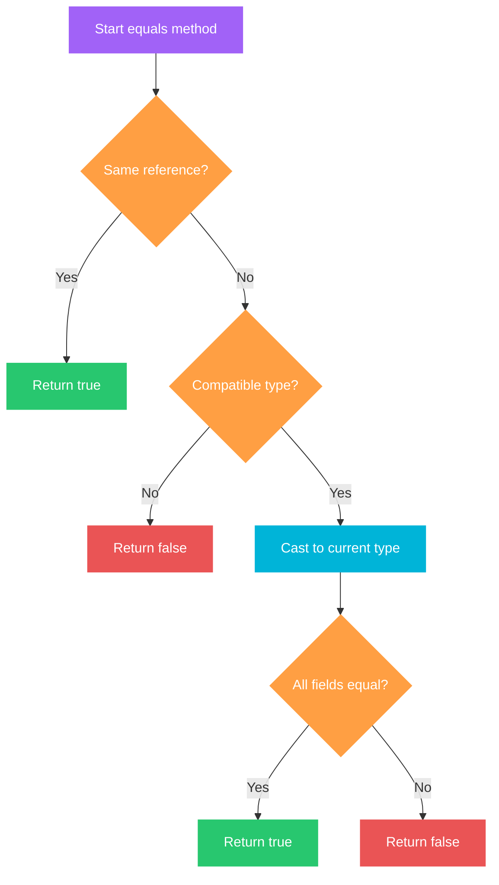

# equals() Method in Java Object Class

**equals() Method in Java Object Class** | We can use the `equals()` method in Java to check the equality of two objects based on their reference (default) or based on data (after overriding).

- [Java equals() Method Example](#java-equals-method-example)
- [Override equals() Method in Java](#override-equals-method-in-java)
- [How to Override equals() Method in Java](#how-to-override-equals-method-in-java)
- [Uses of equals() Method in Java](#uses-of-equals-method-in-java)
- [Example-2 to Override equals method in Java](#example-2-to-override-equals-method-in-java)
- [Example-3 to Override equals method in Java](#example-3-to-override-equals-method-in-java)
- [Object Comparison in Java with equals() Method](#object-comparison-in-java-with-equals-method)

---

## 1. Java equals() Method Example

The `equals()` method is defined in [java.lang.Object class](069_Object_Class_in_Java.md) and **compares two objects based on their reference**. If both have the same reference then it returns `true`, else it returns `false`.

**Default implementation in Object class:**

```java
public boolean equals(Object obj) {
   return (this == obj);
}
```

⚖️ Examples to demonstrate Object class `equals()` method in Java:

**Basic comparison example:**

```java
public class Test {
   public static void main(String[] args) {

      Test t1 = new Test();
      Test t2 = new Test();
      Test t3 = t1;

      System.out.println(t1.equals(t2));
      System.out.println(t1.equals(t3));
      System.out.println(t2.equals(t3));
   }
}
```

📤 **Output:**

```
false
true
false
```

The `t1` and `t2` are two different objects of the `Test` class, `t3` is pointing to the reference of object `t1`. Hence, `t1` and `t2` have different references but `t3` and `t1` are having the same reference.

The `equals()` method is called on these objects. Since the `equals()` method is not available in the `Test` class so, the compiler searches for it in the superclass. Indirectly or directly every valid Java class is the subclass of `java.lang.Object` class. Hence `equals()` method will be executed from the Object class which contains logic to compare two objects based on their reference.

**Employee class example:**

```java
class Employee {

   int id;
   String name;

   Employee(int id, String name) {
      this.id = id;
      this.name = name;
   }
}

public class Test {
   public static void main(String[] args) {

      // create objects
      Employee e1 = new Employee(101, "Emma");
      Employee e2 = new Employee(102, "Oliver");
      Employee e3 = e1;
      Employee e4 = new Employee(101, "Emma");

      // display details
      System.out.println(e1.id+" "+ e1.name);
      System.out.println(e2.id+" "+ e2.name);
      System.out.println(e3.id+" "+ e3.name);
      System.out.println(e4.id+" "+ e4.name);

      // compare objects
      System.out.println(e1.equals(e2)); // false
      System.out.println(e1.equals(e3)); // true
      System.out.println(e1.equals(e4)); // false
   }
}
```

📤 **Output:**

```
101 Emma
102 Oliver
101 Emma
101 Emma
false
true
false
```

> 📝 **Note:** If two references are pointing to the same object then only the `equals()` method of `java.lang.Object` class returns `true`, otherwise, it returns `false`.

In the above example, `e1` and `e4` contain exactly the same data. Since they have different references and the Object class `equals()` method compares objects based on reference, therefore, it gives the result as `false`.

---

## 2. Override equals() Method in Java

If we want to compare two objects with state or value then we must override the `equals()` method in the subclass. Many times objects are created and passed as method arguments at runtime. So, to know whether the given objects are same or not, we must compare objects using their state.

**Java Program to compare two objects by overriding equals() method:**

```java
class Employee {

   int id;
   String name;

   Employee(int id, String name) {
      this.id = id;
      this.name = name;
   }

   @Override
   public boolean equals(Object obj) {
      if(this == obj){
         return true;
      }
      if(obj instanceof Employee) {
         Employee e = (Employee) obj;
         return (this.id == e.id) &&
                 this.name.equals(e.name);
      }
      return false;
   }
}

public class Test {
   public static void main(String[] args) {

      // create objects
      Employee e1 = new Employee(101, "Emma");
      Employee e2 = new Employee(102, "Oliver");
      Employee e3 = e1;
      Employee e4 = new Employee(101, "Emma");

      // compare objects
      System.out.println(e1.equals(e2)); // false
      System.out.println(e1.equals(e3)); // true
      System.out.println(e1.equals(e4)); // true
   }
}
```

📤 **Output:**

```
false
true
true
```

---

## 3. How to Override equals() Method in Java



1️⃣ **Step 1 -- Check reference equality.** While overriding, first check if the passed object and current object are pointing to the same reference. If both are pointing to the same reference then both objects are always the same and they will contain the same data.

**Reference check:**

```java
// compare passed object and current
// object reference
if(this == obj){
   return true;
}
```

For example -- `e1` and `e3` are two different objects but they are pointing to the same reference, then it will return `true`.

```java
Employee e1 = new Employee(101, "Emma");
Employee e3 = e1;
System.out.println(e1.equals(e3)); // true
```

2️⃣ **Step 2 -- Check type compatibility.** Before comparing the values of the object, compare whether both objects are compatible or not. For this, we can use the `instanceof` operator.

**Type compatibility check:**

```java
if(obj instanceof Employee) {
   // logic to compare data of objects
} else {
   return false;
}
```

It will handle situations like comparing with `null`, or incompatible type objects:

```java
Employee e1 = new Employee(101, "Emma");
System.out.println(e1.equals(null)); // false
Test t1 = new Test();
System.out.println(e1.equals(t1)); // false
```

If we try to compare `Employee` type objects with `Student`, `Test`, or some other type object then it must return `false` because they are not compatible with each other.

3️⃣ **Step 3 -- Convert object type to current class type.**

The parameter of the `equals()` method is an `Object` type. To compare it with another object, it should be converted to the current class type.

**Downcast:**

```java
Employee e = (Employee) obj;
```

4️⃣ **Step 4 -- Compare all values of the object.**

Here, to compare two primitive values use the `==` operator, and to compare objects use the `equals()` method. For example, `id` and `name` are two values in the `Employee` class. Since `id` is a primitive variable so we will use the `==` operator and the `name` is of `String` type hence `equals()` method will be used.

**Field comparison:**

```java
// get current object values
int id1 = this.id;
String name1 = this.name;

// get passed object values
int id2 = e.id;
String name2 = e.name;

// compare values
if((id1 == id2) && (name1.equals(name2)) {
   return true;
}
```

The current object can be fetched directly by its name or using the `this` keyword. We can reduce the above lines as:

**Compact form:**

```java
return (this.id == e.id) && this.name.equals(e.name);
```

Or:

```java
return (id == e.id) && name.equals(e.name);
```

> 💡 **Tip:** Uses of the `this` keyword improve the readability of the code, therefore it is recommended to use the `this` keyword while comparing the data of the objects.

---

## 4. Uses of equals() Method in Java

In all wrapper classes, the [Arrays class](033_Arrays_Class_Java_With_Examples.md), and `String` class, `equals()` method is overridden to compare the data of the objects. But in the `StringBuffer` and `StringBuilder` class, the `equals()` method is not overridden -- they will use the Object class `equals()` method to compare the objects.

**String vs StringBuilder comparison:**

```java
public class Test {
  public static void main(String[] args) {

    String str1 = new String("Know Program");
    String str2 = new String("Know Program");
    System.out.println(str1.equals(str2));

    StringBuilder sb1 = new StringBuilder("Know Program");
    StringBuilder sb2 = new StringBuilder("Know Program");
    System.out.println(sb1.equals(sb2));
  }
}
```

📤 **Output:**

```
true
false
```

- ✅ `String` overrides `equals()` -- compares content
- ❌️ `StringBuilder` does not override `equals()` -- compares reference

> 📝 **Note:** The `Set` collection classes allow storing only unique elements, they don't allow storing duplicate elements. The duplicate elements are found with the help of the `equals()` method. If the `equals()` method returns `true` then they are duplicate elements.

---

## 5. Example-2 to Override equals method in Java

Write code to override the `equals()` method in the given `Student` class.

**Student class:**

```java
class Student {

   private int rollno;
   private String name;
   private String dept;
   private double avg;

   // constructor
   Student(int rollno, String name,
          String dept, double avg) {
      this.rollno = rollno;
      this.name = name;
      this.dept = dept;
      this.avg = avg;
   }
}
```

Use `==` operator to compare primitive values, and use `equals()` method to compare Objects.

**Overridden equals() method:**

```java
@Override
public boolean equals(Object obj) {

   if(this == obj) return true;

   if(obj instanceof Student) {
      Student s = (Student) obj;

      return
        ( (this.rollno == s.rollno) &&
          this.name.equals(s.name) &&
          this.dept.equals(s.dept) &&
          (this.avg == s.avg) );
   }

   return false;
}
```

---

## 6. Example-3 to Override equals method in Java

We have 2 classes `Student` and `Address`. Each `Student` has their `id`, `name`, and `Address`. Each `Address` contains the house number and city. The main task is to check two students are the same or not.

2 Students are the same if they have exactly the same `id`, `name`, and `Address`. In `Address`, they must have the same house number and city. Therefore we have to override the `equals()` method in both `Student` and `Address` classes.

**Address class:**

```java
class Address {
  int hno; // house-number
  String city;

  Address(int hno, String city) {
    this.hno = hno;
    this.city = city;
  }

  @Override
  public boolean equals(Object obj) {
    if(this == obj) return true;
    if(obj instanceof Address) {
      Address ad = (Address)obj;
      return (this.hno == ad.hno) &&
          this.city.equals(ad.city);
    }
    return false;
  }
}
```

**Student class:**

```java
class Student {
  int id;
  String name;
  Address adrs;

  public Student(int id, String name, Address adrs) {
    this.id = id;
    this.name = name;
    this.adrs = adrs;
  }

  @Override
  public boolean equals(Object obj) {
    if(this == obj) return true;
    if(obj instanceof Student) {
      Student st = (Student) obj;
      return (this.id == st.id) &&
           (this.name.equals(st.name)) &&
           (this.adrs.equals(st.adrs));
    }
    return false;
  }
}
```

**Test class:**

```java
public class Test {
  public static void main(String[] args) {
    Student st1 =
     new Student(101, "Sophia", new Address(8546, "Los Angeles"));
    Student st2 =
     new Student(101, "Sophia", new Address(8546, "Los Angeles"));
    Student st3 =
     new Student(101, "Sophia", new Address(9853, "San Francisco"));

    System.out.println(st1.equals(st2)); // true
    System.out.println(st1.equals(st3)); // false
  }
}
```

📤 **Output:**

```
true
false
```

> 💡 **Tip:** If you want to display Student data then you have to override the `toString()` method. See more: toString() method in Java Object class.

---

## 7. Object Comparison in Java with equals() Method

We can use the `equals()` method to compare different types of objects. We have already seen the comparison of two different objects.

| Comparison using equals() ⚖️ | Valid? ✅ | Return 📤 |
|------|-------|--------|
| **Two objects** | Yes | `false`/`true` |
| **Two primitive variables** | No | Compile-time error |
| **Two nulls** | No | Compile-time error |
| **Null with object** | No | Compile-time error |
| **Object with null** | Yes | `false` |
| **Null referenced with null** | No | NullPointerException |
| **Null referenced with object** | No | NullPointerException |
| **Two Null referenced** | No | NullPointerException |
| **Object with null referenced** | Yes | `false` |
| **Incompatible objects** | Yes | `false` |

We can't use the `equals()` method on primitive values because `equals()` is an instance method and to call `equals()` method an object should be there.

**Primitive comparison (error):**

```java
int i1 = 10;
int i2 = 20;
System.out.println(i1.equals(i2)); // error
```

We can't compare two nulls, or nulls with objects because a `null` is also treated as a primitive type value.

**Null comparison (error):**

```java
System.out.println(null.equals(null)); // error

Test t1 = new Test();
System.out.println(null.equals(t1)); // error
```

Comparing Object with `null` always gives `false` as a result.

**Object with null:**

```java
Test t1 = new Test();
System.out.println(t1.equals(null)); // false
```

Using the `equals()` method on null referenced with `null`, null referenced with an object, and two nulls referenced always raise `NullPointerException` at runtime.

**Null reference exceptions:**

```java
Test t1 = null;
System.out.println(t1.equals(null)); // Exception

Test t2 = new Test();
System.out.println(t1.equals(t2)); // Exception

Test t3 = null;
System.out.println(t1.equals(t3)); // Exception
```

Using the `equals()` method on Object with null referenced, and incompatible objects always gives `false` as result.

**Object with null reference:**

```java
Test t1 = new Test();
Test t2 = null;
System.out.println(t1.equals(t2)); // false

Student st1 = new Student();
System.out.println(t1.equals(st1)); // false
```

If you enjoyed this post, share it with your friends. Do you want to share more information about the topic discussed above or do you find anything incorrect? Let us know in the comments. Thank you!

**Java Tutorial**

**Java.lang.Object Class**
- [Object Class in Java](069_Object_Class_in_Java.md)
- getClass() method
- [hashCode() Method](071_Hashcode_in_Java_–_hashCode()_Method.md)
- toString() Method
- Java equals() Method
- == vs equals() in Java
- HashCode() vs equals()
- [Clone() Method in Java](074_Clone()_Method_in_Java.md)
- Object Class Quiz Set-1
- Object Class Quiz Set-2
- equals() Method Quiz
- Hashcode Value Quiz

**Math Class in Java**
- [Java Math class & methods](078_Java_Math_Class_with_Examples.md)
- [Import Math class in Java](077_Import_Math_Class_in_Java.md)
- [Math.PI in Java Example](079_PI_in_Java_–_Math.PI_Java_Example.md)
- Math.sqrt() method in Java
- Math.pow() method in Java
- Math.max() method in Java
- Math.abs() method in Java
- Math.ceil() method in Java
- Math.floor() method in Java
- Math.round() method in Java
- Math.random() method Java
