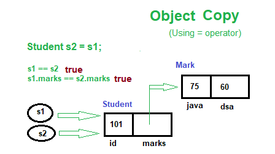
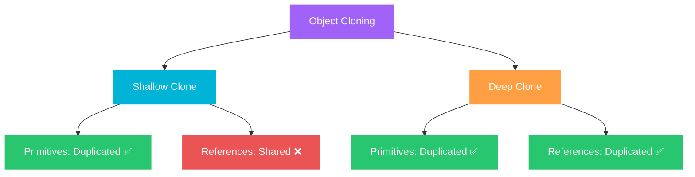
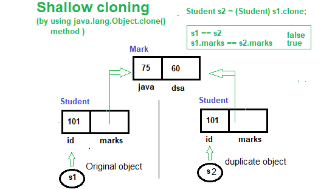
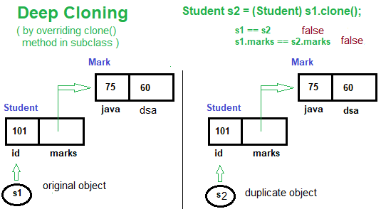

# Clone() Method in Java

**Clone() Method in Java Object class** | Cloning of objects means creating an exact duplicate copy with the current object state. In Java, to perform cloning the `clone()` method is given in [java.lang.Object class](069_Object_Class_in_Java.md).

- [Need of Cloning](#need-of-cloning)
- [Object Class clone() Method](#object-class-clone-method)
- [Overriding clone() method in Java](#overriding-clone-method-in-java)
- [Cloning Java Object with HAS-A relation](#cloning-java-object-with-has-a-relation)
- [Cloning object with IS-A relation](#cloning-object-with-is-a-relation)

The prototype of `java.lang.Object.clone()` method is:

`protected native Object clone() throws CloneNotSupportException`

> ⚠️ **Caution:** To execute `clone()` method on an object the **class must implement `java.lang.Cloneable` interface**, else this method throws `java.lang.CloneNotSupportException`.

We can perform cloning only on clonable objects. An object is said to be clonable if and only if the corresponding class implements the `Cloneable` interface. `Cloneable` is a marker interface present in `java.lang` package. It provides permission to execute the `clone()` method to clone the object.

---

## 1. Need of Cloning

The need of cloning or the main purpose of cloning is:

- 💾 **To maintain a backup copy.**
- 🔒 **To preserve the state of an object.**

Whenever we are assigning one object reference to another object then after changing one object state, another object state also changed.

**Problem without cloning:**

```java
class Student {
  int id;
  Student(int id) {
    this.id = id;
  }
}

class Test {
  public static void main(String[] args) {
    Student s1 = new Student(9);
    Student s2 = s1;
    System.out.println(s1 == s2);

    // display details
    System.out.println(s1.id+" "+s2.id);

    // change original object state
    s1.id = 100;

    // state after change
    System.out.println(s1.id+" "+s2.id);
  }
}
```

📤 **Output:**

```
true
9 9
100 100
```

Here `s1` and `s2` point to the same reference. Therefore after changing the id of `s1`, modification is also reflected in `s2`.

We can notice that after changing one object state another object state also changed. To solve this problem, we need to go for cloning operations. The below image shows how the `=` operator just assigns the reference of the original object to the duplicate object.



---

## 2. Object Class clone() Method

Rules to invoke `clone()` method of Object class:

1. 🔑 To execute the `clone()` method the current **object should be `Cloneable`** type else it leads to the exception `CloneNotSupportedException`.
2. 🔒 It is a **protected method**, therefore it can be called on a class object only inside that class. If we call it in other classes including in subclass it leads to a compile-time error. To call it from other classes we must override the `clone()` method in that subclass with the `public` keyword.
3. 📋 The **return type** of `clone()` method is **`java.lang.Object` type**. Therefore, we must cast the clone method returning the object to its current object class.
4. ⚠️ The `clone()` method throws **`CloneNotSupportedException`** which is a checked exception. We must handle it either by catching it using a try/catch block or by reporting it using the `throws` keyword.

**Clone method example:**

```java
class Student implements Cloneable {

  int id;
  Student(int id) {
    this.id = id;
  }

  public static void main(String[] args)
        throws CloneNotSupportedException {

    // create objects
    Student s1 = new Student(9);
    Student s2 = (Student) s1.clone();

    // compare references
    System.out.println(s1 == s2);

    // display details
    System.out.println(s1.id+" "+s2.id);

    // change original object state
    s1.id = 100;

    // state after change
    System.out.println(s1.id+" "+s2.id);
  }
}
```

📤 **Output:**

```
false
9 9
100 9
```

After changing one object state another object state doesn't change. After modifying the id of `s1` modification doesn't affect `s2`.

> 📝 **Note:** We invoked `clone()` within a subclass. If we try to invoke the `clone()` method outside of this class (like `Test` class) then we will get a **compile-time error: clone() has protected access in Object**. To solve this problem we must override the `clone()` method.

clone() Method Quiz

---

## 3. Overriding clone() method in Java

If we want to call the `clone()` method from its user class then we must override the `clone()` method.

Generally, we override methods for two reasons:

1. 🔧 To change implementation logic. Examples: Overriding `toString()`, `hashCode()`, and `equals()` method.
2. 🔑 To change the accessibility modifiers. Example: Overriding `clone()` method.

Procedure to override `clone()` method:

- We are overriding the `clone()` method just to change the accessibility, not to change the implementation logic. Therefore we must call the Object class `clone()` method while overriding as `super.clone()`.
- The Object class `clone()` method return type is `java.lang.Object`, but while overriding we can implement covariant returns (`Student` type). So that the user/test class developer no need to downcast the cloned object. But before returning we must downcast the return value.

**Overridden clone() method:**

```java
@Override
public Student clone() throws CloneNotSupportedException {
    // downcast the return value
    return (Student) super.clone();
}
```

Now let us see the example of overriding the `clone()` method in Java:

**Full example with overriding:**

```java
class Student implements Cloneable {

  int id;

  Student(int id) {
    this.id = id;
  }

  @Override
  public Student clone()
        throws CloneNotSupportedException {
    return (Student) super.clone();
  }
}

class Test {
  public static void main(String[] args)
        throws CloneNotSupportedException {

    // create objects
    Student s1 = new Student(9);
    Student s2 = s1.clone();

    // compare references
    System.out.println(s1 == s2);

    // display details
    System.out.println(s1.id+" "+s2.id);

    // change original object state
    s1.id = 100;

    // state after change
    System.out.println(s1.id+" "+s2.id);
  }
}
```

📤 **Output:**

```
false
9 9
100 9
```

After changing the value of the primitive variable of the original object, the new object value doesn't change.

---

## 4. Cloning Java Object with HAS-A relation

Java supports two types of cloning:

1. 📋 Shallow cloning
2. 📋 Deep cloning



### Shallow Cloning in Java

The process of creating a bitwise copy of an object is called shallow cloning. **If the main object contains primitive variables then exactly duplicate copies will be created in the cloned object. If the main object contains any reference variable then the corresponding object won't be created, just the reference variable will be created pointing to the old object.**

> 📝 **Note:** The Object class `clone()` method is implemented to perform shallow cloning.

**Java Shallow Cloning example:**

```java
class Mark {
  int java;
  int dsa;

  Mark(int java, int dsa) {
    this.java = java;
    this.dsa = dsa;
  }
}

class Student implements Cloneable {
  int id;
  Mark marks;

  Student(int id, Mark marks) {
    this.id = id;
    this.marks = marks;
  }

  @Override
  public Student clone()
           throws CloneNotSupportedException {
    return (Student) super.clone();
  }
}

class Test {
  public static void main(String[] args)
        throws CloneNotSupportedException {

    // create objects
    Student s1 = new Student(101, new Mark(75, 60));
    Student s2 = s1.clone();

    System.out.println(s1 == s2);
    System.out.println(s1.marks == s2.marks);

    // Java mark of original and new object
    System.out.println(s1.marks.java+" "+s2.marks.java);

    // changing Java marks of original object
    s1.marks.java = 90;

    // After change
    System.out.println("After change,");
    System.out.println(s1.marks.java+" "+s2.marks.java);
  }
}
```

📤 **Output:**

```
false
true
75 75
After change,
90 90
```



> ⚠️ **Caution:** In shallow cloning, by using cloned object reference if we perform any change to contained values then those changes will be reflected in the new object. To overcome this problem we should go for deep cloning.

### Deep Cloning in Java

The process of creating an exact duplicate independent copy including the content of the object is called deep cloning.

In deep cloning, if the main object contains any primitive variable then in the cloned object duplicate copies will be created. If the main object contains any reference variable then the corresponding content object also will be created in the cloned copy.

Deep clone copies all the levels of the object from top to bottom recursively. The developer must develop deep cloning by overriding the `clone()` method.

**Procedure:**

1. 🔧 Drive both `Student` and `Mark` classes from the `Cloneable` interface.
2. 🔑 Override `clone()` method in both `Student` and `Mark` class as `public`.
3. 📋 Call the `Mark` class `clone()` method on `this.marks` object in the `Student` class `clone()` method.

**Deep Cloning in Java example:**

```java
class Mark implements Cloneable {
  int java;
  int dsa;

  Mark(int java, int dsa) {
    this.java = java;
    this.dsa = dsa;
  }

  @Override
  public Mark clone()
           throws CloneNotSupportedException {
    return (Mark) super.clone();
  }
}

class Student implements Cloneable {
  int id;
  Mark marks;

  Student(int id, Mark marks) {
    this.id = id;
    this.marks = marks;
  }

  @Override
  public Student clone()
           throws CloneNotSupportedException {
    Student s = (Student) super.clone();
    s.marks = this.marks.clone();
    return s;
  }
}

class Test {
  public static void main(String[] args)
        throws CloneNotSupportedException {

    // create objects
    Student s1 = new Student(101, new Mark(75, 60));
    Student s2 = s1.clone();

    System.out.println(s1 == s2);
    System.out.println(s1.marks == s2.marks);

    // Java mark of original and new object
    System.out.println(s1.marks.java+" "+s2.marks.java);

    // changing Java marks of original object
    s1.marks.java = 90;

    // After change
    System.out.println("After change,");
    System.out.println(s1.marks.java+" "+s2.marks.java);
  }
}
```

📤 **Output:**

```
false
false
75 75
After change,
90 75
```

Now, using cloned object reference if we perform any change to the content object then those changes won't be reflected in the new object.



> 💡 **Tip:** If the object contains only primitive variables then shallow cloning (default implementation of `clone()` method in Object class) is the best choice. But if the object contains a reference variable then deep cloning (override `clone()` method) is the best.

---

## 5. Cloning object with IS-A relation

The `clone()` method of the Object class clones the object inheritance graphs starting from the root superclass (`java.lang.Object` class) to the current cloning subclass. Therefore when an object is cloned then its superclass non-static variables are also cloned. And here, the **only subclass should be of type `Cloneable`**, the superclass need not be of type `Cloneable`.

In other words (indirect way) we can say, for IS-A relation Java supports only deep cloning.

**IS-A relation cloning example:**

```java
class GrandFather {
  int house = 2;
}

class Father extends GrandFather {
  int money = 500_000;
}

class Child extends Father implements Cloneable {
  int car = 3;

  @Override
  public String toString() {
    return "" + house +" " + money + " " + car;
  }

  public static void main(String[] args)
   throws CloneNotSupportedException{

    // objects
    Child c1 = new Child();
    Child c2 = (Child) c1.clone();

    // display data
    System.out.println("c1 object details: ");
    System.out.println(c1);
    System.out.println("c2 object details: ");
    System.out.println(c2);

    // modifing values
    c1.house = 10;
    c1.money = 5000;
    c1.car = 1;
    System.out.println("After change,");

    // display data
    System.out.println("c1 object details: ");
    System.out.println(c1);
    System.out.println("c2 object details: ");
    System.out.println(c2);
  }
}
```

📤 **Output:**

```
c1 object details:
2 500000 3
c2 object details:
2 500000 3
After change,
c1 object details:
10 5000 1
c2 object details:
2 500000 3
```

If the superclass is having an internal object then that internal object is not cloned -- only referenced variable memory is cloned.

**Superclass with reference variable:**

```java
class A { }
class B { }

class C {
  A a1 = new A();
}

class D extends C implements Cloneable {
  B b1 = new B();

  public static void main(String[] args)
           throws CloneNotSupportedException {

    // objects
    D d1 = new D();
    D d2 = (D) d1.clone();

    System.out.println(d1.a1 == d2.a1); // true
    System.out.println(d1.b1 == d2.b1); // true

    d1.a1 = new A();
    d1.b1 = new B();

    System.out.println(d1.a1 == d2.a1); // false
    System.out.println(d1.b1 == d2.b1); // false
  }
}
```

If you enjoyed this post, share it with your friends. Do you want to share more information about the topic discussed above or do you find anything incorrect? Let us know in the comments. Thank you!

**Java Tutorial**

**Java.lang.Object Class**
- [Object Class in Java](069_Object_Class_in_Java.md)
- getClass() method
- [hashCode() Method](071_Hashcode_in_Java_–_hashCode()_Method.md)
- toString() Method
- Java equals() Method
- == vs equals() in Java
- HashCode() vs equals()
- Clone() Method in Java
- Object Class Quiz Set-1
- Object Class Quiz Set-2
- equals() Method Quiz
- Hashcode Value Quiz

**Math Class in Java**
- [Java Math class & methods](078_Java_Math_Class_with_Examples.md)
- [Import Math class in Java](077_Import_Math_Class_in_Java.md)
- [Math.PI in Java Example](079_PI_in_Java_–_Math.PI_Java_Example.md)
- Math.sqrt() method in Java
- Math.pow() method in Java
- Math.max() method in Java
- Math.abs() method in Java
- Math.ceil() method in Java
- Math.floor() method in Java
- Math.round() method in Java
- Math.random() method Java
