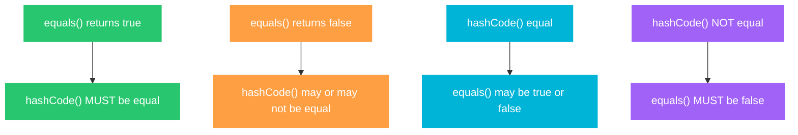

# hashCode() and equals() Method in Java

**hashCode() and equals() method in Java** | Understanding the contract between `hashCode()` and `equals()` methods and how to properly override them.

- [Relation between hashCode() and equals() Method in Java](#relation-between-hashcode-and-equals-method-in-java)
- [Overriding hashCode() and equals() Method in Java](#overriding-hashcode-and-equals-method-in-java)

Previously we discussed [hashCode() method](071_Hashcode_in_Java_–_hashCode()_Method.md) and equals() method of [java.lang.Object class](069_Object_Class_in_Java.md) in detail. Now let us see the relation between `hashCode()` and the `equals()` method in Java. What are the differences between the `hashCode()` and `equals()` methods in Java?

**What is the contract between the hashcode and the equals method?**

There is a contract between the `equals()` and `hashCode()` method in Java: if two objects are equal by the `equals()` method then their `hashCode()` must be equal i.e. **two equivalent objects should have the same hashcode**.



**Student class:**

```java
class Student {
   int id;
   Student(int id) {
      this.id = id;
   }
}
```

Assume `s1` and `s2` are two different objects of the `Student` class. **If `s1.equals(s2)` is true then `s1.hashCode() == s2.hashCode()` is always true.**

[java.lang.Object class](069_Object_Class_in_Java.md) `equals()` and `hashCode()` method follows the above contract. Hence whenever we are overriding the `equals()` method then compulsory we should override the `hashCode()` method to satisfy the above contract i.e. two equivalent objects should have the same hashCode. If we don't follow this contract then we won't get any compile-time error, or runtime exception but it is not a good programming practice.

> ⚠️ **Caution:** Whenever you override `equals()`, always override `hashCode()` too. Failing to do so can cause unexpected behavior in hash-based collections like `HashMap` and `HashSet`.

In `java.lang.String` class `equals()` method is overridden for content comparison and hence `hashCode()` method is also overridden to generate hashcode value based on the content.

**String hashCode example:**

```java
public class Test {
   public static void main(String[] args) {

      String s1 = new String("KnowProgram");
      String s2 = new String("KnowProgram");
      System.out.println(s1.equals(s2));

      System.out.println(s1.hashCode() == s2.hashCode());
      System.out.println(s1.hashCode());
      System.out.println(s2.hashCode());
   }
}
```

📤 **Output:**

```
true
true
2058267993
2058267993
```

In `StringBuffer` and `StringBuilder` classes, the `equals()` method is not overridden for content comparison, therefore the `hashCode()` method is also not overridden.

**StringBuilder hashCode example:**

```java
public class Test {
   public static void main(String[] args) {

      StringBuilder s1 = new StringBuilder("KnowProgram");
      StringBuilder s2 = new StringBuilder("KnowProgram");
      System.out.println(s1.equals(s2));

      System.out.println(s1.hashCode() == s2.hashCode());
      System.out.println(s1.hashCode());
      System.out.println(s2.hashCode());
   }
}
```

📤 **Output:**

```
false
false
225534817
1878246837
```

---

## 1. Relation between hashCode() and equals() Method in Java

1. If two objects are not equal by the `equals()` method then their hashcode value may or may not be the same.

| `s1.equals(s2)` ⚖️ | `s1.hashCode() == s2.hashCode()` 🔢 |
|---------|------|
| `true` | `true` |
| `false` | `true`/`false` |

2. If the hashcode of two objects is equal then the `equals()` method may return `true` or `false`.
3. If the hashcode of two objects is not equal then these objects are always not equal by the `equals()` method.

| `s1.hashCode() == s2.hashCode()` 🔢 | `s1.equals(s2)` ⚖️ |
|------|---------|
| `true` | `true`/`false` |
| `false` | `false` |

---

## 2. Overriding hashCode() and equals() Method in Java

🔑 **Key Point:** Based on which parameter we override the `equals()` method, it is highly recommended to use the same parameter while overriding `hashCode()` also.

In all collections classes, wrapper classes, and string classes the `equals()` method is overridden for content comparison. Hence it is recommended to override the `equals()` method in our class for content comparison.

In the equals() method we have already discussed how to override `equals()` and the steps to be followed. Now, we will use that knowledge to develop the `Student` class.

**Student class with overridden equals() and hashCode():**

```java
class Student {
   private int id;

   Student(int id) {
      this.id = id;
   }

   @Override
   public boolean equals(Object obj) {
      if(this == obj) return true;
      if(obj instanceof Student) {
         Student s = (Student) obj;
         return this.id == s.id;
      }
      return false;
   }

   @Override
   public int hashCode() {
      return id;
   }
}
```

**Test class:**

```java
public class Test {
  public static void main(String[] args) {

     Student s1 = new Student(1001);
     Student s2 = new Student(1002);
     Student s3 = new Student(1001);

     // invoke hashCode() method
     System.out.println("hashCode():: " +
                    s1.hashCode() + " " +
                    s2.hashCode() + " " +
                    s3.hashCode() );

     // invoke equals() method
     System.out.println("equals():: " +
                  s1.equals(s2) + " " +
                  s1.equals(s3) + " " +
                  s2.equals(s3) );
  }
}
```

📤 **Output:**

```
hashCode():: 1001 1002 1001
equals():: false true false
```

> 💡 **Tip:** Notice that `s1` and `s3` have the same `id` (1001), so both `equals()` returns `true` and `hashCode()` returns the same value -- fulfilling the contract.

If you enjoyed this post, share it with your friends. Do you want to share more information about the topic discussed above or do you find anything incorrect? Let us know in the comments. Thank you!

**Java Tutorial**

**Java.lang.Object Class**
- [Object Class in Java](069_Object_Class_in_Java.md)
- getClass() method
- [hashCode() Method](071_Hashcode_in_Java_–_hashCode()_Method.md)
- toString() Method
- Java equals() Method
- == vs equals() in Java
- HashCode() vs equals()
- [Clone() Method in Java](074_Clone()_Method_in_Java.md)
- Object Class Quiz Set-1
- Object Class Quiz Set-2
- equals() Method Quiz
- Hashcode Value Quiz

**Math Class in Java**
- [Java Math class & methods](078_Java_Math_Class_with_Examples.md)
- [Import Math class in Java](077_Import_Math_Class_in_Java.md)
- [Math.PI in Java Example](079_PI_in_Java_–_Math.PI_Java_Example.md)
- Math.sqrt() method in Java
- Math.pow() method in Java
- Math.max() method in Java
- Math.abs() method in Java
- Math.ceil() method in Java
- Math.floor() method in Java
- Math.round() method in Java
- Math.random() method Java
