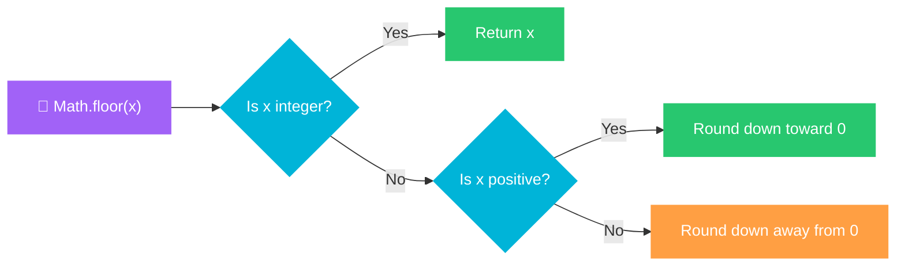

# Math.floor() Method in Java

**Math.floor() Method in Java** | The `floor()` method of [java.lang.Math class](078_Java_Math_Class_with_Examples.md) returns the largest (closest to positive infinity) double value that is less than or equal to the argument and is equal to a mathematical integer.

- [Java Math.floor() Examples](#java-mathfloor-examples)
- [Special Cases for Math.floor() Method in Java](#special-cases-for-mathfloor-method-in-java)
- [Related Links](#related-links)

---

## 1. Java Math.floor() Examples

📐 **Method prototype:**

```java
public static double floor(double a)
```

**Basic floor() examples:**

```java
public class Test{
   public static void main(String[] args) {
      System.out.println(Math.floor(2.0)); // 2.0
      System.out.println(Math.floor(-2.0)); // -2.0

      System.out.println(Math.floor(2.5)); // 2.0
      System.out.println(Math.floor(-2.5)); // -3.0

      System.out.println(Math.floor(2.9)); // 2.0
      System.out.println(Math.floor(-2.9)); // -3.0
   }
}
```

If we import Math class statically and then we can invoke `floor()` method without calling through its class name.

**Using static import (all members):**

```java
import static java.lang.Math.*;
public class Test {
   public static void main(String[] args) {
      System.out.println(floor(9.9)); // 9.0
      System.out.println(floor(5.0)); // 5.0
   }
}
```

The `import static java.lang.Math.*;` statement will import all static members of the Math class. But if we want to import only the `floor()` method of the Math class, not another static method and variables of Math class then we can use the `import static java.lang.Math.floor;` statement. Learn more about [static import in Java](024_Static_Import_in_Java.md)

**Using static import (floor only):**

```java
import static java.lang.Math.floor;
public class Test {
   public static void main(String[] args) {
      System.out.println(floor(9.9)); // 9.0
      System.out.println(floor(5.0)); // 5.0
   }
}
```

### More Examples

**When the argument is positive:**

| Expression 📐 | Result |
|---------------|--------|
| `Math.floor(2.0)` | 2.0 |
| `Math.floor(2.1)` | 2.0 |
| `Math.floor(2.5)` | 2.0 |
| `Math.floor(2.9)` | 2.0 |
| `Math.floor(3.0)` | 3.0 |
| `Math.floor(3.3)` | 3.0 |
| `Math.floor(3.5)` | 3.0 |
| `Math.floor(3.9)` | 3.0 |

**When the argument is negative:**

| Expression 📐 | Result |
|---------------|--------|
| `Math.floor(-2.0)` | -2.0 |
| `Math.floor(-2.1)` | -3.0 |
| `Math.floor(-2.5)` | -3.0 |
| `Math.floor(-2.9)` | -3.0 |
| `Math.floor(-3.0)` | -3.0 |
| `Math.floor(-3.3)` | -4.0 |
| `Math.floor(-3.5)` | -4.0 |
| `Math.floor(-3.9)` | -4.0 |

---

## 2. Special Cases for Math.floor() Method in Java

1) **If passed values an integer then the same value is returned.**

```java
Math.floor(5)   // => 5.0
Math.floor(6.0) // => 6.0
```

2) **If the argument is zero (either positive or negative), infinity or NaN then also the same value is returned.**

**Zero arguments:**

```java
// argument is zero
Math.floor(0)  // => 0.0
Math.floor(-0) // => 0.0
```

**Infinity arguments:**

```java
// argument is INFINITY
Math.floor(Double.POSITIVE_INFINITY) // => Infinity
Math.floor(Double.NEGATIVE_INFINITY) // => -Infinity
```

**NaN argument:**

```java
// argument is NaN
Math.floor(Double.NaN) // => NaN
```

> 📝 **Note:** The value of Math.ceil(x) is exactly the value of `-Math.floor(-x)`.



---

## 3. Related Links

If you enjoyed this post, share it with your friends. Do you want to share more information about the topic discussed above or do you find anything incorrect? Let us know in the comments. Thank you!

**Java Tutorial**

**Math Class in Java**
- [Java Math class & methods](078_Java_Math_Class_with_Examples.md)
- [Import Math class in Java](077_Import_Math_Class_in_Java.md)
- [Math.PI in Java Example](079_PI_in_Java_–_Math.PI_Java_Example.md)
- Math.sqrt() method in Java
- Math.pow() method in Java
- Math.max() method in Java
- Math.abs() method in Java
- Math.ceil() method in Java
- Math.floor() method in Java
- Math.round() method in Java
- Math.random() method Java

**Java.lang.Object Class**
- [Object Class in Java](069_Object_Class_in_Java.md)
- getClass() method
- [hashCode() Method](071_Hashcode_in_Java_–_hashCode()_Method.md)
- toString() Method
- Java equals() Method
- == vs equals() in Java
- HashCode() vs equals()
- [Clone() Method in Java](074_Clone()_Method_in_Java.md)
- Object Class Quiz Set-1
- Object Class Quiz Set-2
- equals() Method Quiz
- Hashcode Value Quiz
