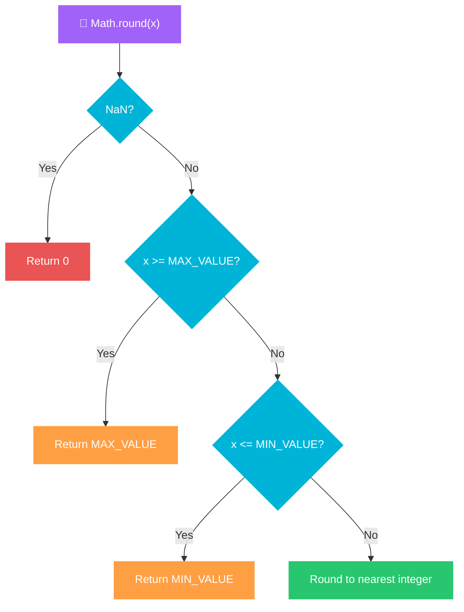

# Math.round() Method in Java

**Math.round() Method in Java** | The `java.lang.Math.round()` method returns the closest value to the argument, with ties rounding to positive infinity. There are two overloaded forms of the `round()` method in [java.lang.Math class](078_Java_Math_Class_with_Examples.md).

- [Java Math.round() Examples](#java-mathround-examples)
- [Java Round to 2 Decimal Places](#java-round-to-2-decimal-places)
- [Special Cases for Math.round() Method in Java](#special-cases-for-mathround-method-in-java)
- [Related Links](#related-links)

---

## 1. Java Math.round() Examples

📐 **Method prototypes:**

```java
public static int round(float a)
public static long round(double a)
```

**Basic round() demonstration:**

```java
public class Test {
   public static void main(String[] args) {
      System.out.println(Math.round(5.3)); // 5
      System.out.println(Math.round(5.5)); // 6
      System.out.println(Math.round(5.7)); // 6
   }
}
```

📤 **Output:**

```
5
6
6
```

### More Examples

| Expression 📐 | Result |
|---------------|--------|
| `Math.round(9.0)` | 9 |
| `Math.round(9.3)` | 9 |
| `Math.round(9.5)` | 10 |
| `Math.round(9.7)` | 10 |
| `Math.round(-9.0)` | -9 |
| `Math.round(-9.3)` | -9 |
| `Math.round(-9.5)` | -9 |
| `Math.round(-9.7)` | -10 |

If we import the Math class statically and then we can invoke the `round()` method without calling through its class name.

**Using static import (all members):**

```java
import static java.lang.Math.*;
public class Test {
   public static void main(String[] args) {
      System.out.println(round(5.3)); // 5
      System.out.println(round(5.5)); // 6
      System.out.println(round(5.7)); // 7
   }
}
```

The `import static java.lang.Math.*;` statement will import all static members of the Math class. But if we want to import only the `round()` method of the Math class, not another static method and variables of the Math class then we can use the `import static java.lang.Math.round;` statement. Learn more about [static import in Java](024_Static_Import_in_Java.md)

**Using static import (round only):**

```java
import static java.lang.Math.round;
public class Test {
   public static void main(String[] args) {
      System.out.println(round(5.3)); // 5
      System.out.println(round(5.5)); // 6
   }
}
```

---

## 2. Java Round to 2 Decimal Places

By default `round()` method rounds all digits after decimal place but we can write code to round float or double value to n decimal places.

💡 **Tip:** Multiply by 10^n, round, then divide by 10^n:

```java
double number = 12.3456789;
// rounding upto 2 decimal places
double n2 = Math.round(number * 100.0) / 100.0;
```

**Rounding to 1, 2, and 3 decimal places:**

```java
public class Test {
   public static void main(String[] args) {

      double number = 12.3456789;
      System.out.println(number);

      // rounding upto 1 decimal places
      double n1 = Math.round(number * 10.0) / 10.0;
      System.out.println(n1);

      // rounding upto 2 decimal places
      double n2 = Math.round(number * 100.0) / 100.0;
      System.out.println(n2);

      // rounding upto 3 decimal places
      double n3 = Math.round(number * 1000.0) / 1000.0;
      System.out.println(n3);
   }
}
```

📤 **Output:**

```
12.3456789
12.3
12.35
12.346
```

---

## 3. Special Cases for Math.round() Method in Java

1) **If the argument is NaN, the result is 0.**

```java
System.out.println(Math.round(Float.NaN));  // 0
System.out.println(Math.round(Double.NaN)); // 0
```

2) **While working with `public static int round(float a)`:**

- If the argument is negative infinity or any value less than or equal to the value of `Integer.MIN_VALUE`, the result is equal to the value of `Integer.MIN_VALUE`.
- If the argument is positive infinity or any value greater than or equal to the value of `Integer.MAX_VALUE`, the result is equal to the value of `Integer.MAX_VALUE`.

**Float boundary examples:**

```java
public class Test {
   public static void main(String[] args) {

      // argument is negative infinity
      System.out.println(Math.round(Float.NEGATIVE_INFINITY));

      // argument is less than or equal to Integer.MIN_VALUE
      System.out.println(Math.round(Integer.MIN_VALUE));
      System.out.println(Math.round(Long.MIN_VALUE));

      // argument is positive infinity
      System.out.println(Math.round(Float.POSITIVE_INFINITY));

      // argument is grater than or equal to Integer.MAX_VALUE
      System.out.println(Math.round(Integer.MAX_VALUE));
      System.out.println(Math.round(Long.MAX_VALUE));
      System.out.println(Math.round(Float.MAX_VALUE));
   }
}
```

📤 **Output:**

```
-2147483648
-2147483648
-2147483648
2147483647
2147483647
2147483647
2147483647
```

3) **While working with `public static long round(double a)`:**

- If the argument is negative infinity or any value less than or equal to the value of `Long.MIN_VALUE`, the result is equal to the value of `Long.MIN_VALUE`.
- If the argument is positive infinity or any value greater than or equal to the value of `Long.MAX_VALUE`, the result is equal to the value of `Long.MAX_VALUE`.

**Double boundary examples:**

```java
public class Test {
   public static void main(String[] args) {

      // argument is negative infinity
      System.out.println(Math.round(Double.NEGATIVE_INFINITY));

      // argument is less than or equal to Long.MIN_VALUE
      double d1= Long.MIN_VALUE;
      System.out.println(Math.round(d1));

      // argument is positive infinity
      System.out.println(Math.round(Double.POSITIVE_INFINITY));

      // argument is grater than or equal to Integer.MAX_VALUE
      double d2 = Long.MAX_VALUE;
      double d3 = Float.MAX_VALUE;
      double d4 = Double.MAX_VALUE;
      System.out.println(Math.round(d2));
      System.out.println(Math.round(d3));
      System.out.println(Math.round(d4));
   }
}
```

📤 **Output:**

```
-9223372036854775808
-9223372036854775808
9223372036854775807
9223372036854775807
9223372036854775807
9223372036854775807
```



---

## 4. Related Links

If you enjoyed this post, share it with your friends. Do you want to share more information about the topic discussed above or do you find anything incorrect? Let us know in the comments. Thank you!

**Java Tutorial**

**Math Class in Java**
- [Java Math class & methods](078_Java_Math_Class_with_Examples.md)
- [Import Math class in Java](077_Import_Math_Class_in_Java.md)
- [Math.PI in Java Example](079_PI_in_Java_–_Math.PI_Java_Example.md)
- Math.sqrt() method in Java
- Math.pow() method in Java
- Math.max() method in Java
- Math.abs() method in Java
- Math.ceil() method in Java
- Math.floor() method in Java
- Math.round() method in Java
- Math.random() method Java

**Java.lang.Object Class**
- [Object Class in Java](069_Object_Class_in_Java.md)
- getClass() method
- [hashCode() Method](071_Hashcode_in_Java_–_hashCode()_Method.md)
- toString() Method
- Java equals() Method
- == vs equals() in Java
- HashCode() vs equals()
- [Clone() Method in Java](074_Clone()_Method_in_Java.md)
- Object Class Quiz Set-1
- Object Class Quiz Set-2
- equals() Method Quiz
- Hashcode Value Quiz
