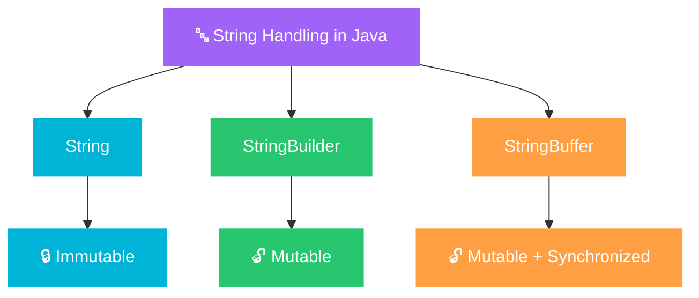

# String Handling in Java

**String Handling in Java** | In String Handling, you will learn to store string data in JVM from a program and further perform several operations on this string data. The operations such as comparing, concatenating, replacing, changing cases, trimming, retrieving characters, splitting, etc.

- [Java String Tutorial](#java-string-tutorial)
- [Java String Programs](#java-string-programs)

---

## 1. Java String Tutorial

Performing different operations on string data is called string handling. To perform several operations on string data there are many built-in methods given in the `String`, `StringBuffer`, and `StringBuilder` classes. This article contains all the links to posts related to Java String.

In Java, for String Handling, we mainly used the `String`, `StringBuilder`, and `StringBuffer` classes. The `java.lang.String` is an immutable class and it means once a string object is declared we can't modify them, and on every modification, it creates a new string object. Whereas the `StringBuilder` and `StringBuffer` classes are mutable classes and they allow modification on the same object.

### Java String Class and Methods

- [Constructors of String class in Java](089_String_Constructor_in_Java.md)
- [Immutable Class in Java](091_Immutable_Class_in_Java.md)
- Java replace() vs replaceAll() Method
- [Java String trim() Vs strip()](093_Java_String_trim()_Vs_strip().md)
- [How to Define a Method to Take and Return String Data in Java](090_How_to_Take_&_Return_a_String_in_Java.md)

**[String Class Methods in Java](097_String_Class_Methods_In_Java.md):** charAt(), codePoints(), codePointAt(), codePointBefore(), codePointCount(), offsetByCodePoints(), [compareTo()](106_String_compareTo()_Java.md), [compareToIgnoreCase()](107_String_compareToIgnoreCase()_Java.md), [concat()](113_Concat_Strings_in_Java.md), [contains()](116_String_contains()_Method_in_Java.md), equals(), [equalsIgnoreCase()](105_String_equalsIgnoreCase()_Java.md), format(), getBytes(), hashCode(), indent(), [indexOf()](110_Java_String_indexOf()_Method.md), intern(), [isBlank()](124_String_isBlank()_Java_with_Examples.md), [isEmpty()](100_String_isEmpty()_Java_with_Examples.md), [join()](098_String_join()_In_Java.md), [lastIndexOf()](111_String_lastIndexOf()_in_Java.md), [length()](099_How_to_Find_Length_of_String_in_Java.md), matches(), repeat(), [replace()](114_Replace()_In_String_Java.md), [replaceAll()](118_String_replaceAll()_Java.md), replaceFirst(), [split()](119_Split()_Method_In_Java.md), startsWith() & endsWith(), strip() stripLeading() & stripTrailing(), [substring()](112_Substring_Method_In_Java.md), toCharArray(), [toLowerCase()](120_Java_String_to_Lowercase.md), [toString()](126_String_toString()_Java.md), toUpperCase(), [trim()](122_Trim()_in_Java_String.md), valueOf()

### Java StringBuilder and StringBuffer Class

- [Import StringBuffer In Java](132_Import_StringBuffer_In_Java.md)
- [When To Use StringBuffer And StringBuilder In Java](133_When_To_Use_StringBuffer_And_StringBuilder_In_Java.md)
- String To StringBuilder Java
- StringBuilder To String Java
- [Java String To StringBuffer](136_Java_String_To_StringBuffer.md)
- [StringBuffer To String In Java](136_Java_String_To_StringBuffer.md)
- StringBuilder Methods: [toString()](139_StringBuilder_toString()_Java.md), substring(), [reverse()](141_StringBuilder_reverse()_In_Java.md), replace(), length(), indexOf(), insert(), append(), capacity(), charAt()
- StringBuffer Methods: append(), insert(), length(), reverse()

### StringUtils Class

Apart from the `String`, `StringBuilder`, and `StringBuffer` class sometimes we need to use external libraries for String handling. One of the biggest limitations of `String`, `StringBuilder`, and `StringBuffer` class methods is that it doesn't handle `null` properly. If an object is referencing to `null` then those methods will give `NullPointerException`.

To solve this problem and for other features, we can take the help of the Apache Common Lang package. This package contains `StringUtils` class having several methods for String handling.

1. [Import StringUtils in Java](155_Import_StringUtils_in_Java.md)
2. StringUtils Class Methods: isEmpty(), isNotEmpty(), isBlank(), isNotBlank(), [isEmpty() vs isBlank()](160_StringUtils_isEmpty()_Vs_isBlank().md), equals(), lowerCase(), [isNumeric()](163_StringUtils_isNumeric()_Java.md), rightPad()

---

## 2. Java String Programs

1. Take String Input In Java using Scanner Class
2. [How to Find Length of String in Java](099_How_to_Find_Length_of_String_in_Java.md)
3. How to Iterate through String Java
4. Sum of digits in a String
5. Count No of Vowels String
6. String Pattern Programs in Java
7. How To Reverse a String In Java
8. String Palindrome In Java
9. Sort String In Java
10. How to Compare Strings In Java
11. Check If String Contains Uppercase & Lowercase
12. Java Check If Char is Uppercase
13. Check If String is Uppercase Java
14. Swap Characters in String Java
15. Generate Random Strings
16. Java Program to Find Weight of String
17. Find Second Occurrence of Character in String Java
18. Find Last Occurrence of Character in String Java
19. Java Replace nth Occurrence String
20. Replace Last Occurrence of Character in String Java
21. How to Replace Dot in Java
22. How To Remove Substring From String Java
23. Replace Special Characters In Java
24. Java Replace String With Escape Character
25. Java Remove Special Characters From String
26. How To Remove Character From a String Java
27. Remove Commas From String Java
28. Replace Comma in String Java
29. Golden Ratio Java Program

**Number programs using String**

1. Unique Number
2. Fascinating Number
3. ISBN Number

**String Array Programs**

1. Java Convert Number String to Array
2. How to Iterate Through a String Array In Java?
3. Convert String Array to Lowercase Java
4. String Array to UpperCase Java

**Others/Games Programs using String**

1. Hidden Word Java Program
2. Java Secret Message Program
