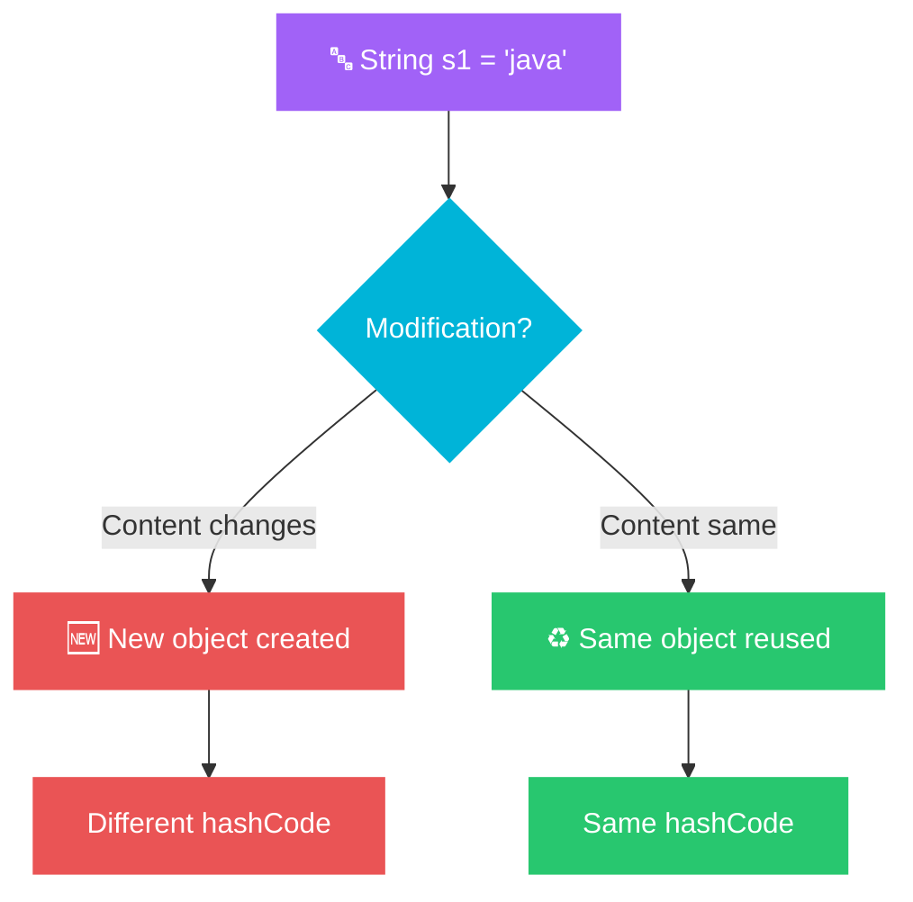

# Immutable Class in Java

**Immutable Class in Java** | In this tutorial, we will discuss what is an immutable class in Java, what is immutability in Java, and a list of immutable classes in Java.

- [List of Immutable Classes in Java](#list-of-immutable-classes-in-java)
- [Types of immutable class in Java](#types-of-immutable-class-in-java)
- [Recommended articles](#recommended-articles)

---

## 1. What is Immutability?

🔒 **What is immutability in Java?** Once we create an object then we can't perform any changes on that object. If we are trying to perform any changes, and if there will be a change in the content then with those changes a new object will be created. If there is no change in the content then the existing object will be reused. This behavior is nothing but immutability.

🔒 **What is an immutable class in Java?** A class, whose objects are immutable in nature is called an immutable class. It means we can't perform any changes on the object of an immutable class. For every modification, if there is a change in the content then a new object will be created.

Let us understand it through an example. In Java, `String` is an immutable class. Therefore, its objects are immutable objects, once a `String` object is created then we can't perform any changes on that object.

**String immutability demonstration:**

```java
public class Test {

   public static void main(String[] args) {
      String s1 = "Know Program";
      System.out.println(System.identityHashCode(s1));
      System.out.println(s1);

      s1 = s1.concat(" - Java Tutorial");
      System.out.println(System.identityHashCode(s1));
      System.out.println(s1);
   }

}
```

📤 **Output:**

```
517938326
Know Program
1100439041
Know Program - Java Tutorial
```

**Content change creates new object:**

```java
public class Test {

   public static void main(String[] args) {
      String s1 = "java";
      System.out.println(System.identityHashCode(s1));

      String s2 = s1.toUpperCase();
      System.out.println(System.identityHashCode(s2));

      System.out.println(s1 == s2);
   }

}
```

📤 **Output:**

```
358699161
2143192188
false
```

Here, one String object is created with content "java", and assigned to reference variable `s1`. After calling the `toUpperCase()` method its content will be "JAVA" and it is different from the current object's content ("java") therefore due to its immutability nature another String object will be created and assigned to the reference variable `s2`. Because of this reason, both `s1` and `s2` objects contain different references.

**No content change reuses existing object:**

```java
public class Test {

   public static void main(String[] args) {
      String s1 = "java";
      System.out.println(System.identityHashCode(s1));

      String s3 = s1.toLowerCase();
      System.out.println(System.identityHashCode(s3));

      System.out.println(s1 == s3);
   }

}
```

📤 **Output:**

```
517938326
517938326
true
```

In this example, the String object is created with content "java" and assigned to the reference variable `s1`. After calling the `toLowerCase()` method its content will be "java" which is similar to the current object's content ("java") therefore the current object will be re-used and assigned to the reference variable `s3`. A new string object will not be created. Hence we are getting similar hashcode values for them.

If it is a mutable class then after any operation we will get similar hashcode because in that case, a new object will not be created. For example, `StringBuilder` is a mutable class, and after appending its object we will get the same hashcode value.



---

## 2. List of Immutable Classes in Java

In Java following classes are Immutable classes:

- 🔤 **String class** - We have already seen the example.
- 📄 **[java.io.File](048_File_Class_in_Java.md)** - It represents an object external to the virtual machine i.e. a file on the local system, which may or may not exist, and has some methods modifying and querying the state of this external object. But the File object itself stays immutable. Except `java.io.File` all other classes in `java.io` are mutable classes.
- 📦 **All Wrapper classes** for the primitive types: `java.lang.Byte`, `java.lang.Short`, `java.lang.Integer`, `java.lang.Long`, `java.lang.Double`, `java.lang.Float`, `java.lang.Character`, `java.lang.Boolean`.
- 🕰️ **All classes of java.time** except `DateTimeException` is immutable. Most of the classes of the sub-packages of `java.time` are immutable too.
- 🛡️ **Most subclasses of java.security.Permission** (representing permissions needed for some action or given to some code), but not `java.security.PermissionCollection` and subclasses.

There are more immutable classes in Java, but these are the popular Java classes. See more [here](https://stackoverflow.com/questions/5124012/examples-of-immutable-classes).

---

## 3. Types of immutable class in Java

We can categorize immutable class in Java into two types:

**1) Immutable classes which allow modification.** In these classes, after modification, if the content is different then a new object will be created. Else the same object will be reused. Example: `String` class.

```java
String s1 = "Know Program";
s1 = s1.concat(" - Java Tutorial");
```

`String` class allows modification, and generated content is different than it will store results in another String object.

**2) Immutable classes which don't allow modification.** Example: All Wrapper classes for the primitive types, and `java.io.File` class.

```java
Integer io = 10;
```

In wrapper classes for the primitive types, we don't have any method to perform modification operations on the objects.

```java
File f1 = new File("data.txt");
```

Similar to wrapper classes, the `File` class also doesn't provide any method to perform modification operations on the File class objects.

---

## 4. Recommended articles

- What is Mutable in Java?
- Mutable vs immutable.
- Why string is Immutable in java?
- How to create immutable class in Java?
