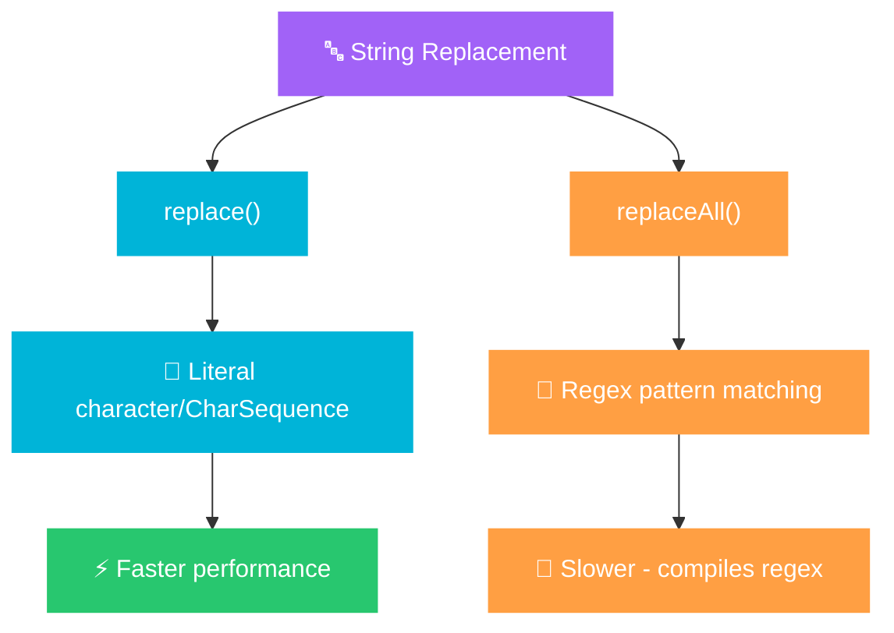

# Java replace() vs replaceAll() Method

**Java replace() vs replaceAll() Method** | Java has various methods and functions to manipulate strings. The `replace()` and `replaceAll()` methods are one of them. Even though both [replace()](114_Replace()_In_String_Java.md) and [replaceAll()](118_String_replaceAll()_Java.md) methods are used to replace characters or sub-string in the given string but they work differently.

- [replace() vs replaceAll() Java](#replace-vs-replaceall-java)
- [Java replace() vs replaceAll() Performance](#java-replace-vs-replaceall-performance)
- [Related Links](#related-links)

---

## 1. Method Signatures

The method details of both `replace()` and `replaceAll()` are as follows:

| Method 🏷️ | Signature 📋 | Uses Regex? |
|------------|-------------|-------------|
| **replace (char)** | `public String replace(char oldChar, char newChar)` | ❌️ |
| **replace (CharSequence)** | `public String replace(CharSequence oldChar, CharSequence newChar)` | ❌️ |
| **replaceAll** | `public String replaceAll(String oldChar, String newChar)` | ✅ |

The `replace()` method can replace one character with another character or it can replace a `CharSequence` with another `CharSequence`. It can't replace based on the regular expression. The `replaceAll()` method can only replace one string with another string, where the first string is a regular expression.

> 🔑 **Key Point:** The main difference between `replace()` and `replaceAll()` is: `replaceAll()` replaces based on the regular expression but `replace()` method doesn't.

---

## 2. replace() vs replaceAll() Java

**replace() method demonstration:**

```java
public class Main {
   public static void main(String args[]) {
      String str = "Java Language, Python Language, " + "Go Language";
      String str1 = str.replace("Language", "Program");
      String str2 = str.replace('a', 'e');
      System.out.println(str1);
      System.out.println(str2);
   }
}
```

📤 **Output:**

```
Java Program, Python Program, Go Program
Jeve Lenguege, Python Lenguege, Go Lenguege
```

**replaceAll() method demonstration:**

```java
public class Main {
   public static void main(String args[]) {
      String str = "Java Program, Python Program, Go Program";
      String str1 = str.replaceAll("(.*)Program(.*)", "Language");
      String str2 = str.replaceAll("Program", "Language");
      System.out.println(str1);
      System.out.println(str2);
   }
}
```

📤 **Output:**

```
Language
Java Language, Python Language, Go Language
```



---

## 3. Java replace() vs replaceAll() Performance

As a performance concern, the `replace()` function is much faster than the `replaceAll()` method because `replaceAll()` method first compiles the regular expression pattern and then matches and finally replaces the character.

> 💡 **Tip:** Use `replace()` when you don't need regex pattern matching - it is significantly faster.

If you enjoyed this post, share it with your friends. Do you want to share more information about the topic discussed above or do you find anything incorrect? Let us know in the comments. Thank you!

---

## 4. Related Links

**Java Tutorial**

**[String Class Methods](097_String_Class_Methods_In_Java.md)**
- charAt() Method
- codePoints() Method
- [compareTo() Method](106_String_compareTo()_Java.md)
- [compareToIgnoreCase()](107_String_compareToIgnoreCase()_Java.md)
- [concat() Method](113_Concat_Strings_in_Java.md)
- [contains() Method](116_String_contains()_Method_in_Java.md)
- equals() Method
- [equalsIgnoreCase()](105_String_equalsIgnoreCase()_Java.md)
- format() Method
- getBytes() Method
- hashCode() Method
- indent() Method
- [indexOf() Method](110_Java_String_indexOf()_Method.md)
- intern() Method
- [isBlank() Method](124_String_isBlank()_Java_with_Examples.md)
- [isEmpty() Method](100_String_isEmpty()_Java_with_Examples.md)
- isBlank() vs isEmpty()
- [join() Method](098_String_join()_In_Java.md)
- [lastIndexOf() Method](111_String_lastIndexOf()_in_Java.md)
- [length() Method](099_How_to_Find_Length_of_String_in_Java.md)
- matches() Method
- repeat() Method
- [replace() Method](114_Replace()_In_String_Java.md)
- [replaceAll() Method](118_String_replaceAll()_Java.md)
- replaceFirst() Method
- replace() vs replaceAll()
- [split() Method](119_Split()_Method_In_Java.md)
- startsWith() & endsWith()
- strip() & stripLeading()
- [substring() Method](112_Substring_Method_In_Java.md)
- toCharArray() Method
- [toLowerCase() Method](120_Java_String_to_Lowercase.md)
- [toString() Method](126_String_toString()_Java.md)
- toUpperCase() Method
- [trim() Method](122_Trim()_in_Java_String.md)
- [trim() vs strip()](093_Java_String_trim()_Vs_strip().md)
- valueOf() Method
