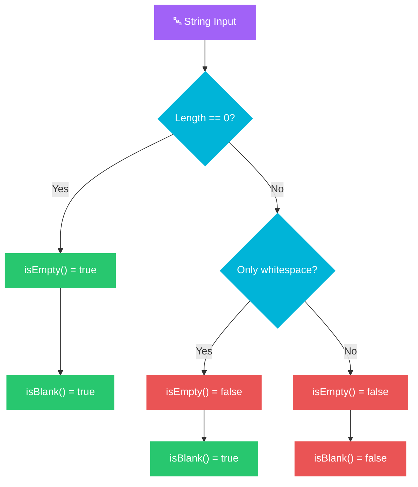

# isBlank() vs isEmpty() in Java String

**isBlank() vs isEmpty() in Java String** | In the [String class of Java](097_String_Class_Methods_In_Java.md), there are two methods to check if a string is valid or not. Those methods are [isBlank()](124_String_isBlank()_Java_with_Examples.md) and [isEmpty()](100_String_isEmpty()_Java_with_Examples.md). In their respective topics, we have already seen them in detail. Now, let us see the comparison between the `isBlank()` and `isEmpty()` methods of the Java String class.

- [Differences between isBlank() vs isEmpty()](#differences-between-isblank-vs-isempty)
- [Program to demonstrate isBlank() vs isEmpty()](#program-to-demonstrate-isblank-vs-isempty)
- [Related Links](#related-links)

---

## 1. Internal Implementation

**`isBlank()` internal implementation:**

```java
public boolean isBlank() {
    return indexOfNonWhitespace() == length();
}
```

**`isEmpty()` internal implementation:**

```java
public boolean isEmpty() {
   return value.length == 0;
}
```

📤 **Return value of `isEmpty()` method:**

- `true` - If the length of the string is 0.
- `false` - If the length of the string is greater than 0.

This method was given in **Java 1.6** version. It returns `true` if the String doesn't have a character, and it returns `false` if at least 1 character is available in this string object.

📤 **Return values of `isBlank()` method:**

- `true` - If the string is empty or contains only whitespace (space, tab).
- `false` - If the string is not empty and contains valid characters except white space.

This method was given in the **Java 11** version. This method returns `true` if the String doesn't have characters or it has only spaces/tabs. Otherwise, it returns `false`.

---

## 2. Differences between isBlank() vs isEmpty()

The below table shows the differences between the `isBlank()` and `isEmpty()` methods given in the String class.

| Feature | `isEmpty()` 🅰️ | `isBlank()` 🅱️ |
|---------|----------------|----------------|
| **Introduced in** | Java 1.6 | Java 11 |
| **Returns true when** | Length is 0 | Length is 0 OR only whitespaces |
| **What it checks** | Only length of the string | Length and characters of the string |
| **`""` (empty)** | ✅ `true` | ✅ `true` |
| **`" "` (spaces)** | ❌️ `false` | ✅ `true` |
| **`"text"`** | ❌️ `false` | ❌️ `false` |
| **Relationship** | When `isEmpty()` is `true` then `isBlank()` will always be `true`, but if `isEmpty()` is `false` then `isBlank()` may or may not be `false`. | When `isBlank()` is `true` then `isEmpty()` may or may not be `true`, but when `isBlank()` is `false` then `isEmpty()` will always be `false`. |

> 📝 **Note:** An empty string must be blank but a blank string may or may not be empty. It means when `isEmpty()` is `true` then the `isBlank()` method will always give `true`, but the reverse isn't true.

---

## 3. Program to demonstrate isBlank() vs isEmpty()

**Comparison demonstration:**

```java
public class Test {
   public static void main(String[] args) {

      String s1 = "";
      System.out.println(s1.isBlank() + " " + s1.isEmpty());

      String s2 = " ";
      System.out.println(s2.isBlank() + " " + s2.isEmpty());

      String s3 = "Program";
      System.out.println(s3.isBlank() + " " + s3.isEmpty());

      String s4 = new String();
      System.out.println(s4.isBlank() + " " + s4.isEmpty());

      String s5 = new String("");
      System.out.println(s5.isBlank() + " " + s5.isEmpty());

      String s6 = new String(" ");
      System.out.println(s6.isBlank() + " " + s6.isEmpty());

      String s7 = new String("Program");
      System.out.println(s7.isBlank() + " " + s7.isEmpty());
   }
}
```

📤 **Output:**

```
true true
true false
false false
true true
true true
true false
false false
```

The string literal `" "` is a valid string of length 1 therefore `s2.isEmpty()` method returns `false`, but it contains only white spaces therefore `s2.isBlank()` method returns `true`.



If you enjoyed this post, share it with your friends. Do you want to share more information about the topic discussed above or do you find anything incorrect? Let us know in the comments. Thank you!

---

## 4. Related Links

**Java Tutorial**

**[String Class Methods](097_String_Class_Methods_In_Java.md)**
- charAt() Method
- codePoints() Method
- [compareTo() Method](106_String_compareTo()_Java.md)
- [compareToIgnoreCase()](107_String_compareToIgnoreCase()_Java.md)
- [concat() Method](113_Concat_Strings_in_Java.md)
- [contains() Method](116_String_contains()_Method_in_Java.md)
- equals() Method
- [equalsIgnoreCase()](105_String_equalsIgnoreCase()_Java.md)
- format() Method
- getBytes() Method
- hashCode() Method
- indent() Method
- [indexOf() Method](110_Java_String_indexOf()_Method.md)
- intern() Method
- [isBlank() Method](124_String_isBlank()_Java_with_Examples.md)
- [isEmpty() Method](100_String_isEmpty()_Java_with_Examples.md)
- isBlank() vs isEmpty()
- [join() Method](098_String_join()_In_Java.md)
- [lastIndexOf() Method](111_String_lastIndexOf()_in_Java.md)
- [length() Method](099_How_to_Find_Length_of_String_in_Java.md)
- matches() Method
- repeat() Method
- [replace() Method](114_Replace()_In_String_Java.md)
- [replaceAll() Method](118_String_replaceAll()_Java.md)
- replaceFirst() Method
- replace() vs replaceAll()
- [split() Method](119_Split()_Method_In_Java.md)
- startsWith() & endsWith()
- strip() & stripLeading()
- [substring() Method](112_Substring_Method_In_Java.md)
- toCharArray() Method
- [toLowerCase() Method](120_Java_String_to_Lowercase.md)
- [toString() Method](126_String_toString()_Java.md)
- toUpperCase() Method
- [trim() Method](122_Trim()_in_Java_String.md)
- [trim() vs strip()](093_Java_String_trim()_Vs_strip().md)
- valueOf() Method
