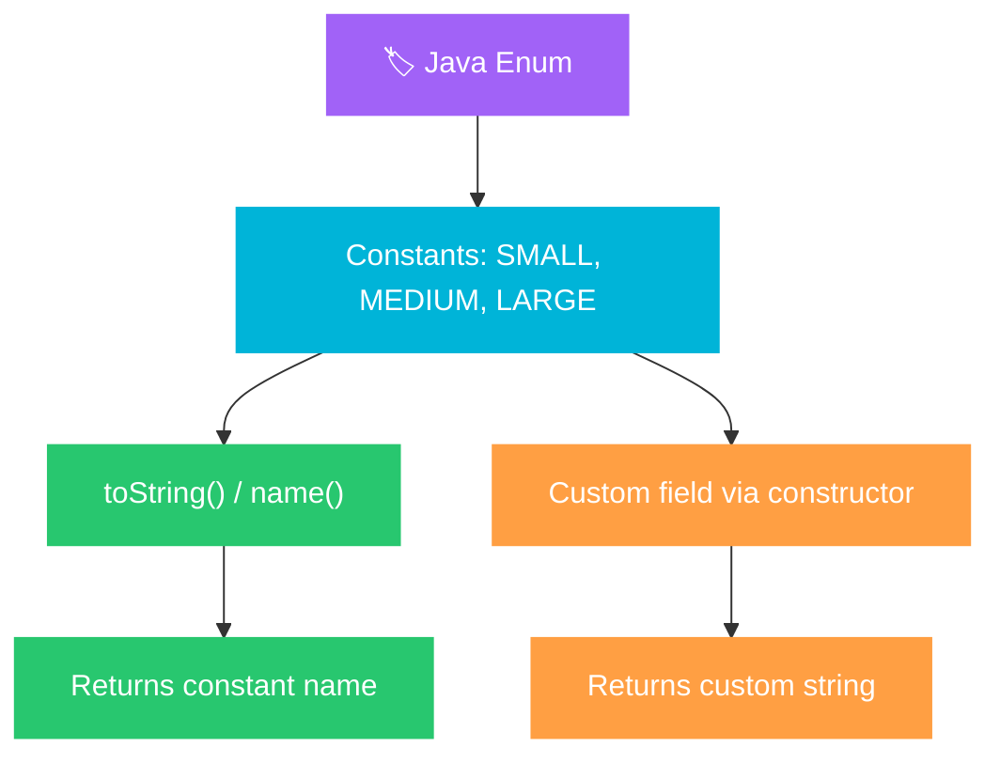

# Enum of Strings Java

**Enum of Strings Java** | The `enum` is a keyword that is present in the special classes to represent constants. To create an enum we use the `enum` keyword and separate constants with a comma. The enum stands for enumeration which means "specifically listed", these are more used in switch statements.

- [Java Enum Of Strings Example](#java-enum-of-strings-example)
- [Get String Of Enum Java](#get-string-of-enum-java)
- [Check If String Is Part Of Enum Java](#check-if-string-is-part-of-enum-java)
- [Related Links](#related-links)

---

## 1. Overview

These enums are just like classes, the difference is they are by default `public`, `static`, and `final`. They cannot create an object and cannot extend other classes. Usually, we use enum when we are dealing with months, colors, weeks, etc.

**Basic enum example:**

```java
enum Levels {
   LOW, MEDIUM, HIGH
}

public class Main {
   public static void main(String[] args) {
      Levels myVar = Levels.MEDIUM;
      switch (myVar) {
      case LOW:
         System.out.println("Low level");
         break;
      case MEDIUM:
         System.out.println("Medium level");
         break;
      case HIGH:
         System.out.println("High level");
         break;
      }
   }
}
```

📤 **Output:**

```
Medium level
```

---

## 2. Java Enum Of Strings Example

**Enum with overridden `toString()` method:**

```java
enum Levels {
   LOW {
      public String toString() {
         return "The size is LOW.";
      }
   },
   SMALL {
      public String toString() {
         return "The size is small.";
      }
   },
   MEDIUM {
      public String toString() {
         return "The size is medium.";
      }
   };
}

public class Main {
   public static void main(String[] args) {
      System.out.println(Levels.MEDIUM.toString());
      System.out.println(Levels.SMALL.toString());
      System.out.println(Levels.LOW.toString());
   }
}
```

📤 **Output:**

```
The size is medium.
The size is small.
The size is LOW.
```

---

## 3. Get String Of Enum Java

Here our goal is to access the enum of strings. Let us see another example for the same.

**Using `toString()` and `name()` methods:**

```java
enum Levels {
   SMALL, MEDIUM, LARGE, EXTRALARGE
}

public class Main {
   public static void main(String[] args) {
      System.out.println("The string value of SMALL is "
         + Levels.SMALL.toString());
      System.out.println("The string value of MEDIUM is "
         + Levels.MEDIUM.name());
      System.out.println("The string value of LARGE is "
         + Levels.LARGE.name());
      System.out.println("The string value of EXTRALARGE is "
         + Levels.EXTRALARGE.name());
   }
}
```

📤 **Output:**

```
The string value of SMALL is SMALL
The string value of MEDIUM is MEDIUM
The string value of LARGE is LARGE
The string value of EXTRALARGE is EXTRALARGE
```

**Using enum with custom string values (constructor approach):**

```java
public enum Levels {
   SMALL("Small"), MEDIUM("Medium"),
   LARGE("Large"), EXTRALARGE("Extra Large");

   private String abbreviation;

   private Levels(String abbreviation) {
      this.abbreviation = abbreviation;
   }

   public String getAbbreviation() {
      return abbreviation;
   }
}
```

```java
public class Main {
   public static void main(String[] args) {
      System.out.println("The string value of SMALL: "
         + Levels.SMALL.getAbbreviation());
      System.out.println("The string value of MEDIUM: "
         + Levels.MEDIUM.getAbbreviation());
      System.out.println("The string value of LARGE: "
         + Levels.LARGE.getAbbreviation());
      System.out.println("The string value of EXTRALARGE: "
         + Levels.EXTRALARGE.getAbbreviation());
   }
}
```

📤 **Output:**

```
The string value of SMALL: Small
The string value of MEDIUM: Medium
The string value of LARGE: Large
The string value of EXTRALARGE: Extra Large
```

> 💡 **Tip:** Use the constructor approach when you need custom string representations that differ from the enum constant name.

---

## 4. Check If String Is Part Of Enum Java

**Using `name()` comparison:**

```java
enum Levels {
  SMALL, MEDIUM, LARGE, EXTRALARGE
}

public class Main {
  public static boolean contains(String test) {
    for (Levels c : Levels.values()) {
      if (c.name().equals(test)) {
        return true;
      }
    }
    return false;
  }

  public static void main(String[] args) {
    System.out.println(contains("SMALL"));
    System.out.println(contains("BIG"));
  }
}
```

📤 **Output:**

```
true
false
```

**Using custom string field comparison:**

```java
public enum Levels {
   SMALL("Small"), MEDIUM("Medium"),
   LARGE("Large"), EXTRALARGE("Extra Large");

   private String abbreviation;

   private Levels(String abbreviation) {
      this.abbreviation = abbreviation;
   }

   public String getAbbreviation() {
      return abbreviation;
   }
}
```

```java
public class Main {
  public static boolean contains(String test) {
    for (Levels c : Levels.values()) {
      if (c.getAbbreviation().equals(test)) {
        return true;
      }
    }
    return false;
  }

  public static void main(String[] args) {
    System.out.println(contains("SMALL"));
    System.out.println(contains("Small"));
    System.out.println(contains("BIG"));
    System.out.println(contains("EXTRALARGE"));
    System.out.println(contains("Extra Large"));
  }
}
```

📤 **Output:**

```
false
true
false
false
true
```



> 📝 **Note:** When checking with `name()`, the comparison is case-sensitive and matches the exact enum constant name. When checking with a custom field, the comparison matches the custom string value.

If you enjoyed this post, share it with your friends. Do you want to share more information about the topic discussed above or do you find anything incorrect? Let us know in the comments. Thank you!

---

## 5. Related Links

**String Programs**
- Sum of digits in a String
- Count No of Vowels String
- String Pattern Programs in Java
- Take String Input In Java
- Take Multiple String Input in Java
- How To Reverse a String In Java
- Remove Special Characters
- String - Remove Character
- String Palindrome In Java
- Sort String In Java
- How to Compare Strings In Java
- Second Occurrence of Character
- Replace nth Occurrence String
- Last Occurrence of Character
- Uppercase & Lowercase
- Java Check If Char is Uppercase
- Check If String is Uppercase
- Swap Characters in String Java
- [Java String indexOf() Method](110_Java_String_indexOf()_Method.md)
- How to Replace Dot in Java?
- [How to Find Length of String](099_How_to_Find_Length_of_String_in_Java.md)
- [Substring Method In Java](112_Substring_Method_In_Java.md)
- [Split Method In Java](119_Split()_Method_In_Java.md)
