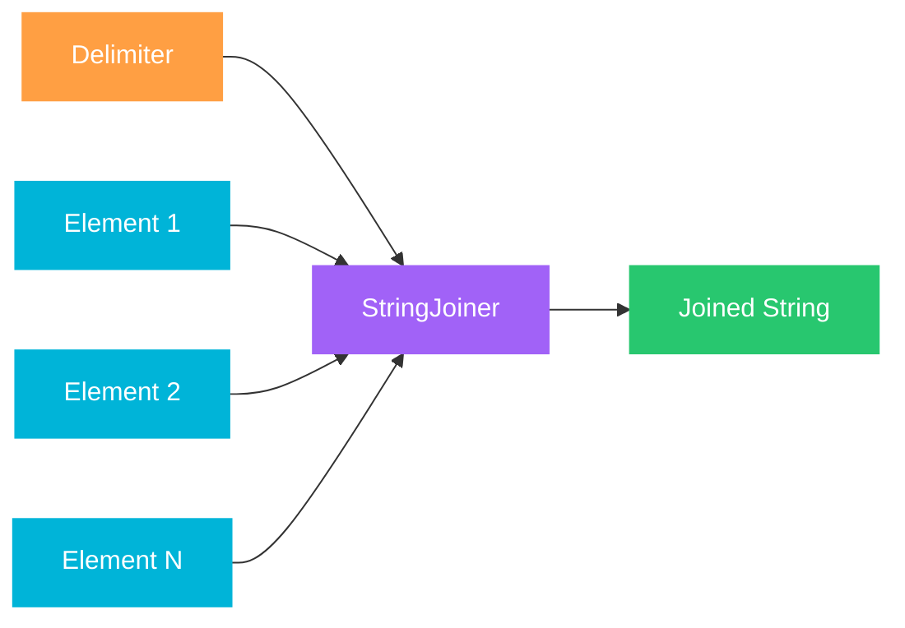

# String join() In Java

**String join() In Java** | The `join()` method in the [Java String class](097_String_Class_Methods_In_Java.md) joins the string with the given delimiter. The `join()` method was introduced in JDK 1.8 version. There are two method variations of the Java String `join()` method.

- [String.join() Java Method Implementation](#stringjoin-java-method-implementation)
- [Java String.join() Example](#java-stringjoin-example)
- [Java String.join() Exception](#java-stringjoin-exception)

---

## 1. String.join() Java Method Implementation

The method details of the `join()` method are as follows:

1. `public static String join(CharSequence delimiter, CharSequence... substring)`
2. `public static String join(CharSequence delimiter, Iterable<? extends CharSequence> substring)`

The internal implementation of the Java String `join()` method is as follows:

**Variation 1 - join with varargs:**

```java
public static String join(CharSequence delimiter,
                          CharSequence... elements) {
   Objects.requireNonNull(delimiter);
   Objects.requireNonNull(elements);
   // Number of elements not likely worth Arrays.stream overhead.
   StringJoiner joiner = new StringJoiner(delimiter);
   for (CharSequence cs: elements) {
      joiner.add(cs);
   }
   return joiner.toString();
}
```

In the above method:

- 🔤 **Parameters:** *delimiter* - a sequence of characters used to separate each of the elements in the resulting string, *elements* - the elements to join together.
- 📤 **Returns:** Joined string.
- 🚨 **Throws:** `NullPointerException` if the substring or elements is `null`.

**Variation 2 - join with Iterable:**

```java
public static String join(CharSequence delimiter,
        Iterable<? extends CharSequence> elements) {
   Objects.requireNonNull(delimiter);
   Objects.requireNonNull(elements);
   StringJoiner joiner = new StringJoiner(delimiter);
   for (CharSequence cs: elements) {
      joiner.add(cs);
   }
   return joiner.toString();
}
```

In the above method:

- 🔤 **Parameters:** *delimiter* - a sequence of characters used to separate each of the elements in the resulting string, *elements* - an `Iterable` that will have its elements joined together.
- 📤 **Returns:** Joined string.
- 🚨 **Throws:** `NullPointerException` if the substring or delimiter is `null`.

| Detail 📋 | Variation 1 🅰️ | Variation 2 🅱️ |
|-----------|----------------|----------------|
| **Parameter Type** | `CharSequence...` (varargs) | `Iterable<? extends CharSequence>` |
| **Delimiter** | `CharSequence` | `CharSequence` |
| **Returns** | `String` | `String` |
| **Since** | Java 1.8 | Java 1.8 |



---

## 2. Java String.join() Example

Let us see an example of the String `join()` in Java. We took a delimiter as `"."` and passed it to the Java String `join()` method.

**Example 1 - Building a URL:**

```java
public class Main {
   public static void main(String args[]) {
      String string = String.join(".", "www", "knowprogram", "com");
      System.out.println(string);
   }
}
```

📤 **Output:**

```
www.knowprogram.com
```

**Example 2 - Creating date and time strings:**

```java
public class Main {
   public static void main(String[] args) {
      String time = String.join(":", "06", "05", "15");
      System.out.println("The time is = " + time);
      String date = String.join("-", "12", "10", "10");
      System.out.print("The date is = " + date);
   }
}
```

📤 **Output:**

```
The time is = 06:05:15
The date is = 12-10-10
```

---

## 3. Java String.join() Exception

This program demonstrates the exception thrown by the `String.join()` Java method.

**NullPointerException example:**

```java
public class Main {
   public static void main(String argvs[]) {
      String string = null;
      string = String.join(null, "know", "program", "website");
      System.out.println(string);
   }
}
```

📤 **Output:**

```
Exception in thread "main" java.lang.NullPointerException: Cannot invoke "java.lang.CharSequence.toString()" because "delimiter" is null
at java.base/java.lang.String.join(String.java:3225)
at Main.main(Main.java:5)
```

> ⚠️ **Caution:** In the above program, we have passed `null` for the delimiter therefore the `String.join()` method throws `NullPointerException`. Similarly, if we pass `null` for the elements then also it will throw the same exception.

If you enjoyed this post, share it with your friends. Do you want to share more information about the topic discussed above or do you find anything incorrect? Let us know in the comments. Thank you!

**Java Tutorial**

**[String Class Methods](097_String_Class_Methods_In_Java.md)**
- charAt() Method
- codePoints() Method
- [compareTo() Method](106_String_compareTo()_Java.md)
- [compareToIgnoreCase()](107_String_compareToIgnoreCase()_Java.md)
- [concat() Method](113_Concat_Strings_in_Java.md)
- [contains() Method](116_String_contains()_Method_in_Java.md)
- equals() Method
- [equalsIgnoreCase()](105_String_equalsIgnoreCase()_Java.md)
- format() Method
- getBytes() Method
- hashCode() Method
- indent() Method
- [indexOf() Method](110_Java_String_indexOf()_Method.md)
- intern() Method
- [isBlank() Method](124_String_isBlank()_Java_with_Examples.md)
- [isEmpty() Method](100_String_isEmpty()_Java_with_Examples.md)
- isBlank() vs isEmpty()
- join() Method
- [lastIndexOf() Method](111_String_lastIndexOf()_in_Java.md)
- [length() Method](099_How_to_Find_Length_of_String_in_Java.md)
- matches() Method
- repeat() Method
- [replace() Method](114_Replace()_In_String_Java.md)
- [replaceAll() Method](118_String_replaceAll()_Java.md)
- replaceFirst() Method
- replace() vs replaceAll()
- [split() Method](119_Split()_Method_In_Java.md)
- startsWith() & endsWith()
- strip() & stripLeading()
- [substring() Method](112_Substring_Method_In_Java.md)
- toCharArray() Method
- [toLowerCase() Method](120_Java_String_to_Lowercase.md)
- [toString() Method](126_String_toString()_Java.md)
- toUpperCase() Method
- [trim() Method](122_Trim()_in_Java_String.md)
- [trim() vs strip()](093_Java_String_trim()_Vs_strip().md)
- valueOf() Method
