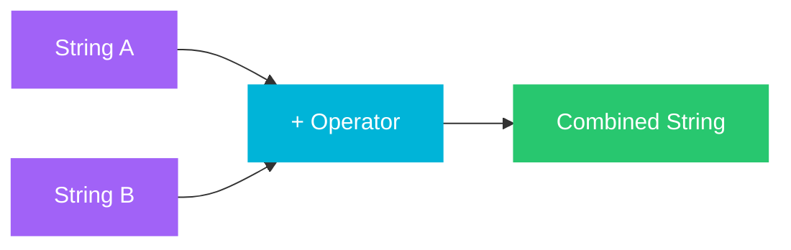

# Concat Strings in Java

**Concat Strings in Java** | The word concatenation means to add a string to another string. The concatenation can be done by using the `+` operator. Java string class provides `concat()` method to add a string to another string. In this tutorial, let us see the different ways to concatenate strings.

- [Java String Concat Example](#java-string-concat-example)
- [How to Concat String in Java using + Operator](#how-to-concat-string-in-java-using--operator)
- [Java Concat Array Of Strings](#java-concat-array-of-strings)

---

## 1. Java String Concat Example

🔗 How concatenation of String in Java works:

- **Example-1:** `String1 = "Hello"`, `String2 = "world"` --> After concatenation: `"Hello world"`
- **Example-2:** `String1 = "Hi"`, `String2 = "Programmer"` --> After concatenation: `"Hi Programmer"`

We can concatenate strings in two ways:

- 🅰️ Using the `+` operator
- 🅱️ By using `concat()` method of the Java String class

| Detail 📋 | Description 📝 |
|-----------|---------------|
| **Method Signature** | `public String concat(String str)` |
| **Parameters** | `str` - the string needed to be combined |
| **Returns** | The string which is combined |

**Example-1 - Concat string using `concat()`:**

```java
public class Main {
   public static void main(String args[]) {
      String string = "Hi, ";
      string = string.concat("Good Morning");
      System.out.println(string);
   }
}
```

📤 **Output:**

```
Hi, Good Morning
```

Let us see another example of how to concat strings in Java using `concat()` method of string class. This time we will apply `concat()` method multiple times.

**Example-2 - Multiple `concat()` calls:**

```java
public class Main {
   public static void main(String args[]) {
      String string1 = "Java";
      String string2 = " Programming";
      String string3 = " Language";

      String string4 = string1.concat(string2);
      System.out.println("string4: " + string4);
      String string5 = string4.concat(string3);
      System.out.println("string5: " + string5);

      String string6 = string1.concat(string2).concat(string3);
      System.out.println("string6: " + string6);
   }
}
```

📤 **Output:**

```
string4: Java Programming
string5: Java Programming Language
string6: Java Programming Language
```

**Example-3 - Demonstrating immutability with `concat()`:**

```java
public class Main {
   public static void main(String args[]) {
      String str1 = "As string";
      System.out.println(str1);
      str1 = str1.concat(" is immutable.");
      System.out.println(str1);
      str1 = str1.concat(" Once created it cannot be changed.");
      System.out.println(str1);
   }
}
```

📤 **Output:**

```
As string
As string is immutable.
As string is immutable. Once created it cannot be changed.
```

**Example-4 - Chained `concat()` calls:**

```java
public class Main {
   public static void main(String[] args) {
      String string1 = "Hello, ";
      String string2 = "KnowProgram";
      String string3 = " Reader's.";

      String string4 = string1.concat(string2);
      System.out.println(string4);

      String str5 = string1.concat(string2).concat(string3);
      System.out.println(str5);
   }
}
```

📤 **Output:**

```
Hello, KnowProgram
Hello, KnowProgram Reader's.
```

---

## 2. How to Concat String in Java using + Operator

Not only using the string class `concat()` method but also using the `+` operator we can concat strings. Let us understand it through examples.



**Example-1 - Concat using `+` operator:**

```java
public class Main {
   public static void main(String args[]) {
      String string = "Hi, ";
      string = string + "Good Morning";
      System.out.println(string);
   }
}
```

📤 **Output:**

```
Hi, Good Morning
```

**Example-2 - Multiple `+` concatenations:**

```java
public class Main {
   public static void main(String args[]) {
      String string1 = "Java";
      String string2 = " Programming";
      String string3 = " Language";

      String string4 = string1 + string2;
      System.out.println("string4: " + string4);
      String string5 = string4 + string3;
      System.out.println("string5: " + string5);

      String string6 = string1 + string2 + string3;
      System.out.println("string6: " + string6);
   }
}
```

📤 **Output:**

```
string4: Java Programming
string5: Java Programming Language
string6: Java Programming Language
```

**Example-3 - Immutability with `+` operator:**

```java
public class Main {
   public static void main(String args[]) {
      String str1 = "As string";
      System.out.println(str1);
      str1 = str1 + " is immutable.";
      System.out.println(str1);
      str1 = str1 + " Once created it cannot be changed.";
      System.out.println(str1);
   }
}
```

📤 **Output:**

```
As string
As string is immutable.
As string is immutable. Once created it cannot be changed.
```

**Example-4 - Chained `+` concatenation:**

```java
public class Main {
   public static void main(String[] args) {
      String string1 = "Hello, ";
      String string2 = "KnowProgram";
      String string3 = " Reader's.";

      String string4 = string1 + string2;
      System.out.println(string4);

      String str5 = string1 + string2 + string3;
      System.out.println(str5);
   }
}
```

📤 **Output:**

```
Hello, KnowProgram
Hello, KnowProgram Reader's.
```

---

## 3. Java Concat Array Of Strings

We have seen how to concat strings in Java using `concat()` method or using the concatenation operator (`+`). Now let us develop a simple program for its use case. We have an [array of strings](046_String_Array_in_Java.md) and we have to concat it to make a single string.

**Concat array of strings using `concat()`:**

```java
import java.util.Arrays;

public class Main {
   public static void main(String[] args) {
      String lang[] =
         { "Java ", "Python ", "HTML ", "C++ ", "CSS" };
      String string = "";

      for (String str : lang) {
         string = string.concat(str);
      }
      System.out.println("String array: "
                  + Arrays.toString(lang));

      System.out.println("String Array Merging: " + string);
   }
}
```

📤 **Output:**

```
String array: [Java , Python , HTML , C++ , CSS]
String Array Merging: Java Python HTML C++ CSS
```

We can also use the `+` operator to concat array of strings. For this, in the for loop we have to use the concatenation operator `+` instead of the Java string `concat()` method. And we will get the same result.

**Using `+=` operator in loop:**

```java
for (String str : lang) {
   string += str;
}
```

> 💡 **Tip:** For large-scale string concatenation in loops, prefer `StringBuilder` for better performance since `String` objects are immutable and each concatenation creates a new object.

If you enjoyed this post, share it with your friends. Do you want to share more information about the topic discussed above or do you find anything incorrect? Let us know in the comments. Thank you!

**Java Tutorial**

**[String Class Methods](097_String_Class_Methods_In_Java.md)**
