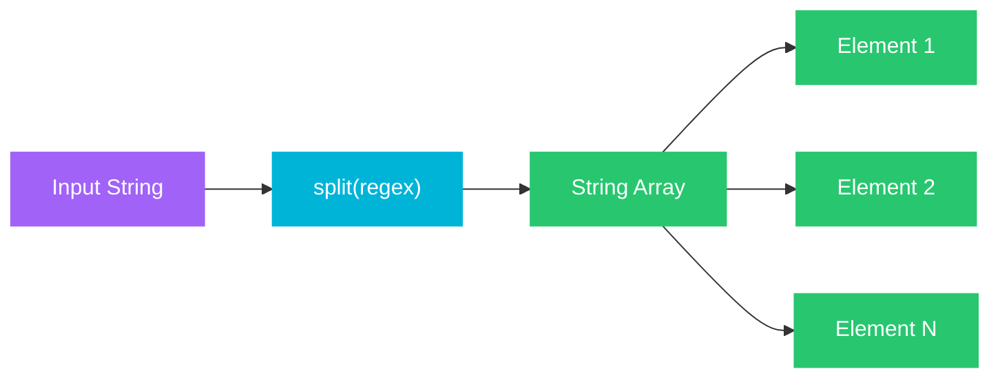

# Split() Method In Java

**Split() Method In Java** | The `split()` is a built-in method in the [Java String class](097_String_Class_Methods_In_Java.md), which is used to divide the string. It uses a regular expression to divide the string into multiple substrings. **It divides the string and returns the array of substrings. It breaks the substring according to the mentioned regular expression.**

- [Java Split String By Space](#java-split-string-by-space)
- [Java Split String By Comma](#java-split-string-by-comma)
- [Java Split String Into Array](#java-split-string-into-array)
- [Java Split String By Delimiter](#java-split-string-by-delimiter)
- [Java Split String By Dot](#java-split-string-by-dot)

---

## 1. Java Split String By Space

| Detail 📋 | Description 📝 |
|-----------|---------------|
| **Method Signature** | `public String[] split(String regex)` |
| **Parameter** | `regex` - the delimiting regular expression |
| **Returns** | The array of strings computed by splitting this string around matches of the given regular expression |
| **Throws** | `PatternSyntaxException` if the regular expression's syntax is invalid (unchecked exception) |

For example, let us consider the below string:

**Introductory example:**

```java
String string = "Java Programming";

// now we want to split the string from "r"
String[] substrings = string.split("r");

System.out.println(Arrays.toString(substrings));
```

📤 **Output:**

```
[Java P, og, amming]
```

Observing the output, the `split()` method has removed the character `"r"` from the string and returned an array of substrings. We have stored the returned array of substrings in the `substrings` variable and displayed them using the Arrays.toString() method. The `toString()` method of the [Arrays class](033_Arrays_Class_Java_With_Examples.md) converts the array to a string. To use the Arrays class, first import it.

To split the string by space just mention a space inside the `split()` method i.e. pass `" "` in the `split()` method. Since the return type of the `split()` method is an array of substrings after removing the characters given in the pattern, we will get the array of substrings.

**Java Program to Split String By Space:**

```java
class Main {
   public static void main(String[] args) {
      String string = "Learn Java Programming Language";
      String[] substrings = string.split(" ");
      for (String str : substrings) {
         System.out.println(str);
      }
   }
}
```

📤 **Output:**

```
Learn
Java
Programming
Language
```

---

## 2. Java Split String By Comma

Now, we will develop a Java program to split the string based on the comma. The `split()` method will produce the array of substrings after removing the comma `","` and splitting the string.

**Java Split String By Comma:**

```java
class Main {
   public static void main(String[] args) {
      String string = "Learn,Java Programming,KnowProgram";
      String[] substrings = string.split(",");
      for (String str : substrings) {
         System.out.println(str);
      }
   }
}
```

📤 **Output:**

```
Learn
Java Programming
KnowProgram
```

---

## 3. Java Split String Into Array

We can split a String into an array based on various patterns. In the below program, the given string is split based on space.

**Split string into array:**

```java
import java.util.Arrays;

public class Main {
   public static void main(String[] args) {
      String string = "Know Program website helps to learn "
             + "various programming language effectively.";

      String[] strArray = string.split(" ");

      System.out.println(Arrays.toString(strArray));
   }
}
```

📤 **Output:**

```
[Know, Program, website, helps, to, learn, various, programming, language, effectively.]
```

We have stored the returned array of substrings in the `strArray` variable and displayed them using the Arrays.toString() method. The `toString()` method of the [Arrays class](033_Arrays_Class_Java_With_Examples.md) converts the array to a string.

---

## 4. Java Split String By Delimiter

By using a delimiter we can split the string containing delimiter characters. Delimiters are characters that split strings separately into tokens. The whitespace character is a default delimiter in Java. In the below example, we have used slash `'/'` as a delimiter.

**Java Program to Split String By Delimiter:**

```java
import java.util.*;

public class Main {
  public static void main(String[] args) {
    String string =
     "know/program/website/programming/language/java/string/split";

    String[] strArray = string.split("/");

    System.out.println(Arrays.toString(strArray));
  }
}
```

📤 **Output:**

```
[know, program, website, programming, language, java, string, split]
```

---

## 5. Java Split String By Dot

In Java, the dot character (`.`) is **used to represent all characters in regex**. If you split a string by passing `"."` in the `split()` method then it will return an empty array of strings. If we want to match a literal dot, we have to use the backslash escape: `"\\."`.

**Java Program to Split String By Dot:**

```java
import java.util.Arrays;

public class Main {

  public static void main(String[] args) {
    String string = "www.knowprogram.com";

    // split based on dot (.) character
    String[] strArray = string.split("\\.");
    System.out.println(Arrays.toString(strArray));

    // split each character
    String[] characters = string.split(".");
    System.out.println(Arrays.toString(characters));
  }
}
```

📤 **Output:**

```
[www, knowprogram, com]
[ ]
```

> ⚠️ **Caution:** On calling `split(".")` the method returns an empty array because in regex the dot represents **any character**, which means we want to split based on each character available in the string. Therefore at the end, we get an empty array. Always use `"\\."` to split by a literal dot.



If you enjoyed this post, share it with your friends. Do you want to share more information about the topic discussed above or do you find anything incorrect? Let us know in the comments. Thank you!

**Java Tutorial**

**[String Class Methods](097_String_Class_Methods_In_Java.md)**
