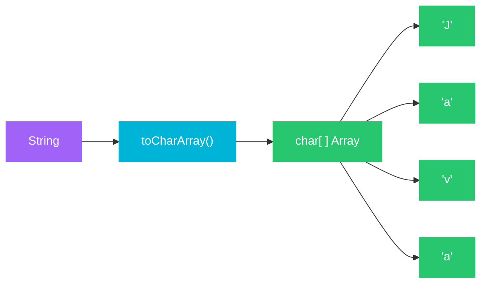

# Java String toCharArray() Method

**Java String toCharArray() Method** | The `toCharArray()` method converts the given string to the sequence of characters. This method does not take any parameter and returns the sequence of characters in the array format.

- [Java String toCharArray() Example](#java-string-tochararray-example)
- [Java toCharArray() Example](#java-tochararray-example)

---

## 1. Java String toCharArray() Example

| Detail 📋 | Description 📝 |
|-----------|---------------|
| **Method Signature** | `public char[] toCharArray()` |
| **Parameters** | None |
| **Return Type** | `char[]` |
| **Returns** | Sequence of characters as a character array |

Now, let us see some examples of the Java String `toCharArray()` method. We will take a string and call the `toCharArray()` method to get the array of characters from the string. And later we will display the array of characters using the [Arrays.toString() method](033_Arrays_Class_Java_With_Examples.md).

**Using `toCharArray()` with `Arrays.toString()`:**

```java
import java.util.Arrays;

public class Main {
   public static void main(String args[]) {
      String string = "Java Programming Language";
      char[] charArray = string.toCharArray();
      System.out.println(Arrays.toString(charArray));
   }
}
```

📤 **Output:**

```
[J, a, v, a,  , P, r, o, g, r, a, m, m, i, n, g,  , L, a, n, g, u, a, g, e]
```

In the previous example, we displayed the array of characters using the [Arrays.toString() method](033_Arrays_Class_Java_With_Examples.md) but we can also use the normal `for` loop or for-each loop to display the array of characters. See: Different ways to print array. Let us see another example.

**Using `toCharArray()` with a for loop:**

```java
public class Main {
   public static void main(String args[]) {
      String string = "Know Program";
      char[] charArray = string.toCharArray();
      for (int i = 0; i < charArray.length; i++) {
         System.out.print(charArray[i] + ", ");
      }
   }
}
```

📤 **Output:**

```
K, n, o, w,  , P, r, o, g, r, a, m,
```

Also see: How to convert string to char array using the native method, Java program to convert char array to string.

---

## 2. Java toCharArray() Example

**Using `toCharArray()` with for-each loop and length:**

```java
public class Main {
   public static void main(String[] args) {
      String string = "Welcome to Know Program";
      char[] charArray = string.toCharArray();
      int length = charArray.length;
      System.out.println("Char Array length: " + length);
      System.out.println("Char Array elements: ");
      for (char ch : charArray) {
         System.out.print(ch + " ");
      }
   }
}
```

📤 **Output:**

```
Char Array length: 23
Char Array elements:
W e l c o m e   t o   K n o w   P r o g r a m
```

**Printing char array directly with `println()`:**

```java
public class Main {
   public static void main(String args[]) {
      String string = "Where there is a will there is a way";
      System.out.println("The string array: ");
      System.out.println(string.toCharArray());
   }
}
```

📤 **Output:**

```
The string array:
Where there is a will there is a way
```

> 💡 **Tip:** The `println(char[])` method in `PrintStream` is overloaded to print the entire character array as a string directly, unlike `println(Object)` which would call `toString()` on the array and print a hash code.



If you enjoyed this post, share it with your friends. Do you want to share more information about the topic discussed above or do you find anything incorrect? Let us know in the comments. Thank you!

**Java Tutorial**

**[String Class Methods](097_String_Class_Methods_In_Java.md)**
