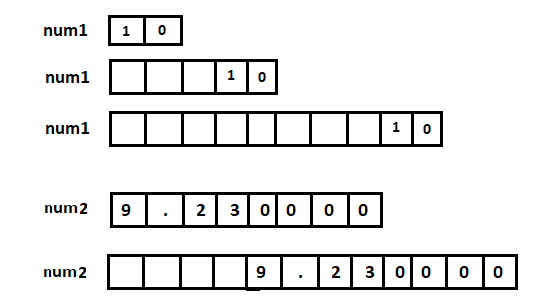
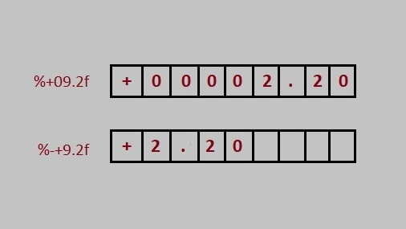
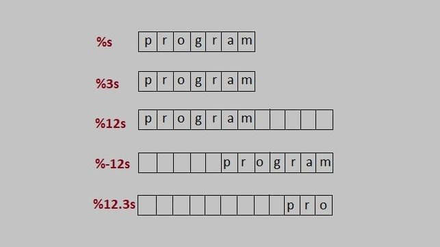

# Java String format() in Detail with Examples

**Java String format() in Detail with Examples** | Java has a special method called `format()` which returns the formatted string using the given locale, arguments, and the specified formatted string. It also helps to concatenate the method.

- [How to Use String.format() in Java?](#how-to-use-stringformat-in-java)
- [String.format() in Java - String Concatenation](#stringformat-in-java---string-concatenation)
- [Conversion Code used in String format() Java](#conversion-code-used-in-string-format-java)
- [Width Modifier used in Java String format() Method](#width-modifier-used-in-java-string-format-method)
- [Precision Modifier Used in Java String format() Method](#precision-modifier-used-in-java-string-format-method)
- [Flag Modifier Used in Java String format() Method](#flag-modifier-used-in-java-string-format-method)
- [Flag # With the Format Specifier in String.format() Method](#flag--with-the-format-specifier-in-stringformat-method)
- [Modifiers Used with a String in Java String format() Method](#modifiers-used-with-a-string-in-java-string-format-method)

---

## 1. How to Use String.format() in Java?

There are two variants in the Java string `format()` method:

- 1️⃣ `public static String format(Locale locale, String string, Object... args)`
- 2️⃣ `public static String format(String string, Object args)`

| Detail 📋 | Description 📝 |
|-----------|---------------|
| **Parameter: Locale** | The value needed to be applied to the `format()` method |
| **Parameter: args** | The arguments passed to the format method |
| **Parameter: String** | The format of the output string |
| **Return Type** | `String` |
| **Returns** | The formatted string |
| **Throws** | `NullPointerException` if the string is `null`; `IllegalFormatException` if the arguments are insufficient |

To use `String.format()` method we have to simply pass the string as a parameter. Let us see it through an example.

**Basic `String.format()` example:**

```java
public class Main {
   public static void main(String args[]) {
      String string = "Java Programming";
      String string1 = String.format("Language name is %s", string);
      System.out.println(string1);

      String string2 = String.format("Answer is %.8f", 47.65734);
      System.out.println(string2);

      String string3 = String.format("Answer is %9.2f", 47.65734);
      System.out.println(string3);
   }
}
```

📤 **Output:**

```
Language name is Java Programming
Answer is 47.65734000
Answer is     47.66
```

The `%s` is used to represent the string variable value. Similarly, `%f` is used to represent a floating point number. We will see more examples of it later.

---

## 2. String.format() in Java - String Concatenation

Using the `String.format()` method we can concatenate a string value more than once. The below example demonstrates where we have concatenated the `string1` value 2 times.

**Positional argument concatenation:**

```java
public class Main {
   public static void main(String args[]) {
      String string1 = "Java";
      String string2 = "Know Program";
      String string = String.format("The Language name" +
               " is: %1$s. %1$s and %2$s", string1, string2);
      System.out.println(string);
   }
}
```

📤 **Output:**

```
The Language name is: Java. Java and Know Program
```

---

## 3. Conversion Code used in String format() Java

| Conversion Code 🏷️ | Usual Variable Type 📋 | Display 📤 |
|--------------------|----------------------|-----------|
| **`%c`** or **`%C`** | `char` | Single character |
| **`%d`** | `byte`, `int`, `short`, `long` | Decimal integer |
| **`%o`** | `byte`, `int`, `short`, `long` | Unsigned octal value |
| **`%x`** or **`%X`** or **`%h`** or **`%H`** | `byte`, `int`, `short`, `long` | Unsigned hex value |
| **`%f`** | `float` or `double` | Signed floating point |
| **`%e`** or **`%E`** | `float` or `double` | Exponential format |
| **`%g`** or **`%G`** | `float` or `double` | Use `%f` or `%e`, whichever is shorter |
| **`%s`** | `String` | String |
| **`%S`** | `String` | String in uppercase |
| **`%%`** | none | Prints only a `%` (no argument converted) |
| **`%n`** | -- | New line |

Below program demonstrates the uses of the above conversion codes used in `String.format()` method.

**Java String Formatting Example with Different Conversion Codes:**

```java
public class Main {
   public static void main(String args[]) {

      char ch = 'a';
      System.out.println(String.format("ch = %c", ch));

      byte n1 = 10;
      short n2 = 200;
      int n3 = -10;
      long n4 = 50;
      long n5 = 5000;
      System.out.println(String.format("n1 = %d", n1));
      System.out.println(String.format("n2 = %d", n2));
      System.out.println(String.format("n3 = %d", n3));
      System.out.println(String.format("n4 = %d", n4));
      System.out.println(String.format("n5 = %d", n5));
      System.out.println(String.format("n4 in octals = %o", n4));
      System.out.println(String.format("n4 in hexadecimal = %x", n4));

      float n6 = 5.5f;
      double n7 = 3000.253215;
      System.out.println(String.format("n4 = %f", n6));
      System.out.println(String.format("n5 = %f", n7));
      System.out.println(String.format("n5 in exponential format = %e", n7));
      System.out.println(String.format("n5 = %g", n7));

      String str = "Know Program";
      char charArray[] = { 'H', 'e', 'l', 'l', 'o' };
      System.out.println(String.format("String = %s", str));
      System.out.println(String.format("Char array = %s", charArray));
      System.out.println(String.format("New line = %n", str));
      System.out.println(String.format("None = %%", str));
   }
}
```

📤 **Output:**

```
ch = a
n1 = 10
n2 = 200
n3 = -10
n4 = 50
n5 = 5000
n4 in octals = 62
n4 in hexadecimal = 32
n4 = 5.500000
n5 = 3000.253215
n5 in exponential format = 3.000253e+03
n5 = 3000.25
String = Know Program
Char array = [C@3f3afe78
New line =

None = %
```

Java Program to **convert String to uppercase using `String.format()`** method:

**Uppercase conversion with `%S`:**

```java
String str = "Know Program";
System.out.println(String.format("String = %S", str));
```

📤 **Output:**

```
String = KNOW PROGRAM
```

> ⚠️ **Caution:** If we use a conversion code with the wrong type of variable, we will get `java.util.IllegalFormatConversionException`.

**Wrong type example:**

```java
char ch = 'a';
System.out.println(String.format("ch = %d", ch));
```

It gives the following exception:

```
Exception in thread "main" java.util.IllegalFormatConversionException: d != java.lang.Character
```

---

## 4. Width Modifier used in Java String format() Method

The width modifier is used to specify the minimum number of positions that the output will take. If the user does not mention any width then the output will take just enough positions required for the output data.

**Java String Formatting Example with Width Modifier:**

```java
public class Main {
   public static void main(String args[]) {
      int num1 = 10;
      System.out.println(String.format("n1 = %d", num1));
      System.out.println(String.format("n2 = %5d", num1));
      System.out.println(String.format("n2 = %10d", num1));

      double num2 = 9.23;
      System.out.println(String.format("n2 = %f", num2));
      System.out.println(String.format("n2 = %12f", num2));
   }
}
```

📤 **Output:**

```
n1 = 10
n2 =    10
n2 =         10
n2 = 9.230000
n2 =     9.230000
```



- 📖 The first line of `format()` width is not mentioned so `10` is displayed as it is.
- 📖 In the second line, we use `%5d` so five empty positions are created, and then from the last position digit `10` is filled, and the remaining positions are filled with spaces.
- 📖 In the third line `%10d` is used so ten empty positions are created and from the last position, value `10` is filled.
- 📖 By default floating points use six positions after the decimal point. If there is no number present after the decimal point then it is filled with zeros. Due to this, `num2=9.23` is displayed as `9.230000`.
- 📖 In the next line, we use `%12f` so it uses 12 positions and fills from left to right.

**Java String Formatting Example-2 with Width Modifier:**

```java
public class Main {
   public static void main(String args[]) {
      int num1 = 100;
      System.out.println(String.format("n1 = %1d", num1));
      System.out.println(String.format("n2 = %2d", num1));
      System.out.println(String.format("n2 = %3d", num1));

      double num2 = 9.23;
      System.out.println(String.format("n2 = %1f", num2));
      System.out.println(String.format("n2 = %5f", num2));
   }
}
```

📤 **Output:**

```
n1 = 100
n2 = 100
n2 = 100
n2 = 9.230000
n2 = 9.230000
```

> 📝 **Note:** If we use a width modifier with less than the required width then it doesn't affect output. The variable `num1` requires 3 positions but we used `%1d`, `%2d`, and `%3d` so it doesn't change output because these are less than or equal to the required space. Similarly, `num2 = 9.23` requires 8 spaces but if we use `%1f` or `%5f` then it doesn't change the output.

---

## 5. Precision Modifier Used in Java String format() Method

To specify width after the decimal point, the **precision modifier** is used. From the previous point (width modifier) we know that `%5f` says the number is to be at least five characters wide. Similarly, `%.3f` specifies three characters after the decimal point; it doesn't affect the width before the decimal point.

| Format 🏷️ | number = 47.65734 | Result 📤 |
|-----------|-------------------|----------|
| **`%f`** | 47.65734 | `47.657340` |
| **`%.1f`** | 47.65734 | `47.7` |
| **`%.2f`** | 47.65734 | `47.66` |
| **`%.3f`** | 47.65734 | `47.657` |
| **`%.4f`** | 47.65734 | `47.6573` |
| **`%.9f`** | 47.65734 | `47.657340000` |

**Java Program to demonstrate `String.format()` with Precision Modifier:**

```java
public class Main {
   public static void main(String args[]) {
      double num = 9.2356;
      System.out.println(String.format("%.1f", num));
      System.out.println(String.format("%.3f", num));
      System.out.println(String.format("%.5f", num));
      System.out.println(String.format("%3.1f", num));
      System.out.println(String.format("%5.2f", num));
      System.out.println(String.format("%10.3f", num));
   }
}
```

📤 **Output:**

```
9.2
9.236
9.23560
9.2
 9.24
     9.236
```

In the above program, `%.1f` prints only one digit after the decimal point. Similarly, `%.3f` prints only 3 digits after the decimal point, and `%.5f` prints five digits after the decimal point so one zero is added to the end of the value. Notice that the original number was `9.2356` but `%.3f` prints `9.236` (due to mathematical rounding).

| Format Specifier 🏷️ | Meaning 📝 |
|---------------------|-----------|
| **`%d`** | Print as a decimal integer |
| **`%5d`** | Print as a decimal integer, at least 5 characters wide |
| **`%f`** | Print as a floating point |
| **`%5f`** | Print as a floating point, at least 5 characters wide |
| **`%.3f`** | Print as a floating point, 3 characters after the decimal point |
| **`%5.3f`** | Print as floating-point, at least 5 wide and 3 after decimal point |

---

## 6. Flag Modifier Used in Java String format() Method

The flag modifier allows one or more print modifications to be specified. The flag can be any one of the characters from the below table.

| Flag 🏷️ | Meaning 📝 |
|---------|-----------|
| **`0`** | Pad with leading zeros |
| **`+`** | Display positive or negative signs of value |
| **`-`** | Left justify the display |
| **Space** | Display space if there is no sign |
| **`#`** | Use the alternative form of the specifier |

**Java Program to Pad value with leading zeros using `String.format()`:**

```java
public class Main {
   public static void main(String args[]) {
      double num = 9.2356;
      System.out.println(String.format("%05.2f", num));
      System.out.println(String.format("%05.1f", num));
      System.out.println(String.format("%09.3f", num));
      System.out.println(String.format("%010.5f", num));
   }
}
```

📤 **Output:**

```
09.24
009.2
00009.236
0009.23560
```

**Java Program to display sign of the given value using `String.format()`:**

```java
public class Main {
   public static void main(String args[]) {
      double num1 = -5;
      double num2 = 10;
      double num3 = 9.2356;
      double num4 = -9.2356;
      System.out.println(String.format("%+5.2f", num1));
      System.out.println(String.format("%+5.1f", num2));
      System.out.println(String.format("%+2.3f", num3));
      System.out.println(String.format("%+5.5f", num4));
   }
}
```

📤 **Output:**

```
-5.00
+10.0
+9.236
-9.23560
```

The specifier `%+5d` will display an int using the next five-character locations and will add a `+` or `-` sign to the value.

**Java Program to left justify the display using `String.format()`:**

```java
public class Main {
   public static void main(String args[]) {
      // without flag (-)
      System.out.println("Without flag (-): ");
      System.out.println(String.format("%+6.1f", -5.9));
      System.out.println(String.format("%+10.3f", 2.2));

      // with flag (-)
      System.out.println("With flag (-): ");
      System.out.println(String.format("%-+6.1f", -5.9));
      System.out.println(String.format("%-+10.3f", 2.2));
   }
}
```

📤 **Output:**

```
Without flag (-):
  -5.9
    +2.200
With flag (-):
-5.9
+2.200
```

**Combining `0` flag and `-` flag:**

```java
public class Main {
   public static void main(String args[]) {
      System.out.println(String.format("%+09.2f", 2.2));
      System.out.println(String.format("%-+9.2f", 2.2));
   }
}
```

📤 **Output:**

```
+00002.20
+2.20
```



- 📖 In the first statement, a float is printed with a precision of 2 and a width of 9. Because the flag `0` is used, the extra four positions that need to be filled are occupied by zeros instead of spaces.
- 📖 In the second statement, the minus sign causes the value to be left-justified, spaces are added to the right instead of left, and the positive sign causes the sign of the number to be printed with the number.

---

## 7. Flag # With the Format Specifier in String.format() Method

Among the flags, the only complexity is in the use of the `#` modifier. What this modifier does depends on the type of format specifier, that is, the conversion code it is used with.

| Flag with Format Specifier 🏷️ | Action 📝 |
|-------------------------------|----------|
| **`%#o`** | Adds a leading `0` to the octal number printed |
| **`%#x`** or **`%#X`** | Adds a leading `0x` or `0X` to the hex number printed |
| **`%#f`** or **`%#e`** | Ensures that the decimal point is printed |

**Java Program to demonstrate `String.format()` using Flag `#` with Format Specifier:**

```java
public class Main {
   public static void main(String args[]) {
      System.out.println(String.format("%#o", 9));
      System.out.println(String.format("%#o", 16));
      System.out.println(String.format("%#x", 17));
      System.out.println(String.format("%#x", 100));
      System.out.println(String.format("%#f", 9.235));
      System.out.println(String.format("%#e", 9.235));
   }
}
```

📤 **Output:**

```
011
020
0x11
0x64
9.235000
9.235000e+00
```

---

## 8. Modifiers Used with a String in Java String format() Method

When a string is printed using the `%s` specifier, then all the characters stored in the array up to the first null will be printed. If a width specifier is used, the string will be right-justified within the space. If a precision specifier is included, only that number of characters will be printed.

**String width and precision modifiers:**

```java
public class Main {
   public static void main(String args[]) {
      System.out.println(String.format("%s", "program"));
      System.out.println(String.format("%3s", "program"));
      System.out.println(String.format("%12s", "program"));
      System.out.println(String.format("%-12s", "program"));
      System.out.println(String.format("%12.3s", "program"));
   }
}
```

📤 **Output:**

```
program
program
     program
program
         pro
```



> 💡 **Tip:** The `String.format()` method is very powerful for creating formatted output. Combine width, precision, and flag modifiers to achieve precise control over the display format of your data.

If you enjoyed this post, share it with your friends. Do you want to share more information about the topic discussed above or do you find anything incorrect? Let us know in the comments. Thank you!

**Java Tutorial**

**[String Class Methods](097_String_Class_Methods_In_Java.md)**
