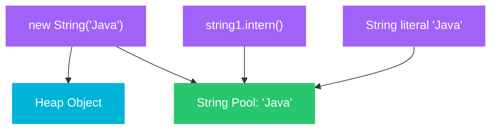

# Java String intern() Method

**Java String intern() Method** | The `intern()` method is used to store only one copy of each distinct string value in the String Pool, ensuring memory efficiency for immutable strings.

- [How intern() Works](#how-intern-works)
- [Java String Intern](#java-string-intern)
- [What is String Interning In Java](#what-is-string-interning-in-java)
- [Java String Interning](#java-string-interning)
- [How String Works Internally In Java](#how-string-works-internally-in-java)

---

## 1. How intern() Works

For example, in code, we need to use the "Apple" string 99 times but by using the `intern()` method we can ensure that the memory allocated for the "Apple" string is only once. We use this method to reduce memory utilization. It can help us to improve the space of the memory.

When we use the `intern()` method it returns a canonical representation for the string object. A pool is usually maintained by the `String` class. When this method is executed it checks whether the string object is equal to the string in the pool or not. If equal then the string from the pool is returned, or else the string object is added to the pool and the reference to the string object will be returned.

> ⚠️ **Caution:** While using the `intern()` method we usually advise you to use the equals() method to compare, not the `==` operator, because `equals()` compares the content of the string whereas `==` compares the memory location.



---

## 2. Java String Intern

**Basic intern() example:**

```java
public class Main {
   public static void main(String[] args) {
      String string1 = new String("Java");
      String string2 = string1.intern();

      System.out.println(string1 == string2);
      System.out.println(string1.equals(string2));

      String string3 = "Java";
      System.out.println(string1 == string3);
      System.out.println(string2 == string3);
      System.out.println(string1.equals(string3));
   }
}
```

📤 **Output:**

```
false
true
false
true
true
```

---

## 3. What is String Interning In Java

When we use the `new` keyword, two string objects are created: one in the heap and the other in the pool. Usually the reference is always done to the heap. Now when `string1` is created two objects are created and pointed to the heap area, but when `string2` and `string3` are created they point to the pool. So when `string2` and `string3` are compared it returns `true`.

**Understanding object creation:**

```java
String string1 = new String("Java");
String string2 = string1.intern();
String string3 = "Java";
```

- 🏗️ **Line 1:** The "Java" object is created in the string pool (every string literal is placed in the string pool). Another object is created for `string1` in the heap area and it points to the string pool "Java" object. Hence 2 objects are created.
- 🔗 **Line 2:** One object is created for `string2` and points to the string pool "Java" object.
- 💾 **Line 3:** JVM checks whether the given string literal "Java" is already present in the string pool or not. Since it is already available, its reference is assigned to `string3`.

---

## 4. Java String Interning

**Intern with concatenation:**

```java
public class Main {
   public static void main(String[] args) {
      String string1 = new String("Mango");
      String string2 = string1.concat("Mango");
      String string3 = string2.intern();
      System.out.println(string2 == string3);

      String string4 = "MangoMango";
      System.out.println(string3 == string4);
   }
}
```

📤 **Output:**

```
true
true
```

---

## 5. How String Works Internally In Java

When the `intern()` method is used we get the reference for the object in the pool area. In this case when `string2` is executed it creates only one object in the pool area, then we try to intern `string3` with `string2` which is again referenced to the pool area, and `string4` is also created in the pool area. Hence the output is `true`.

> 📝 **Note:** String interning is particularly useful when your application deals with a large number of duplicate string values. It can significantly reduce memory consumption by ensuring only one copy of each distinct string exists in the pool.

---

If you enjoyed this post, share it with your friends. Do you want to share more information about the topic discussed above or do you find anything incorrect? Let us know in the comments. Thank you!

**Java Tutorial**

**[String Class Methods](097_String_Class_Methods_In_Java.md)**
- charAt() Method
- codePoints() Method
- [compareTo() Method](106_String_compareTo()_Java.md)
- [compareToIgnoreCase()](107_String_compareToIgnoreCase()_Java.md)
- [concat() Method](113_Concat_Strings_in_Java.md)
- [contains() Method](116_String_contains()_Method_in_Java.md)
- equals() Method
- [equalsIgnoreCase()](105_String_equalsIgnoreCase()_Java.md)
- format() Method
- getBytes() Method
- hashCode() Method
- indent() Method
- [indexOf() Method](110_Java_String_indexOf()_Method.md)
- intern() Method
- [isBlank() Method](124_String_isBlank()_Java_with_Examples.md)
- [isEmpty() Method](100_String_isEmpty()_Java_with_Examples.md)
- isBlank() vs isEmpty()
- [join() Method](098_String_join()_In_Java.md)
- [lastIndexOf() Method](111_String_lastIndexOf()_in_Java.md)
- [length() Method](099_How_to_Find_Length_of_String_in_Java.md)
- matches() Method
- repeat() Method
- [replace() Method](114_Replace()_In_String_Java.md)
- [replaceAll() Method](118_String_replaceAll()_Java.md)
- replaceFirst() Method
- replace() vs replaceAll()
- [split() Method](119_Split()_Method_In_Java.md)
- startsWith() & endsWith()
- strip() & stripLeading()
- [substring() Method](112_Substring_Method_In_Java.md)
- toCharArray() Method
- [toLowerCase() Method](120_Java_String_to_Lowercase.md)
- [toString() Method](126_String_toString()_Java.md)
- toUpperCase() Method
- [trim() Method](122_Trim()_in_Java_String.md)
- [trim() vs strip()](093_Java_String_trim()_Vs_strip().md)
- valueOf() Method
