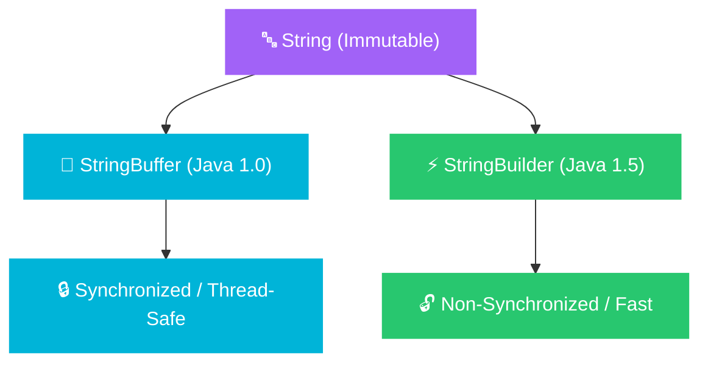

# When To Use StringBuffer And StringBuilder In Java

**When To Use StringBuffer And StringBuilder In Java** | A comparison of the two mutable string classes, their differences, and when to use each one.

- [Mutable vs Immutable](#mutable-vs-immutable)
- [StringBuffer Class](#stringbuffer-class)
- [StringBuilder Class](#stringbuilder-class)
- [When Should we use StringBuffer and StringBuilder](#when-should-we-use-stringbuffer-and-stringbuilder)

---

## 1. Mutable vs Immutable

First, let us understand what is mutable and what is immutable:

- 🔒 **Immutable** — An object whose data cannot be modified, but the results can be stored in a new object
- 🔓 **Mutable** — An object whose data can be modified, and the result can be stored in the same object

---

## 2. StringBuffer Class

As we all know strings are immutable, that is for each and every change made to the string a new object will be created which leads to a lot of memory consumption, and also performance might be reduced. To overcome this, `StringBuffer` has been created which makes the string mutable.

This means the changes that we do to the string data of the `StringBuffer` class will be stored in the same `StringBuffer` object without creating a new object. This in turn saves a lot of data and enhances the performance. Both `String` and `StringBuffer` classes were given in **Java 1.0** version onwards.

**StringBuffer example:**

```java
public class Main {
   public static void main(String[] args) {
      StringBuffer str = new StringBuffer("Java");
      StringBuffer str1 = str.append("Program");
      System.out.println(str1);
   }
}
```

📤 **Output:**

```
Java Program
```

---

## 3. StringBuilder Class

When we have a `StringBuffer` class why do we use a `StringBuilder` class? This is because the `StringBuffer` class is termed as a synchronized or thread-safe object. All methods of the `StringBuffer` class are synchronized. Hence `StringBuffer` gives less performance in a single thread model, and also locking and unlocking objects is not necessary.

To overcome this problem `StringBuilder` class was introduced in **Java 1.5** version. The `StringBuilder` class contains exact similar constructors and methods as the `StringBuffer` class but all of those methods are non-synchronized. Hence the `StringBuilder` class is used as a non-thread-safe mutable string.



---

## 4. When Should we use StringBuffer and StringBuilder

| Feature ⚖️ | StringBuffer 💾 | StringBuilder ⚡ |
|------------|-----------------|------------------|
| **Thread Safety** | ✅ Synchronized | ❌️ Non-synchronized |
| **Performance (single thread)** | ❌️ Slower | ✅ Faster |
| **Performance (multi thread)** | ✅ Better | ❌️ Not safe |
| **Introduced in** | Java 1.0 | Java 1.5 |
| **Use case** | Multi-thread environment | Single-thread application |

- 🔒 The **StringBuffer** object can be used to store and modify the data in a **multi-thread environment**
- ⚡ The **StringBuilder** must be used when storing and modifying the string data in a **single thread model application**

> 📝 **Note:** Both the `StringBuffer` and `StringBuilder` class contain the same constructors and methods. Both of them work in a very similar way. The main difference is `StringBuffer` class methods are synchronized, giving better performance in multithread applications, whereas the `StringBuilder` class methods are non-synchronized, giving better performance in a single thread application.

---

If you enjoyed this post, share it with your friends. Do you want to share more information about the topic discussed above or do you find anything incorrect? Let us know in the comments. Thank you!

**Java Tutorial**

- [Import StringBuffer Class](132_Import_StringBuffer_In_Java.md)
- StringBuffer vs StringBuilder
- String To StringBuilder
- StringBuilder To String
- [String To StringBuffer](136_Java_String_To_StringBuffer.md)
- [StringBuffer To String](136_Java_String_To_StringBuffer.md)

**StringBuilder Methods**
- [toString() Method](139_StringBuilder_toString()_Java.md)
- substring() Method
- [reverse() Method](141_StringBuilder_reverse()_In_Java.md)
- replace() Method
- length() Method
- indexOf() Method
- insert() Method
- append() Method
- capacity() Method
- charAt() Method

**StringBuffer Methods**
- append() Method
- insert() Method
- length() Method
- reverse() Method
