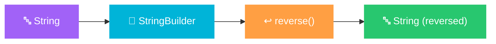

# StringBuilder reverse() In Java

**StringBuilder reverse() In Java** | The `reverse()` method reverses the character sequence of a `StringBuilder` object, and can also be used to reverse a `String` via conversion.

- [Syntax and Parameters](#syntax-and-parameters)
- [Java StringBuilder reverse() Method Example-1](#java-stringbuilder-reverse-method-example-1)
- [StringBuilder Reverse In Java Example-2](#stringbuilder-reverse-in-java-example-2)
- [StringBuilder Reverse In Java Example-3](#stringbuilder-reverse-in-java-example-3)
- [Reverse a String In Java Using StringBuilder Example-1](#reverse-a-string-in-java-using-stringbuilder-example-1)
- [Reverse a String In Java Using StringBuilder Example-2](#reverse-a-string-in-java-using-stringbuilder-example-2)

---

## 1. Syntax and Parameters

The `reverse()` method in the Java `StringBuilder` class helps us to reverse the `StringBuilder` object content. The `String` class does not contain any method to reverse the string object, but with the help of the `StringBuilder` class we can reverse the string object as well.

```java
public StringBuilder reverse()
```

| Detail 🏷️ | Description 📋 |
|-----------|----------------|
| **Parameters** | This method does not take any parameters |
| **Return Type** | `StringBuilder` |
| **Returns** | The reversed `StringBuilder` |

🛠️ **Examples:**

- 🔄 StringBuilder: `"Hi"` → After Reverse: `"iH"`
- 🔄 StringBuilder: `"Phone"` → After Reverse: `"enohP"`

---

## 2. Java StringBuilder reverse() Method Example-1

In the below program we are passing the string to the `StringBuilder` class constructor. We called the `reverse()` method on the given `StringBuilder` object and it returns a new `StringBuilder` object which is assigned to the `sb1` variable.

**Basic reverse example:**

```java
public class Main {
   public static void main(String[] args) {
      StringBuilder sb = new StringBuilder("Good Morning");
      System.out.println("StringBuilder = " + sb);

      StringBuilder sb1 = sb.reverse();
      System.out.println("Reverse = " + sb1.toString());
   }
}
```

📤 **Output:**

```
StringBuilder = Good Morning
Reverse = gninroM dooG
```

---

## 3. StringBuilder Reverse In Java Example-2

**Reversing an uppercase string:**

```java
public class Main {
   public static void main(String[] args) {
      StringBuilder sb = new StringBuilder("REVERSE");
      System.out.println("StringBuilder = " + sb);

      StringBuilder sb1 = sb.reverse();
      System.out.println("Reverse = " + sb1);
   }
}
```

📤 **Output:**

```
StringBuilder = REVERSE
Reverse = ESREVER
```

---

## 4. StringBuilder Reverse In Java Example-3

**Reversing strings and numbers:**

```java
public class Main {
   public static void main(String[] args) {

      StringBuilder strb1 = new StringBuilder("reverse");
      System.out.println("StringBuilder1 = " + strb1);
      System.out.println("Reverse1 = " + strb1.reverse());

      StringBuilder strb2 = new StringBuilder("789632");
      System.out.println("StringBuilder2 = " + strb2);
      System.out.println("Reverse2 = " + strb2.reverse());
   }
}
```

📤 **Output:**

```
StringBuilder1 = reverse
StringBuilder2 = 789632
Reverse1 = esrever
Reverse2 = 236987
```

> ⚠️ **Caution:** The `reverse()` method modifies the original `StringBuilder` object in place. It does not create a new object.

---

## 5. Reverse a String In Java Using StringBuilder Example-1

Let us see how to reverse a string in Java using the `StringBuilder` class. The `String` class in Java does not contain any built-in method to reverse the string object, but we can reverse the string object using the `StringBuilder` class.

We have to convert `String` to `StringBuilder` and then call the `reverse()` method on the `StringBuilder` object which results in the reversed `StringBuilder` object. Later convert `StringBuilder` to a `String` object. Finally, we will have the reversed string values in `String` format.

**Step-by-step String reversal:**

```java
public class Main {
   public static void main(String[] args) {
      String string = "Programming Language";
      System.out.println("String = " + string);

      // create StringBuilder from String
      StringBuilder strb = new StringBuilder(string);
      System.out.println("StringBuilder = " + strb);

      // reverse StringBuilder
      StringBuilder sb1 = strb.reverse();

      // convert StringBuilder to String
      String string1 = sb1.toString();

      System.out.println("Reverse string = " + string1);
   }
}
```

📤 **Output:**

```
String = Programming Language
StringBuilder = Programming Language
Reverse string = egaugnaL gnimmargorP
```



---

## 6. Reverse a String In Java Using StringBuilder Example-2

We can do all the above operations (converting `String` to `StringBuilder`, reversing the `StringBuilder` object, converting `StringBuilder` back to `String`) in a single line.

**One-liner String reversal:**

```java
public class Main {
   public static void main(String[] args) {
      String string = "Hello World";
      System.out.println("String = " + string);

      String reverseString = new StringBuilder(string).reverse().toString();
      System.out.println("Reverse string = " + reverseString);
   }
}
```

📤 **Output:**

```
String = Hello World
Reverse string = dlroW olleH
```

> 💡 **Tip:** The one-liner `new StringBuilder(string).reverse().toString()` is the most concise way to reverse a `String` in Java. It is commonly used in coding interviews and competitive programming.

---

If you enjoyed this post, share it with your friends. Do you want to share more information about the topic discussed above or do you find anything incorrect? Let us know in the comments. Thank you!

**Java Tutorial**

- [Import StringBuffer Class](132_Import_StringBuffer_In_Java.md)
- [StringBuffer vs StringBuilder](133_When_To_Use_StringBuffer_And_StringBuilder_In_Java.md)
- String To StringBuilder
- StringBuilder To String
- [String To StringBuffer](136_Java_String_To_StringBuffer.md)
- [StringBuffer To String](136_Java_String_To_StringBuffer.md)

**StringBuilder Methods**
- [toString() Method](139_StringBuilder_toString()_Java.md)
- substring() Method
- reverse() Method
- replace() Method
- length() Method
- indexOf() Method
- insert() Method
- append() Method
- capacity() Method
- charAt() Method

**StringBuffer Methods**
- append() Method
- insert() Method
- length() Method
- reverse() Method
