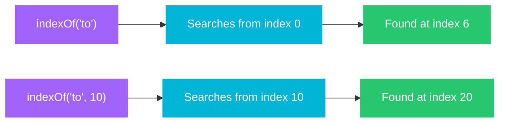

# Java StringBuilder indexOf() Method

**Java StringBuilder indexOf() Method** | Learn how to find the first occurrence of a substring using the `indexOf()` method in the `StringBuilder` class.

- [Method Syntax and Parameters](#method-syntax-and-parameters)
- [StringBuilder indexOf() Java Example-1](#stringbuilder-indexof-java-example-1)
- [Java StringBuilder indexOf() Method Example-2](#java-stringbuilder-indexof-method-example-2)
- [IndexOf() StringBuilder Java Example-3](#indexof-stringbuilder-java-example-3)
- [Java StringBuilder indexOf Example-4](#java-stringbuilder-indexof-example-4)
- [Related Links](#related-links)

---

## 1. Method Syntax and Parameters

The `indexOf()` method is used to return the first occurrence of the passed substring. If the given substring is not present in the string then the `indexOf()` method returns `-1`.

The `indexOf()` method has two variations:

| Variation 🔧 | Signature 📋 |
|--------------|-------------|
| **Basic** | `public int indexOf(String substring)` |
| **With start index** | `public int indexOf(String substring, int start)` |

| Parameter 🏷️ | Description 📖 |
|--------------|---------------|
| **substring** | The sub-string needed to be searched in the string |
| **start** | From which index substring needed to be searched |
| **Return type** | `int` — the index of the substring, or `-1` if not found |

🔍 **Example:**
- String: `"Hello People"`, Substring: `"ll"` — Output: `2`
- String: `"Names"`, Substring: `"ames"` — Output: `1`

---

## 2. StringBuilder indexOf() Java Example-1

Let us see some examples of the `StringBuilder` class `indexOf()` method. We will create a `StringBuilder` object by taking some strings and checking for the index of some substring.

**Java code:**

```java
public class Main {
   public static void main(String[] args) {
      StringBuilder string = new StringBuilder("Know Program");
      System.out.println("StringBuilder = " + string);
      int index = string.indexOf("Pro");
      System.out.println("Index = " + index);
   }
}
```

📤 **Output:**

```
StringBuilder = Know Program
Index = 5
```

---

## 3. Java StringBuilder indexOf() Method Example-2

In the below program we search for the substring which is not present in the given string. In that case Java `StringBuilder` `indexOf()` method returns `-1`.

**Java code:**

```java
public class Main {
   public static void main(String[] args) {
      String string = "Creditors have a better memory than debtors";
      StringBuilder sb = new StringBuilder(string);
      System.out.println("StringBuilder = " + sb);

      int index = sb.indexOf("Hi");
      System.out.println("Index = " + index);
   }
}
```

📤 **Output:**

```
StringBuilder = Creditors have a better memory than debtors
Index = -1
```

> 📝 **Note:** When the substring is not found, `indexOf()` returns `-1` rather than throwing an exception.

---

## 4. IndexOf() StringBuilder Java Example-3

In the below program the substring `"to"` has been repeated twice, as we are now using the other variation of the `indexOf()` method we are retrieving the second occurrence of the substring.

**Java code:**

```java
public class Main {
   public static void main(String[] args) {
      StringBuilder string = new StringBuilder("Early to bed, early to rise");
      System.out.println("StringBuilder = " + string);

      int index = string.indexOf("to");
      System.out.println("Index = " + index);

      int index1 = string.indexOf("to", 10);
      System.out.println("Index = " + index1);
   }
}
```

📤 **Output:**

```
StringBuilder = Early to bed, early to rise
Index = 6
Index = 20
```

💡 **Tip:** The `indexOf("to")` method will search for the substring `"to"` from the beginning of the `StringBuilder` object, whereas `indexOf("to", 10)` will start searching substring `"to"` from the 10th index of the `StringBuilder` object.



---

## 5. Java StringBuilder indexOf Example-4

**Java code:**

```java
public class Main {
   public static void main(String[] args) {
      StringBuilder string = new StringBuilder("Practice makes the man perfect");
      System.out.println("StringBuilder = " + string);
      int ind = string.indexOf("ma", 15);
      System.out.println("Index = " + ind);
   }
}
```

📤 **Output:**

```
StringBuilder = Practice makes the man perfect
Index = 19
```

---

## 6. Related Links

If you enjoyed this post, share it with your friends. Do you want to share more information about the topic discussed above or do you find anything incorrect? Let us know in the comments. Thank you!

**Java Tutorial**

- [Import StringBuffer Class](132_Import_StringBuffer_In_Java.md)
- [StringBuffer vs StringBuilder](133_When_To_Use_StringBuffer_And_StringBuilder_In_Java.md)
- String To StringBuilder
- StringBuilder To String
- [String To StringBuffer](136_Java_String_To_StringBuffer.md)
- [StringBuffer To String](136_Java_String_To_StringBuffer.md)

**StringBuilder Methods**

- [toString() Method](139_StringBuilder_toString()_Java.md)
- substring() Method
- [reverse() Method](141_StringBuilder_reverse()_In_Java.md)
- replace() Method
- length() Method
- indexOf() Method
- insert() Method
- append() Method
- capacity() Method
- charAt() Method

**StringBuffer Methods**

- append() Method
- insert() Method
- length() Method
- reverse() Method
