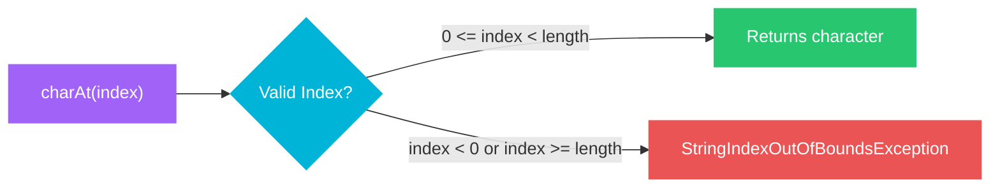

# Java StringBuilder charAt() Method

**Java StringBuilder charAt() Method** | Learn how to retrieve a character at a specific index using the `charAt()` method in the `StringBuilder` class.

- [Method Syntax and Parameters](#method-syntax-and-parameters)
- [Java StringBuilder charAt() Method Example](#java-stringbuilder-charat-method-example)
- [StringBuilder Java charAt() Method Uses](#stringbuilder-java-charat-method-uses)
- [Exception thrown By Java StringBuilder charAt() Method](#exception-thrown-by-java-stringbuilder-charat-method)
- [Related Links](#related-links)

---

## 1. Method Syntax and Parameters

The `charAt()` method is used to **return the character at the specific index** in the string of character sequence. The `charAt()` method is a string manipulation method that is present in the `StringBuilder` class which means it supports single threading and is not synchronized.

The index value passed to the `charAt()` method should be between `0` and `length – 1`. If the value exceeds the `(length – 1)` or is less than `0` then the method throws an `IndexOutOfBoundsException`. This method works very similarly to the `String` class charAt() method.

| Property 📋 | Details 📖 |
|-------------|-----------|
| **Syntax** | `public char charAt(int index)` |
| **Parameter** | The index value for which the character needs to be returned |
| **Return type** | `char` |
| **Returns** | The character at the specified index |
| **Exception** | Throws `IndexOutOfBoundsException` if the index is below `0` or exceeds the string length |

🔍 **Example:**
- String: `"Hello"`, index: `1` — Output: `'e'`
- String: `"Hello"`, index: `-1` — Output: `IndexOutOfBoundsException`

---

## 2. Java StringBuilder charAt() Method Example

Let us see some examples of the `StringBuilder` `charAt()` method. We will take a `StringBuilder` object with some string and then call `charAt()` method.

**Basic charAt() usage:**

```java
public class Main {
   public static void main(String[] args) {
      StringBuilder sb = new StringBuilder();
      sb.append("Java Programming Language");
      System.out.println(sb.charAt(5));
      System.out.println(sb.charAt(10));
   }
}
```

📤 **Output:**

```
P
a
```

---

## 3. StringBuilder Java charAt() Method Uses

This program returns each and every character in the given `StringBuilder`. We will iterate the `StringBuilder` object, fetch each character, and display the character.

**Iterating all characters:**

```java
public class Main {
   public static void main(String[] args) {
      StringBuilder string = new StringBuilder("Java");
      System.out.println("String: " + string);
      for (int i = 0; i < string.length(); i++) {
         System.out.print(string.charAt(i) + " ");
      }
   }
}
```

📤 **Output:**

```
String: Java
J a v a
```

> 💡 **Tip:** You can use `charAt()` in a loop to process each character individually, which is useful for character-level string manipulation.

---

## 4. Exception thrown By Java StringBuilder charAt() Method

The `charAt()` method of the `StringBuilder` class throws StringIndexOutOfBoundsException if the passed parameter is negative or greater than or equal to the length of the string. The below programs demonstrate it:

**Index equal to length:**

```java
public class Main {
   public static void main(String[] args) {
      try {
         StringBuilder sb = new StringBuilder("Java");
         char ch = sb.charAt(sb.length());
         System.out.println("Char at position " + sb.length() + " is " + ch);
      } catch (Exception e) {
         System.out.println("Exception: " + e);
      }
   }
}
```

📤 **Output:**

```
Exception: java.lang.StringIndexOutOfBoundsException: index 4, length 4
```

**Negative index:**

```java
public class Main {
   public static void main(String[] args) {
      try {
         StringBuilder sb = new StringBuilder("Java");
         char ch = sb.charAt(-9);
         System.out.println("Char at position " + sb.length() + " is " + ch);
      } catch (Exception e) {
         System.out.println("Exception: " + e);
      }
   }
}
```

📤 **Output:**

```
Exception: java.lang.StringIndexOutOfBoundsException: index -9, length 4
```

> ⚠️ **Caution:** Valid index range is `0` to `length() - 1`. Passing `length()` itself or any negative value will throw `StringIndexOutOfBoundsException`.



---

## 5. Related Links

If you enjoyed this post, share it with your friends. Do you want to share more information about the topic discussed above or do you find anything incorrect? Let us know in the comments. Thank you!

**Java Tutorial**

- [Import StringBuffer Class](132_Import_StringBuffer_In_Java.md)
- [StringBuffer vs StringBuilder](133_When_To_Use_StringBuffer_And_StringBuilder_In_Java.md)
- String To StringBuilder
- StringBuilder To String
- [String To StringBuffer](136_Java_String_To_StringBuffer.md)
- [StringBuffer To String](136_Java_String_To_StringBuffer.md)

**StringBuilder Methods**

- [toString() Method](139_StringBuilder_toString()_Java.md)
- substring() Method
- [reverse() Method](141_StringBuilder_reverse()_In_Java.md)
- replace() Method
- length() Method
- indexOf() Method
- insert() Method
- append() Method
- capacity() Method
- charAt() Method

**StringBuffer Methods**

- append() Method
- insert() Method
- length() Method
- reverse() Method
