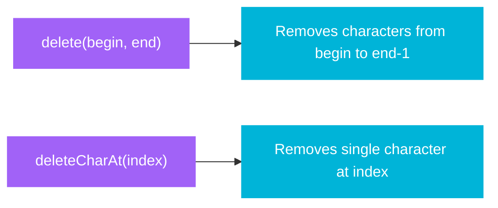

# Java StringBuilder Delete Last Character

**Java StringBuilder Delete Last Character** | Learn how to delete characters and substrings from a `StringBuilder` using the `delete()` and `deleteCharAt()` methods.

- [Method Syntax and Parameters](#method-syntax-and-parameters)
- [StringBuilder delete() Java Example](#stringbuilder-delete-java-example)
- [Java StringBuilder Delete Last Character Example](#java-stringbuilder-delete-last-character-example)
- [Delete A Specific Character StringBuilder Java Example](#delete-a-specific-character-stringbuilder-java-example)
- [Related Links](#related-links)

---

## 1. Method Syntax and Parameters

There are many scenarios where we have to delete some characters or strings that might be due to some issues. To do this, Java provides built-in methods that make it easy for the programmer to delete unwanted characters or strings.

In the `StringBuilder` class, there are two variations of the delete method:

| Method 🔧 | Signature 📋 |
|-----------|-------------|
| **delete** | `public StringBuilder delete(int begin, int end)` |
| **deleteCharAt** | `public StringBuilder deleteCharAt(int index)` |

| Parameter 🏷️ | Description 📖 |
|--------------|---------------|
| **index** | The index where the character needs to be deleted |
| **begin** | Specifies from where to start the delete operation (inclusive) |
| **end** | Specifies where to end the delete operation (exclusive) |
| **Return type** | `StringBuilder` — the `StringBuilder` after deletion |

- 🚨 The `delete(int begin, int end)` throws **StringIndexOutOfBoundsException** if `start` is negative, greater than `length()`, or greater than `end`.
- 🚨 The `deleteCharAt(int index)` throws `StringIndexOutOfBoundsException` if the `index` is negative or greater than or equal to `length()`.



---

## 2. StringBuilder delete() Java Example

The below program deletes the substring `"en"` in the word `"pen"` — the index is from 5 to 8.

**Deleting a range of characters:**

```java
public class Main {
   public static void main(String[] args) {
      StringBuilder string = new StringBuilder("The pen is mightier than the sword");
      System.out.println("StringBuilder = " + string.toString());
      StringBuilder afterRemoval = string.delete(5, 8);
      System.out.println("After removal = " + afterRemoval);
   }
}
```

📤 **Output:**

```
StringBuilder = The pen is mightier than the sword
After removal = The pis mightier than the sword
```

---

## 3. Java StringBuilder Delete Last Character Example

Let us see a Java program to delete the last character of the `StringBuilder` object. The last character index can be found using `string.length() – 1`.

**Deleting the last character:**

```java
public class Main {
   public static void main(String[] args) {
      StringBuilder string = new StringBuilder("The pen is mightier than the sword");
      System.out.println("StringBuilder = " + string.toString());
      StringBuilder afterRemoval = string.deleteCharAt(string.length() - 1);
      System.out.println("After removal = " + afterRemoval);
   }
}
```

📤 **Output:**

```
StringBuilder = The pen is mightier than the sword
After removal = The pen is mightier than the swor
```

> 💡 **Tip:** To delete the last character, use `deleteCharAt(sb.length() - 1)`. This is a common pattern when removing trailing delimiters (e.g., commas, semicolons).

---

## 4. Delete A Specific Character StringBuilder Java Example

We can also delete a specific character from `StringBuilder` in Java at a given index using the `deleteCharAt()` method.

**Deleting character at a specific index:**

```java
public class Main {
   public static void main(String[] args) {
      StringBuilder string = new StringBuilder("The pen is mightier than the sword");
      System.out.println("StringBuilder = " + string.toString());
      StringBuilder afterRemoval = string.deleteCharAt(5);
      System.out.println("After removal = " + afterRemoval);
   }
}
```

📤 **Output:**

```
StringBuilder = The pen is mightier than the sword
After removal = The pn is mightier than the sword
```

---

## 5. Related Links

If you enjoyed this post, share it with your friends. Do you want to share more information about the topic discussed above or do you find anything incorrect? Let us know in the comments. Thank you!

**Java Tutorial**

- [Import StringBuffer Class](132_Import_StringBuffer_In_Java.md)
- [StringBuffer vs StringBuilder](133_When_To_Use_StringBuffer_And_StringBuilder_In_Java.md)
- String To StringBuilder
- StringBuilder To String
- [String To StringBuffer](136_Java_String_To_StringBuffer.md)
- [StringBuffer To String](136_Java_String_To_StringBuffer.md)

**StringBuilder Methods**

- [toString() Method](139_StringBuilder_toString()_Java.md)
- substring() Method
- [reverse() Method](141_StringBuilder_reverse()_In_Java.md)
- replace() Method
- length() Method
- indexOf() Method
- insert() Method
- append() Method
- capacity() Method
- charAt() Method

**StringBuffer Methods**

- append() Method
- insert() Method
- length() Method
- reverse() Method
