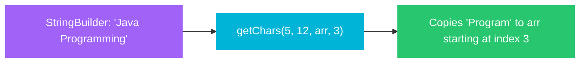

# Java StringBuilder To Char Array

**Java StringBuilder To Char Array** | Learn how to convert a `StringBuilder` object to a character array using `getChars()` and `String.getChars()` methods.

- [Method Syntax and Parameters](#method-syntax-and-parameters)
- [Convert StringBuilder To Char Array Java](#convert-stringbuilder-to-char-array-java)
- [Java StringBuilder To Char Array using String.getChars()](#java-stringbuilder-to-char-array-using-stringgetchars)
- [Related Links](#related-links)

---

## 1. Method Syntax and Parameters

As we are trying to convert an object to a different data type we cannot do it directly.

🔍 **Example:**
- StringBuilder: `"Hello"` — Char array: `{'H', 'e', 'l', 'l', 'o'}`

The `StringBuilder` class contains the `getChars()` method to convert `StringBuilder` to a char array.

| Property 📋 | Details 📖 |
|-------------|-----------|
| **Syntax** | `public void getChars(int start, int end, char[] destination, int deststart)` |
| **Return type** | `void` |
| **Exception** | Throws `StringIndexOutOfBoundsException` if index is greater than the string length or less than `0` |

| Parameter 🏷️ | Description 📖 |
|--------------|---------------|
| **start** | The index from where we need to start copying |
| **end** | The index where we need to end the copy |
| **destination** | The character array where we need to put all the copied elements |
| **deststart** | The index from where we need to paste the copied string |

---

## 2. Convert StringBuilder To Char Array Java

Let us see a program to convert `StringBuilder` to a char array in Java. While creating the array, we have to create an array greater or equal to the length of the `StringBuilder` or we should pass the `start` and `end` values so that they don't give `IndexOutOfBoundsException`.

**Full conversion example:**

```java
import java.util.Arrays;

public class Main {
   public static void main(String[] args) {
      StringBuilder sb = new StringBuilder("Know Program");
      System.out.println("StringBuilder = " + sb);
      char[] arr = new char[sb.length()];
      sb.getChars(0, sb.length(), arr, 0);
      System.out.print("Char array: " + Arrays.toString(arr));
   }
}
```

📤 **Output:**

```
StringBuilder = Know Program
Char array: [K, n, o, w, , P, r, o, g, r, a, m]
```

In the below program, the array doesn't have sufficient spaces to store the character elements therefore it throws `IndexOutOfBoundsException`.

**Insufficient array size (exception):**

```java
import java.util.Arrays;

public class Main {
   public static void main(String[] args) {
      StringBuilder sb = new StringBuilder("Know Program");
      System.out.println("StringBuilder = " + sb);
      char[] arr = new char[2];
      sb.getChars(0, sb.length(), arr, 0);
      System.out.print("Char array: " + Arrays.toString(arr));
   }
}
```

📤 **Output:**

```
StringBuilder = Know Program
Exception in thread "main" java.lang.IndexOutOfBoundsException: start 0, end 12, length 2
```

> ⚠️ **Caution:** Always ensure the destination array is large enough to hold the copied characters, otherwise an `IndexOutOfBoundsException` will be thrown.

If we want to store only some portion of the `StringBuilder` to a char array then we can pass the `start` and `end` values based on our requirement. The below program demonstrates it:

**Partial conversion example:**

```java
import java.util.Arrays;

public class Main {
   public static void main(String[] args) {
      StringBuilder string = new StringBuilder("Java Programming");
      System.out.println("String = " + string.toString());
      char[] arr = new char[15];

      Arrays.fill(arr, '_');
      string.getChars(5, 12, arr, 3);
      System.out.print("Char array: " + Arrays.toString(arr));
   }
}
```

📤 **Output:**

```
String = Java Programming
Char array: [_, _, _, P, r, o, g, r, a, m, _, _, _, _, _]
```



---

## 3. Java StringBuilder To Char Array using String.getChars()

We also have another way to convert `StringBuilder` to a char array in Java. The `String` class also contains `getChars()` method which can be used to convert string to char array. Hence here we need to follow two steps:

1. First convert the `StringBuilder` class to `String`.
2. Then use the `getChars()` method of the `String` class to convert the string to the char array. The syntax is: **`public void getChars(int srcBegin, int srcEnd, char dst[], int dstBegin)`**

**Two-step conversion:**

```java
import java.util.Arrays;

public class Main {
   public static void main(String[] args) {
      StringBuilder sb = new StringBuilder("Java Programming");
      String string = new String(sb);
      System.out.println("String = " + string);
      char[] arr = new char[string.length()];

      string.getChars(0, string.length(), arr, 0);
      System.out.print("Char array: " + Arrays.toString(arr));
   }
}
```

📤 **Output:**

```
String = Java Programming
Char array: [J, a, v, a, , P, r, o, g, r, a, m, m, i, n, g]
```

> 💡 **Tip:** Using `StringBuilder.getChars()` directly is more efficient than converting to `String` first, as it avoids creating an intermediate `String` object.

---

## 4. Related Links

If you enjoyed this post, share it with your friends. Do you want to share more information about the topic discussed above or do you find anything incorrect? Let us know in the comments. Thank you!

**Java Tutorial**

- [Import StringBuffer Class](132_Import_StringBuffer_In_Java.md)
- [StringBuffer vs StringBuilder](133_When_To_Use_StringBuffer_And_StringBuilder_In_Java.md)
- String To StringBuilder
- StringBuilder To String
- [String To StringBuffer](136_Java_String_To_StringBuffer.md)
- [StringBuffer To String](136_Java_String_To_StringBuffer.md)

**StringBuilder Methods**

- [toString() Method](139_StringBuilder_toString()_Java.md)
- substring() Method
- [reverse() Method](141_StringBuilder_reverse()_In_Java.md)
- replace() Method
- length() Method
- indexOf() Method
- insert() Method
- append() Method
- capacity() Method
- charAt() Method

**StringBuffer Methods**

- append() Method
- insert() Method
- length() Method
- reverse() Method
