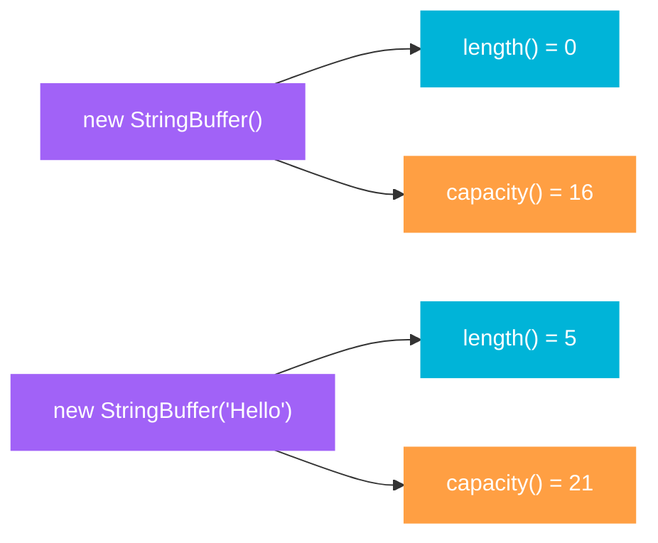

# Java StringBuffer length() Method

**Java StringBuffer length() Method** | Learn how to get the number of characters in a `StringBuffer` object using the `length()` method.

- [StringBuffer length() Method in Java](#stringbuffer-length-method-in-java)
- [How To Use StringBuffer Length In Java](#how-to-use-stringbuffer-length-in-java)
- [StringBuffer Length() Method In Java Example](#stringbuffer-length-method-in-java-example)
- [What is the Default Length of A Java StringBuffer](#what-is-the-default-length-of-a-java-stringbuffer)
- [Related Links](#related-links)

---

## 1. StringBuffer length() Method in Java

The `length()` method of the `StringBuffer` class returns the number of characters in the `StringBuffer` object. We can directly obtain the length of the string without the `StringBuffer` class but it might create a new object hence it consumes more space and performance decreases.

🔍 **Example:**
- StringBuffer: `"People"` — Length: `6`
- StringBuffer: `""` — Length: `0`

| Property 📋 | Details 📖 |
|-------------|-----------|
| **Syntax** | `public int length()` |
| **Parameters** | None |
| **Return type** | `int` |
| **Returns** | The length of the `StringBuffer` object containing a string or sequence of characters |

---

## 2. How To Use StringBuffer Length In Java

In the below program we have used three strings of different lengths. First, we have used the string of medium characters and returned the length using the `length()` method. Then we have used the empty string and returned the length. Later, we have used a string which is quite lengthy with 58 characters.

**Multiple strings with different lengths:**

```java
public class Main {
    public static void main(String[] args) {
        StringBuffer sb1 = new StringBuffer("Garden");
        System.out.println("StringBuffer = " + sb1);
        System.out.println(sb1.length());

        StringBuffer sb2 = new StringBuffer("");
        System.out.println("StringBuffer = " + sb2);
        System.out.println(sb2.length());

        String str = "Business is a money game with few rules and a lot of risk.";
        StringBuffer sb3 = new StringBuffer(str);
        System.out.println("StringBuffer = " + sb3);
        System.out.println(sb3.length());
    }
}
```

📤 **Output:**

```
StringBuffer = Garden
6
StringBuffer =
0
StringBuffer = Business is a money game with few rules and a lot of risk.
58
```

---

## 3. StringBuffer Length() Method In Java Example

In this program, we are taking the user input and printing the length of the same. If you observe the program, you will come to know that we have used the same `StringBuffer` object for two strings hence the output (the length) will be the total of two strings.

**User input and cumulative length:**

```java
import java.util.Scanner;

public class Main {
    public static void main(String[] args) {

        StringBuffer string = new StringBuffer("");
        System.out.print("Enter some string: ");
        Scanner scan = new Scanner(System.in);
        string.append(scan.nextLine());
        System.out.println("The string is: " + string);
        System.out.println("Length of your string: " + string.length());

        System.out.print("\nPlease enter some string again: ");
        string.append(scan.nextLine());
        System.out.println("The string is: " + string);
        System.out.println("Length of your string:" + string.length());
        scan.close();
    }
}
```

📤 **Output:**

```
Enter some string: Hello
The string is: Hello
Length of your string: 6

Please enter some string again: How are you?
The string is: Hello How are you?
Length of your string:18
```

> 📝 **Note:** Since the same `StringBuffer` object is used for both inputs, the second `append()` adds to the existing content, making the total length the sum of both strings.

---

## 4. What is the Default Length of A Java StringBuffer

Initially, the `StringBuffer` object doesn't contain any character therefore the default length of the `StringBuffer` object is `0`.

**Default length example:**

```java
public class Main {
    public static void main(String[] args) {
        StringBuffer string = new StringBuffer();
        System.out.println("Length of your string: " + string.length());
    }
}
```

📤 **Output:**

```
Length of your string: 0
```

> 💡 **Tip:** Don't confuse `length()` with `capacity()`. The `length()` returns the actual number of characters stored, while `capacity()` returns the total allocated space (default 16 for an empty `StringBuffer`).



---

## 5. Related Links

If you enjoyed this post, share it with your friends. Do you want to share more information about the topic discussed above or do you find anything incorrect? Let us know in the comments. Thank you!

**Java Tutorial**

- [Import StringBuffer Class](132_Import_StringBuffer_In_Java.md)
- [StringBuffer vs StringBuilder](133_When_To_Use_StringBuffer_And_StringBuilder_In_Java.md)
- String To StringBuilder
- StringBuilder To String
- [String To StringBuffer](136_Java_String_To_StringBuffer.md)
- [StringBuffer To String](136_Java_String_To_StringBuffer.md)

**StringBuilder Methods**

- [toString() Method](139_StringBuilder_toString()_Java.md)
- substring() Method
- [reverse() Method](141_StringBuilder_reverse()_In_Java.md)
- replace() Method
- length() Method
- indexOf() Method
- insert() Method
- append() Method
- capacity() Method
- charAt() Method

**StringBuffer Methods**

- append() Method
- insert() Method
- length() Method
- reverse() Method
