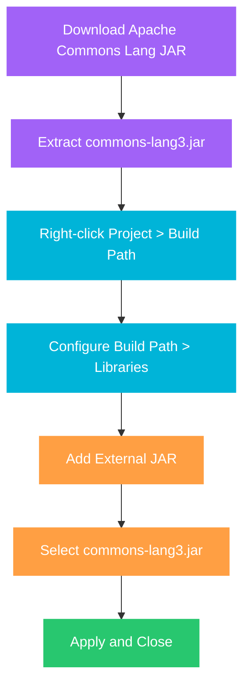

# Import StringUtils in Java

**Import StringUtils in Java** | Learn how to import and use the `StringUtils` class from the Apache Commons Lang package in your Java projects.

- [Import StringUtils in Java Maven Project](#import-stringutils-in-java-maven-project)
- [Import StringUtils in Java Eclipse](#import-stringutils-in-java-eclipse)
- [Java StringUtils Import Example](#java-stringutils-import-example)

---

## 1. Import StringUtils in Java Maven Project

The `StringUtils` class is part of the Apache Commons Lang package but not part of the Java language package. Therefore to import and use `StringUtils` class in our Java class first we need to add the jar file of the Apache Commons Lang package.

If you are working with a Maven project then you can simply add the dependency for it in the `pom.xml` file or if you are working with a simple normal Java project then you can download the jar file and add it into the project classpath.

If you are working with the Maven project then to use `StringUtils` class we can use Maven Dependency. Maven Dependency is just an archive like a JAR or ZIP file which is needed for the project to run, compile, build or test. These dependencies are usually stored in the `pom.xml` file.

📦 **Add the following entry** for Apache Commons Lang dependency in between `<dependencies>` and `</dependencies>`:

**Maven dependency (`pom.xml`):**

```xml
<dependency>
    <groupId>org.apache.commons</groupId>
    <artifactId>commons-lang3</artifactId>
    <version>3.12.0</version>
</dependency>
```

You can also get the latest dependency information from [here](https://commons.apache.org/proper/commons-lang/dependency-info.html). After adding the dependency update the Maven project so that it can download the jar file and source code of the added dependency.

> 💡 **Tip:** After adding the dependency, right-click the project and select **Maven > Update Project** to download the jar automatically.

---

## 2. Import StringUtils in Java Eclipse

If you are developing a simple Java project then you have to [download the Apache Commons Lang jar file](https://commons.apache.org/proper/commons-lang/download_lang.cgi) and add it to the project classpath. Download the Binaries file, and extract `commons-lang3-<version>.jar` from the zip or tar file.

1️⃣ **Select project** => Right click => Build Path => Configure build path
2️⃣ **Libraries** => Classpath => Add external jar
3️⃣ **Select path** of `commons-lang3-3.12.0.jar` file => Apply => Apply and Close



---

## 3. Java StringUtils Import Example

After adding all the required dependencies we need to import `StringUtils` to the program. Test the below code:

**StringUtils usage example:**

```java
import org.apache.commons.lang3.StringUtils;

public class Test {
    public static void main(String[] args) {

        String value = StringUtils.abbreviate("Happy morning", 4);
        System.out.println(value);

        value = StringUtils.capitalize("Happy morning");
        System.out.println(value);

        value = StringUtils.chop("Happy morning");
        System.out.println(value);

        int a = StringUtils.compare(value, value);
        System.out.println(a);

        boolean b = StringUtils.contains("Happy morning", "ft");
        System.out.println(b);

        int c = StringUtils.indexOf(value, 'f');
        System.out.println(c);

        int d = StringUtils.lastIndexOf("Happy morning", 't');
        System.out.println(d);

        value = StringUtils.lowerCase("HAPPY MORNING");
        System.out.println(value);

        value = StringUtils.repeat("Happy morning", 2);
        System.out.println(value);

        value = StringUtils.reverse("Happy morning");
        System.out.println(value);

        value = StringUtils.truncate("Happy morning", 2);
        System.out.println(value);

        value = StringUtils.upperCase("Happy morning");
        System.out.println(value);
    }
}
```

📤 **Output:**

```
H…
Happy morning
Happy mornin
0
false
-1
-1
happy morning
Happy morningHappy morning
gninrom yppaH
Ha
HAPPY MORNING
```

| Method 🔧 | Purpose 📋 | Example Result ✨ |
|-----------|-----------|------------------|
| **`abbreviate()`** | Abbreviates a string with ellipsis | `"H..."` |
| **`capitalize()`** | Capitalizes the first letter | `"Happy morning"` |
| **`chop()`** | Removes the last character | `"Happy mornin"` |
| **`compare()`** | Compares two strings | `0` (equal) |
| **`contains()`** | Checks if string contains substring | `false` |
| **`indexOf()`** | Finds index of a character | `-1` (not found) |
| **`lowerCase()`** | Converts to lowercase | `"happy morning"` |
| **`reverse()`** | Reverses the string | `"gninrom yppaH"` |
| **`upperCase()`** | Converts to uppercase | `"HAPPY MORNING"` |

> 📝 **Note:** If the Apache Commons Lang package was added successfully then `StringUtils` can be imported and used in the class, otherwise you will get a compilation error.
