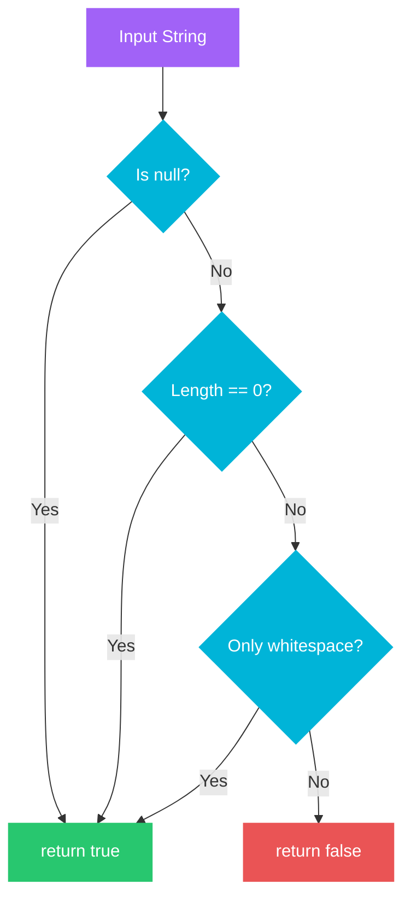

# StringUtils isBlank() Method

**StringUtils isBlank() Method** | Learn how to use the `isBlank()` method from the Apache Commons Lang `StringUtils` class to check if a string is blank, empty, or contains only whitespace.

- [Java StringUtils isBlank() Method](#java-stringutils-isblank-method)
- [StringUtils isBlank() Method Example-1](#stringutils-isblank-method-example-1)
- [StringUtils.isBlank() Method Example-2](#stringutilsisblank-method-example-2)
- [Java StringUtils isBlank() Method Example-3](#java-stringutils-isblank-method-example-3)

---

## 1. Java StringUtils isBlank() Method

The `isBlank()` method is used to check whether the given string is blank or not. The given string is blank when:

- 📏 It has zero characters (empty string)
- 🔗 The string points to `null`
- 📄 The string contains only whitespace characters

| Property 📋 | Details 📖 |
|-------------|-----------|
| **Syntax** | `public static boolean isBlank(final CharSequence cs)` |
| **Purpose** | Checks if a `CharSequence` is empty (`""`), `null`, or whitespace only |
| **Parameters** | The string to check whether it is blank or not |
| **Return type** | `boolean` |
| **Returns** | `true` if the string is blank, `false` otherwise |

| Method Call 🔧 | Result ✨ |
|----------------|----------|
| `StringUtils.isBlank(null)` | `true` |
| `StringUtils.isBlank("")` | `true` |
| `StringUtils.isBlank(" ")` | `true` |
| `StringUtils.isBlank("KP")` | `false` |
| `StringUtils.isBlank(" KP ")` | `false` |

> 🔑 **Key Point:** The main difference between `isEmpty()` and `isBlank()` is that `isBlank()` also returns `true` for whitespace-only strings, while `isEmpty()` returns `false` for them.



---

## 2. StringUtils isBlank() Method Example-1

Let us see demonstrations of the `StringUtils.isBlank()` method of the Apache Commons Lang package.

**Non-empty vs empty string:**

```java
import org.apache.commons.lang3.StringUtils;

public class Main {
    public static void main(String[] args) {
        String string = "KnowProgram";
        System.out.println(StringUtils.isBlank(string));

        String string1 = "";
        System.out.println(StringUtils.isBlank(string1));
    }
}
```

📤 **Output:**

```
false
true
```

- 🔤 The string `"KnowProgram"` has a length greater than `0` therefore `isBlank()` method returns `false`.
- 📏 The variable `string1` holds an empty string literal therefore `StringUtils.isBlank(string1)` returns `true`.

---

## 3. StringUtils.isBlank() Method Example-2

**Null and whitespace-only strings:**

```java
import org.apache.commons.lang3.StringUtils;

public class Main {
    public static void main(String[] args) {
        String string = null;
        System.out.println(StringUtils.isBlank(string));

        String string1 = "   ";
        System.out.println(StringUtils.isBlank(string1));
    }
}
```

📤 **Output:**

```
true
true
```

- 🔗 When the string is pointing to `null`, the `isBlank()` method of `StringUtils` class always returns `true`.
- 📄 When the string contains only whitespace then also it returns `true`. The `StringUtils.isBlank()` method ignores all the whitespaces and hence a string with only whitespace becomes empty and it returns `true`.

> 💡 **Tip:** Use `isBlank()` instead of `isEmpty()` when you want to treat whitespace-only strings as blank/empty. This is especially useful for form validation.

---

## 4. Java StringUtils isBlank() Method Example-3

**Strings with surrounding whitespace:**

```java
import org.apache.commons.lang3.StringUtils;

public class Main {
    public static void main(String[] args) {
        String string = "KP";
        System.out.println(StringUtils.isBlank(string));

        String string1 = "  KP  ";
        System.out.println(StringUtils.isBlank(string1));
    }
}
```

📤 **Output:**

```
false
false
```

- 🔤 The string literal `"KP"` has a length greater than `0` excluding the whitespaces therefore `StringUtils.isBlank()` method returns `false`.
- 📏 Similarly for the variable `string1` where after excluding the whitespaces, the length of the string is greater than `0` and hence `StringUtils.isBlank()` method returns `false`.

| Input 🔧 | isEmpty() ✨ | isBlank() ✨ | Difference 📖 |
|----------|-------------|-------------|--------------|
| `null` | `true` | `true` | Both handle `null` |
| `""` | `true` | `true` | Both detect empty |
| `"   "` | ❌️ `false` | ✅ `true` | `isBlank()` trims whitespace |
| `"KP"` | `false` | `false` | Both detect non-empty |
| `" KP "` | `false` | `false` | Both detect content |
