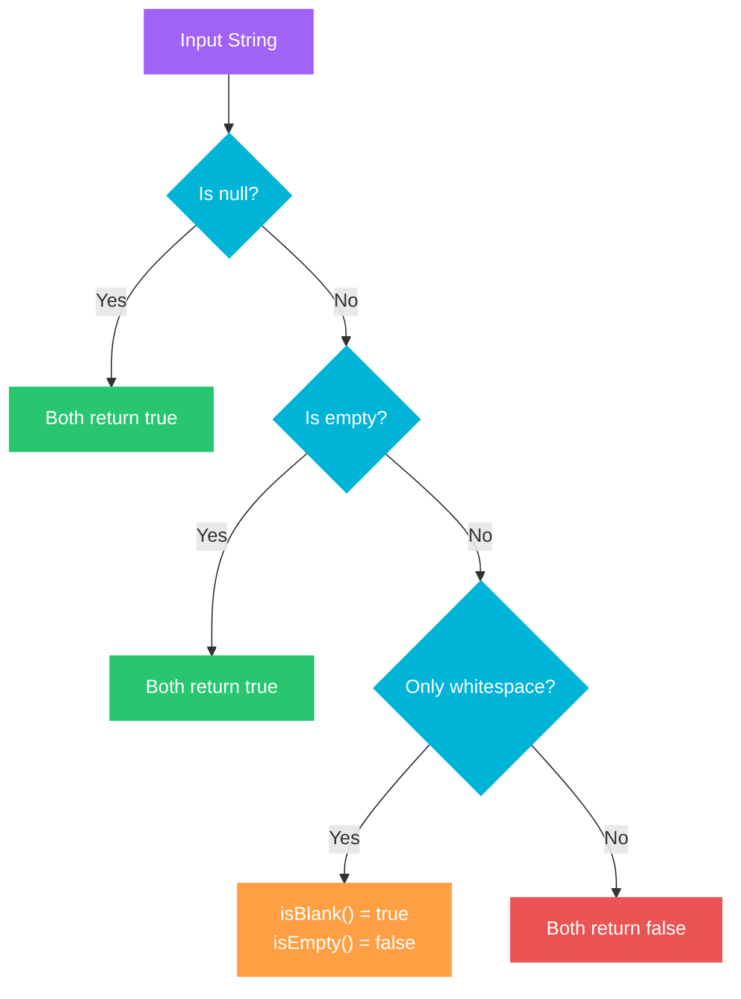

# StringUtils isEmpty() Vs isBlank()

**StringUtils isEmpty() Vs isBlank()** | Both `isEmpty()` and `isBlank()` are present in the `StringUtils` class. These methods are used to find whether the string is empty or not. Even though they perform the same task, there are some differences between them. In this tutorial, we will discuss the differences between `StringUtils` `isEmpty()` vs `isBlank()` method.

- [StringUtils isBlank() vs isEmpty() Method Signature](#stringutils-isblank-vs-isempty-method-signature)
- [StringUtils isEmpty() Vs isBlank() Examples](#stringutils-isempty-vs-isblank-examples)

---

## 1. StringUtils isBlank() vs isEmpty() Method Signature

🔑 **Key Difference:** The `isBlank()` method returns `true` if the string contains only whitespaces but the `isEmpty()` method returns `false`.

**Method signatures:**

```java
public static boolean isEmpty(final CharSequence cs)
public static boolean isBlank(final CharSequence cs)
```

**Method call examples for `isBlank()`:**

| Method Call 🔍 | Result 📤 |
|----------------|-----------|
| `StringUtils.isBlank("")` | ✅ `true` |
| `StringUtils.isBlank(" ")` | ✅ **`true`** |
| `StringUtils.isBlank(null)` | ✅ `true` |
| `StringUtils.isBlank("people")` | ❌️ `false` |
| `StringUtils.isBlank(" string ")` | ❌️ `false` |

**Method call examples for `isEmpty()`:**

| Method Call 🔍 | Result 📤 |
|----------------|-----------|
| `StringUtils.isEmpty("")` | ✅ `true` |
| `StringUtils.isEmpty(" ")` | ❌️ **`false`** |
| `StringUtils.isEmpty(null)` | ✅ `true` |
| `StringUtils.isEmpty("people")` | ❌️ `false` |
| `StringUtils.isEmpty(" string ")` | ❌️ `false` |

> 📝 **Note:** The critical difference is highlighted above — `isBlank(" ")` returns `true` while `isEmpty(" ")` returns `false`.



---

## 2. StringUtils isEmpty() Vs isBlank() Examples

**Example 1 — Whitespace with special characters:**

```java
import org.apache.commons.lang3.StringUtils;

public class Main {

    public static void main(String[] args) {
        String string = "    \n\t";
        System.out.println("String: " + string);
        System.out.println("String length: " + string.length());

        System.out.println(StringUtils.isEmpty(string));
        System.out.println(StringUtils.isBlank(string));
    }
}
```

📤 **Output:**

```
String:

String length: 6
false
true
```

The string literal contains some spaces, new line (`\n`) and new tab (`\t`) characters. It has a length greater than 0 therefore the `StringUtils.isEmpty()` method returns `false`. Since string contains only whitespaces, and after removing whitespaces string length becomes 0 therefore the `StringUtils.isBlank()` method returns `true`.

**Example 2 — Spaces only:**

```java
import org.apache.commons.lang3.StringUtils;

public class Main {

    public static void main(String[] args) {
        String string = "           ";
        System.out.println("String: " + string);
        System.out.println("String length: " + string.length());

        System.out.println(StringUtils.isEmpty(string));
        System.out.println(StringUtils.isBlank(string));
    }
}
```

📤 **Output:**

```
String:
String length: 11
false
true
```

Similar to the previous example, here also string contains only whitespaces therefore the `StringUtils.isEmpty()` returns `false` whereas the `StringUtils.isBlank()` returns `true`.

**Example 3 — Non-empty string:**

```java
import org.apache.commons.lang3.StringUtils;

public class Main {

    public static void main(String[] args) {
        String string = "Know Program";
        System.out.println("String: " + string);
        System.out.println("String length: " + string.length());

        System.out.println(StringUtils.isEmpty(string));
        System.out.println(StringUtils.isBlank(string));
    }
}
```

📤 **Output:**

```
String: Know Program
String length: 12
false
false
```

In the above program, the string literal contains many characters and has a length greater than 0 therefore both `StringUtils.isEmpty()` and `StringUtils.isBlank()` method returns `false`.

**Example 4 — String with spaces and characters:**

```java
import org.apache.commons.lang3.StringUtils;

public class Main {

    public static void main(String[] args) {
        String string = "      Hi    ";
        System.out.println("String length: " + string.length());

        System.out.println(StringUtils.isEmpty(string));
        System.out.println(StringUtils.isBlank(string));
    }
}
```

📤 **Output:**

```
String length: 12
false
false
```

In the above program, string literal contains space and characters. After excluding the whitespaces, the length of string literal is greater than 0 therefore both `StringUtils.isEmpty()` and `StringUtils.isBlank()` method returns `false`.

> 💡 **Tip:** Use `isBlank()` when you want to treat whitespace-only strings as empty. Use `isEmpty()` when whitespace-only strings should be considered non-empty.
