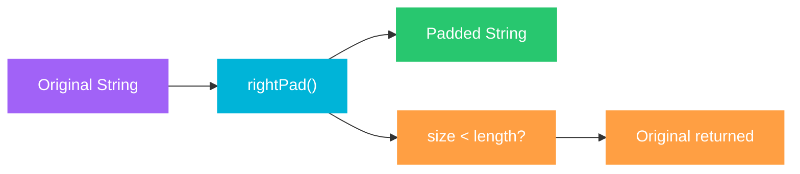

# StringUtils.rightPad() Method

**StringUtils.rightPad() Method** | The `rightPad()` method is a static method in the `StringUtils` class that helps to add pad spaces/character/string to the right side of the string. There are three variations in this method to right pad a string with space, character, and string.

- [StringUtils rightPad() Method](#stringutils-rightpad-method)
- [StringUtils.rightPad() Method Example](#stringutilsrightpad-method-example)
- [Java rightPad() StringUtils Example](#java-rightpad-stringutils-example)
- [Java StringUtils rightPad() Example](#java-stringutils-rightpad-example)

---

## 1. StringUtils rightPad() Method

The syntax for the `rightPad()` method and its variations are as follows:

1. 🔤 `public static String rightPad(final String str, final int size)` — Right pad a `String` with spaces (`' '`). The String is padded to the size.
2. 🔠 `public static String rightPad(final String str, final int size, final char padChar)` — Right pad a `String` with a specified character. The String is padded to the size.
3. 🔡 `public static String rightPad(final String str, final int size, String padStr)` — Right pad a `String` with a specified String. The String is padded to the size.

- 📥 **Parameters:**
  - `str` — the string needed to add spaces/character/string
  - `size` — an integer value, which should say the final length of the string after padding
  - `padChar` — the character which needs to be padded
  - `padStr` — the string which needs to be padded
- 📤 **Return type:** `String`
- ✅ **Returns:** the padded string



---

## 2. StringUtils.rightPad() Method Example

Let us see an example for padding whitespaces to the string using `rightPad(String str, int size)`.

**Padding with spaces:**

```java
import org.apache.commons.lang3.StringUtils;

public class Main {
    public static void main(String[] args) {
        String string = "Calendar";
        System.out.println("String: \"" + string + "\"");
        System.out.println("Length of the string before padding: " + string.length());

        int num = 20;
        String string1 = StringUtils.rightPad(string, num);
        System.out.println("New String: \"" + string1 + "\"");
        System.out.println("Length of the string after padding: " + string1.length());
    }
}
```

📤 **Output:**

```
String: "Calendar"
Length of the string before padding: 8
New String: "Calendar            "
Length of the string after padding: 20
```

In the above example initially, the string contains `"Calendar"` but after calling `rightPad(string, 20)`, twelve spaces are added to the right side of the string and hence its length becomes 20.

> 📝 **Note:** What happens if the given size value is lesser than the length of the string? In that case, the string will not be padded and the original string itself will be returned.

**Size less than string length:**

```java
import org.apache.commons.lang3.StringUtils;

public class Main {
    public static void main(String[] args) {
        String string = "Calendar";
        System.out.println("String: \"" + string + "\"");
        System.out.println("Length: " + string.length() );

        // 3 < string.length()
        String string1 = StringUtils.rightPad(string, 3);
        System.out.println("New String: \"" + string1 + "\"");
        System.out.println("Length: " + string1.length());
    }
}
```

📤 **Output:**

```
String: "Calendar"
Length: 8
New String: "Calendar"
Length: 8
```

---

## 3. Java rightPad() StringUtils Example

This is the example for the second variation: `rightPad(String str, int size, char padChar)`. Here instead of space it will pad the string with a given character.

**Padding with a character:**

```java
import org.apache.commons.lang3.StringUtils;

public class Main {
    public static void main(String[] args) {
        String string = "Calendar";
        System.out.println("String: \"" + string + "\"");
        System.out.println("Length of the string before padding: " + string.length());

        int num = 20;
        String string1 = StringUtils.rightPad(string, num, 'A');
        System.out.println("New String: \"" + string1 + "\"");
        System.out.println("Length of the string after padding: " + string1.length());
    }
}
```

📤 **Output:**

```
String: "Calendar"
Length of the string before padding: 8
New String: "CalendarAAAAAAAAAAAA"
Length of the string after padding: 20
```

---

## 4. Java StringUtils rightPad() Example

This is an example of the third variation: `rightPad(String str, int size, String padStr)`. Here a substring will be padded to the given string.

**Padding with a string:**

```java
import org.apache.commons.lang3.StringUtils;

public class Main {
    public static void main(String[] args) {
        String string = "Calendar";
        System.out.println("String: \"" + string + "\"");
        System.out.println("Length of the string before padding: " + string.length());

        String string1 = StringUtils.rightPad(string, 18, "Cal");
        System.out.println("New String: \"" + string1 + "\"");
        System.out.println("Length of the string after padding: " + string1.length());
    }
}
```

📤 **Output:**

```
String: "Calendar"
Length of the string before padding: 8
New String: "CalendarCalCalCalC"
Length of the string after padding: 18
```

> 💡 **Tip:** When the pad string is longer than the remaining space, it gets truncated to fit the specified size exactly.
