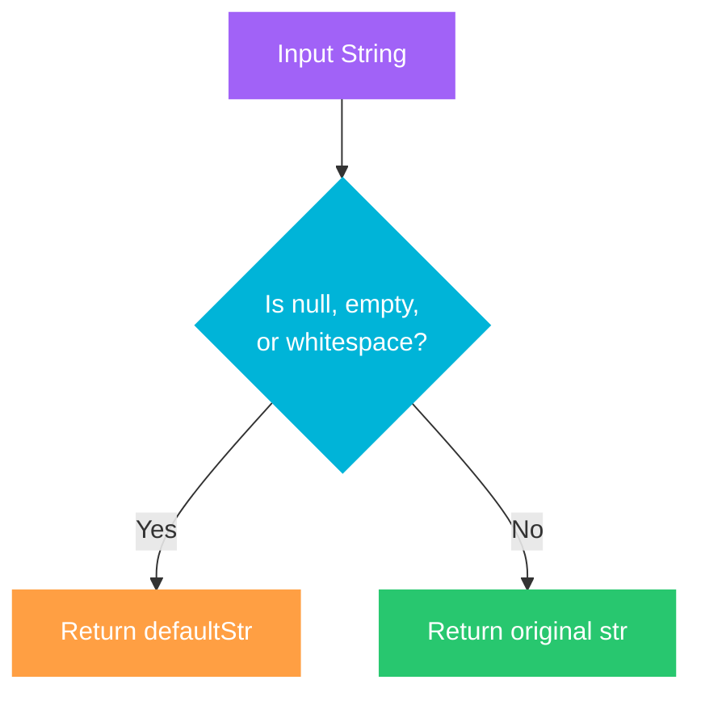

# StringUtils defaultIfBlank() Method

**StringUtils defaultIfBlank() Method** | The `defaultIfBlank()` method of the `StringUtils` class returns a given default string if the passed string is `null`, empty, or whitespace-only. Otherwise, it returns the original string. This is one of the best ways to replace a null or blank string with a fallback value.

- [StringUtils.defaultIfBlank() Method in Java](#stringutilsdefaultifblank-method-in-java)
- [Java StringUtils defaultIfBlank() Method Example](#java-stringutils-defaultifblank-method-example)

---

## 1. StringUtils.defaultIfBlank() Method in Java

**Method signature:**

```java
public static <T extends CharSequence> T defaultIfBlank(final T str, final T defaultStr)
```

It returns either the passed in `CharSequence`, or if the `CharSequence` is whitespace, empty (`""`) or `null`, the value of `defaultStr`.

- 📥 **Parameters:**
  - `str` — the string which will be checked whether it is blank or not
  - `defaultStr` — the string which will be returned if the other string is blank
- 📤 **Return type:** `String`
- ✅ **Returns:** the original string if it is not blank, otherwise the default value



---

## 2. Java StringUtils defaultIfBlank() Method Example

**Example 1 — Empty and whitespace strings:**

```java
import org.apache.commons.lang3.StringUtils;

public class Main {
    public static void main(String[] args) {
        String string = "";
        System.out.println(StringUtils.defaultIfBlank(string, "String1"));
        string = "    ";
        System.out.println(StringUtils.defaultIfBlank(string, "String2"));
    }
}
```

📤 **Output:**

```
String1
String2
```

The first string literal is an empty string and the latter contains only whitespaces. Since they contain only whitespaces or the empty string therefore the `StringUtils.defaultIfBlank()` method returns the second argument passed within it.

**Example 2 — Non-blank string:**

```java
import org.apache.commons.lang3.StringUtils;

public class Main {
    public static void main(String[] args) {
        String string = "Human";
        System.out.println(StringUtils.defaultIfBlank(string, "String1"));
    }
}
```

📤 **Output:**

```
Human
```

In this case, the string contains a valid length of string excluding the whitespaces. Therefore `StringUtils.defaultIfBlank()` method returns the string itself.

**Example 3 — Null reference vs "null" literal:**

```java
import org.apache.commons.lang3.StringUtils;

public class Main {
    public static void main(String[] args) {
        String string = null;
        System.out.println(StringUtils.defaultIfBlank(string, "String1"));
        string = "null";
        System.out.println(StringUtils.defaultIfBlank(string, "String2"));
    }
}
```

📤 **Output:**

```
String1
null
```

Initially, the string contains a `null` reference, therefore, `StringUtils.defaultIfBlank()` method returns the second argument. Later we assigned `"null"` literal to the string which has a valid length without whitespaces therefore `StringUtils.defaultIfBlank()` method returns the string itself.

> 💡 **Tip:** Use `defaultIfBlank()` instead of `defaultIfEmpty()` when you want whitespace-only strings to also be treated as blank and replaced with the default value.
