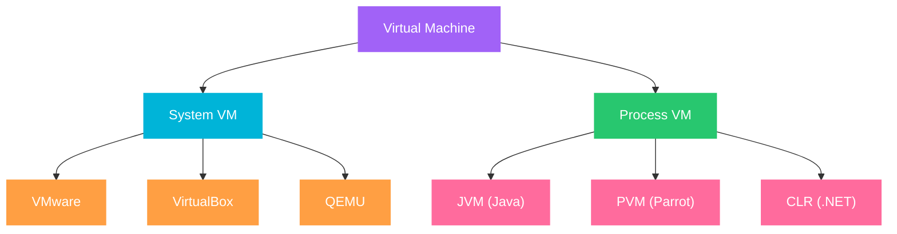

# Virtual Machine and Types – System & Process Virtual Machine

**Virtual Machine and Types – System & Process Virtual Machine** | Understanding virtual machines, their types, and how JVM fits into the picture.

- [Virtual](#virtual)
- [Virtual Machine](#virtual-machine)
- [Types of the Virtual Machine](#types-of-the-virtual-machine)
- [Process Virtual Machine](#process-virtual-machine)

---

## 1. Virtual

The meaning of virtual is the logical representation of one physical thing. In the computer world, the meaning of Virtual is a logical representation of a physical thing created in a computer through software. For example, a photo album on a computer is a virtual family. In a bike racing game, the bike is a virtual bike. In the temple run game, the person running and jumping is a virtual human being. In these examples, the family, the bike, and the person are created virtually using the software on the computer. They are not physically existed inside the computer.

---

## 2. Virtual Machine

A virtual machine (VM) is a software implementation of a computer machine. It creates an isolated duplication of a real computer and allows us to perform operations as we perform operations on a real computer.

A VM is a software program that not only exhibits the behavior of a separate computer but is also capable of performing tasks such as running applications and programs like a separate computer.

🧠 **In Simple Words:**
A virtual machine is like a "computer inside a computer" — it mimics a real machine using software.

❌️ **Problems with direct operations on a computer:**

1. In one computer we can install only one operating system.
2. We can run only the current operating system specific compiled code in a platform-dependent way.
3. We can't use hardware resources effectively.

✅ **Benefits of using VM software:**

1. In a single computer, we can install one operating system in another operating system.
2. We can run any operating system compiled code in the current operating system in a platform-independent way.
3. We can use hardware resources effectively.

💡 **Tip:** VMs are used for installing one operating system in another operating system on the same computer. For example, installing the Linux operating system in the Windows operating system. It is also used for providing a runtime environment for executing a language application in a platform-independent way. By using virtual machines we can use hardware resources effectively.

---

## 3. Types of the Virtual Machine

Virtual machines are separated into two major classes, based on their use and degree of correspondence to a real machine.

1. System Virtual Machine
2. Process Virtual Machine

### System Virtual Machine

A System Virtual Machine is also called a Hardware Virtual Machine. It is the **software emulation** of a computer system. It mimics the entire computer.

In computing, **an emulator is hardware or software that enables one computer system** (called the host) **to behave like another computer system** (called the guest). An emulator typically enables the host system to run software or use a peripheral device designed for the guest system.

It is an environment that allows multiple instances of the operating system (virtual machines) to run on a host system, sharing the physical resources.

System Virtual Machine provides a platform for the execution of a complete operating system. It will create a number of different isolated identical execution environments in a single computer by partitioning computer memory to install and execute the different operating systems at the time. It allows us to install applications in each operating system, run the application in this operating system as if we work in real work on a real computer. For example, we can install Windows XP/7/8 or Linux Ubuntu/Kali in Windows 10 operating system with the help of VM.

#### Examples of System VMs software

1. [VMware](https://www.vmware.com/)
2. [VirtualBox](https://www.oracle.com/in/virtualization/technologies/vm/downloads/virtualbox-downloads.html)
3. Windows Virtual PC
4. [Parallels](https://www.parallels.com/)
5. [QEMU](https://www.qemu.org/)
6. Citrix Xen

🖥️ [**VMware**](https://en.wikipedia.org/wiki/VMware): This virtual machine application is a subsidiary of Dell Technologies. It has two versions, `VMware Player` (which is a free and basic version) and VMware Workstation (It is a paid application and is best used in enterprise settings). The workstation application provides all the benefits of the VMware player and also includes the feature to clone machines, take multiple snapshots of the guest operating system, replay changes made to the guest operating system for testing and record the performance of the software. The VMware can run both on the Windows Operating system and Linux Operating systems.

📦 [**VirtualBox**](https://en.wikipedia.org/wiki/VirtualBox): This virtual machine application is made by Oracle and it is free to use. You can use this application on Windows, Mac, and Linux OS. VirtualBox is an easy, user-friendly VM application. It has a large number of features that make sustaining multiple virtual machines simple. VirtualBox allows files, drive, and peripheral sharing with the host machine.

#### Advantages and Drawbacks

| Aspect | Details 📋 |
|--------|-----------|
| ✅ **Advantage 1** | Multiple operating system environments can run in parallel on the same piece of hardware in strong isolation from each other. |
| ✅ **Advantage 2** | It can provide an instruction set architecture (ISA) that is slightly different from that of the real machine. |
| ❌️ **Drawback 1** | Since the VM indirectly accesses the same hardware so the efficiency is compromised. |
| ❌️ **Drawback 2** | Multiple VMs running in parallel on the same physical machine may result in varied performance depending on the system. Implementing proper isolation techniques may address this drawback. |

#### The Motivation for Process Virtual Machine

- 🏗️ System VMs need skill and planning for setup and administration. It is useful in large multi-organizational or public cloud setups.
- ⚡ Process VMs are easy to launch and simple enough to cater to most organizational development and deployment groups.
- 🔧 Native support of the same OS-ISA application base.
- 🔄 Different OS-ISA combinations also easily supported by using emulation and/or binary translation.

---

## 4. Process Virtual Machine

A Process Virtual Machine is also called a **Language Virtual Machine** or an **Application Virtual Machine** or **Managed Runtime Environment**. Process VM is a software `simulation` of a computer system. It provides a runtime environment to execute a single program and supports a single process.

The purpose of a process virtual machine is to provide a platform-independent programming environment that abstracts the details of the underlying hardware or operating system and allows a program to execute in the same way on any platform. Process virtual machines are implemented using an interpreter; for improving performance these virtual machines will use just-in-time compilers internally.

#### Examples of Process VMs

- ☕ **JVM** (Java Virtual Machine) is used for the Java language
- 🦜 [**PVM**](http://parrot.org/) (Parrot Virtual Machine) is used for Perl Language
- 🔷 **CLR** (Common Language Runtime) is used for .NET Framework

##### JVM

A JVM is a virtual machine that enables a computer to run Java programs as well as programs written in other languages that are also compiled to Java bytecode. The JVM is detailed by a specification that formally describes what is required in a JVM implementation.

##### Parrot

[Parrot](http://parrot.org/) is a virtual machine designed to efficiently compile and execute bytecode for dynamic languages. It currently hosts a variety of language implementations in various stages of completion, including Tcl, Javascript, Ruby, Lua, Scheme, PHP, Python, Perl 6, APL, and a .NET bytecode translator.

##### CLR

The Common Language Runtime (CLR), the virtual machine component of Microsoft's .NET framework, manages the execution of .NET programs. Just-in-time compilation converts the managed code (compiled intermediate language code), into machine instructions which are then executed on the CPU of the computer.

| Feature 🏷️ | System VM 🖥️ | Process VM ⚙️ |
|------------|-------------|--------------|
| **Also Known As** | Hardware Virtual Machine | Language / Application VM |
| **Purpose** | Run complete operating systems | Execute single programs |
| **Scope** | Full machine emulation | Single process runtime |
| **Examples** | VMware, VirtualBox | JVM, CLR, PVM |
| **Resource Usage** | Heavy (full OS) | Lightweight (single app) |
| **Platform Independence** | ❌️ OS-level isolation | ✅ Program-level portability |

> 📝 **Note:** If you enjoyed this post, share it with your friends. Do you want to share more information about the topic discussed above or do you find anything incorrect? Let us know in the comments. Thank you!
