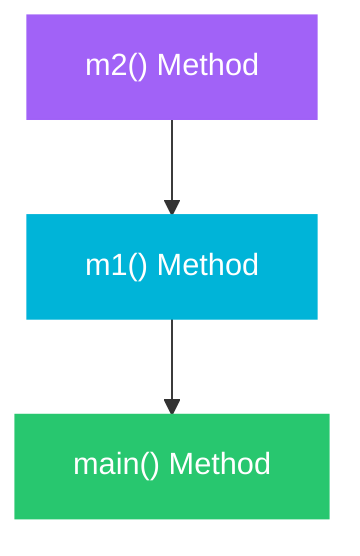
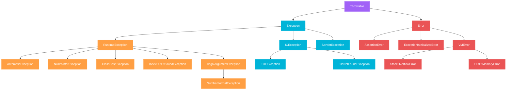

# Exception Handling in Java

**Exception Handling in Java** | Understanding exceptions, why they occur, the exception hierarchy, and how to handle them gracefully.

- [What is an Exception](#what-is-an-exception)
- [Runtime Stack Mechanism](#runtime-stack-mechanism)
- [Default Exception Handling in Java](#default-exception-handling-in-java)
- [Exception Hierarchy in Java](#exception-hierarchy-in-java)
- [Checked vs Unchecked Exception](#checked-vs-unchecked-exception)
- [Fully Checked vs Partially Checked Exception](#fully-checked-vs-partially-checked-exception)

---

## 1. What is an Exception

⚠️ **What is an exception?** An unexpected unwanted event that disrupts the flow of the program is called an Exception. Example: `FileNotFoundException`, `ArrayIndexOutOfBoundException`, and e.t.c. It is highly recommended to handle the exception.

🎯 **Purpose of Exception Handling?** The main object of exception handling is: the graceful termination of the program.

🛡️ **What is exception handling?** Exception handling doesn't mean repairing an exception. We have to provide an alternative way to continue the rest of the program normally, which is the concept of exception handling.

For example: if our program requirement is to read data from a file located at some place, but at runtime that file is not available then our program should not be terminated abnormally. We have to provide some local files to continue rest of the program normally. This way of defining alternatives is nothing but exception handling.

**Exception handling example:**

```java
try {
   // read data from remote file
   // located at some place
} catch(FileNotFoundException e) {
   // use local file and continue
   // rest of the program normally
}
```

---

## 2. Runtime Stack Mechanism

**Runtime stack example:**

```java
public class Test {
   public static void main(String[] args) {
      doStuff();
   }
   public static void doStuff(){
      doMoreStuff();
   }
   public static void doMoreStuff(){
      System.out.println("Hello");
   }
}
```

📤 **Output:**

```
Hello
```

For every thread, JVM will create a runtime stack. Each & every method call performed by that thread will be stored in the corresponding stack. Each entry in the stack is called a stack frame or activation record. After completing every method call the corresponding entry from the stack will be removed. After completing all method calls, the stack will be empty & that empty stack will be destroyed by JVM just before terminating the thread.

---

## 3. Default Exception Handling in Java

**Example of default exception handling:**

```java
public class Test {
   public static void main(String[] args) {
      System.out.println("main() Started");
      m1();
      System.out.println("main() Ended");
   }
   public static void m1() {
      System.out.println("m1() Started");
      m2();
      System.out.println("m1() Ended");
   }
   public static void m2() {
      System.out.println("m2() Started");
      System.out.println(9/0);
      System.out.println("m2() Ended");
   }
}
```

📤 **Output:**

```
main() Started
m1() Started
m2() Started
Exception in thread "main" java.lang.ArithmeticException: / by zero
at Test.m2(Test.java:14)
at Test.m1(Test.java:9)
at Test.main(Test.java:4)
```



Inside a method, if any exception occurs then the method in which it is raised is responsible for creating an exception object by including the following information:

- 🏷️ Name of exception.
- 📋 Description of exception.
- 📍 Location at which exception occurs (stack trace).

After creating an exception object, the method hands over that object to the JVM. JVM will check whether the method contains any exception handling code or not. If the method doesn't contain exception handling code then JVM terminates that method abnormally and removes corresponding entry from the stack. Then JVM identifies the caller method & checks whether the caller method contains the handling code. If not contained, then JVM also terminates that caller method abnormally & removes the corresponding entry from the stack.

This process will be continued until the `main()` method and if the `main()` method also doesn't contain exception handling code then JVM terminates the `main()` method abnormally & removes the corresponding entry from the stack. Then JVM handovers responsibility of exception handling to the default exception handler which is part of JVM. The default exception handler prints exception information in the following format & terminates the program abnormally.

**Default exception handler format:**

```
Exception in thread "Xxx", Name of exception: Description
StackTrace
```

**Example 1:**

```java
public class Test {
   public static void main(String[] args) {
      System.out.println("main() Started");
      m1();
      System.out.println("main() Ended");
   }
   public static void m1() {
      System.out.println("m1() Started");
      System.out.println(9/0);
      System.out.println("m1() Ended");
   }
   public static void m2() {
      System.out.println("m2() Started");
      System.out.println("m2() Ended");
   }
}
```

📤 **Output:**

```
main() Started
m1() Started
Exception in thread "main" java.lang.ArithmeticException: / by zero
at Test.m1(Test.java:9)
at Test.main(Test.java:4)
```

**Example 2:**

```java
public class Test {
   public static void main(String[] args) {
      System.out.println("main() Started");
      m1();
      System.out.println(9/0);
      System.out.println("main() Ended");
   }
   public static void m1() {
      System.out.println("m1() Started");
      m2();
      System.out.println("m1() Ended");
   }
   public static void m2() {
      System.out.println("m2() Started");
      System.out.println("m2() Ended");
   }
}
```

📤 **Output:**

```
main() Started
m1() Started
m2() Started
m2() Ended
m1() Ended
Exception in thread "main" java.lang.ArithmeticException: / by zero
at Test.main(Test.java:5)
```

> 📝 **Note:** In a program if at least one method terminates abnormally then the program termination is abnormal. If all methods terminate normally then only program termination is normal termination.

---

## 4. Exception Hierarchy in Java

`Throwable` class acts as the root for all Java exceptions Hierarchy. `Throwable` class has 2 child classes:

- `Exception`
- `Error`



⚠️ **Exception:** Most of the time exceptions are caused by our program & these are recoverable. For example: If our program requirement is to read data from a remote file located on the server, at runtime if a remote file is not available then we will get a runtime exception saying `FileNotFoundException`.

If `FileNotFoundException` occurs, we can provide a local file and continue the rest of the program normally.

```java
try {
   // read data from remote file
   // locating at server.
} catch( FileNotFoundException e) {
   // use local file and continue
   // rest of the program normally.
}
```

💥 **Error:** Most of the times errors are not caused by our programs, these are caused due to lack of system resources. Errors are not recoverable, therefore we can't handle them. For example: `OutOfMemoryError`, `StackOverflowError`.

If `OutOfMemoryError` occurs, being a programmer we can't do anything & the program will be terminated abnormally. The system admin or server admin is responsible for increasing heap memory.

**Error hierarchy:**

- `Error`
  - `AssertionError`
  - `ExceptionInInitializerError`
  - `VMError`
    - `StackOverflowError`
    - `OutOfMemoryError`

**Exception class child exception classes:**

- `RuntimeException`
  - `ArithmeticException`
  - `NullPointerException`
  - `ClassCastException`
  - `IndexOutOfBoundException`
    - `ArrayIndexOutOfBoundException`
    - `StringIndexOutOfBoundException`
  - `IllegalArgumentException`
    - `NumberFormatException`
- `IOException`
  - `EOFException`
  - `FileNotFoundException`
- `ServletException`
- `RemoteException`
- `InterruptException`

---

## 5. Checked vs Unchecked Exception

The `throws` keyword is purely meant for checked exceptions. Whether it is a checked exception or an unchecked exception, every exception will be raised at runtime only. There is no chance of occurring any exception at compile time. The compile time error came because of syntax mistakes but these are not exceptions.

🔍 **What is a checked exception?** The exceptions which are checked by the compiler for smooth execution of the program are called checked exceptions. Example: `FileNotFoundException`, `SQLException`, and e.t.c.

In our program, if there is a chance of raising a checked exception then it is compulsory to handle the checked exception either by try-catch or by throws keyword otherwise we will get a compile-time error.

**Checked exception example:**

```java
import java.io.*;
public class Test {
   public static void main(String[] args) {
      PrintWriter pw = new PrintWriter("file.txt");
      pw.println("Hello");
   }
}
```

📤 **Compile-time error:**

```
Test.java:4: error: unreported exception FileNotFoundException; must be caught or declared to be thrown
PrintWriter pw = new PrintWriter("file.txt");
^
1 error
```

🔓 **What is an unchecked exception?** The exceptions that are not checked by the compiler, whether the programmer handling them or not. Such types of exceptions are called unchecked exceptions. Example: `ArithmeticException`, `NullPointerException`, and e.t.c.

**Unchecked exception example:**

```java
public class Test {
   public static void main(String[] args) {
      System.out.println(9/0);
   }
}
```

📤 **Output:**

```
Exception in thread "main" java.lang.ArithmeticException: / by zero
at Test.main(Test.java:3)
```

> 🔑 **Key Point:** `RuntimeException` & its child classes, and `Error`, and its child classes are unchecked exceptions, except these remaining are checked exceptions.

---

## 6. Fully Checked vs Partially Checked Exception

A checked exception is said to be fully checked if & only if all its child classes are also checked. Example: `IOException`, `InterruptException`.

A checked exception is said to be partially checked if and only if some of its child classes are unchecked. Example: `Exception`, `Throwable`.

⚠️ **The only possible partially checked exceptions in Java are: `Exception`, `Throwable`.**

| Exception Type 🏷️ | Category 📋 |
|-------------------|------------|
| **`IOException`** | ✅ Checked (fully) |
| **`RuntimeException`** | ❌️ Unchecked |
| **`InterruptException`** | ✅ Checked (fully) |
| **`Error`** | ❌️ Unchecked |
| **`Throwable`** | ⚠️ Checked (Partially) |
| **`ArithmeticException`** | ❌️ Unchecked |
| **`NullPointerException`** | ❌️ Unchecked |
| **`Exception`** | ⚠️ Checked (Partially) |
| **`FileNotFoundException`** | ✅ Checked (fully) |
