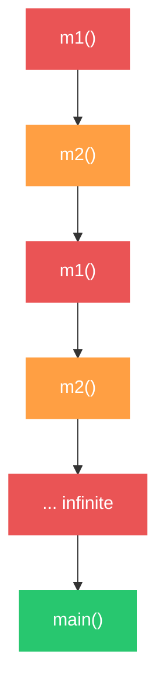

# Top 10 Common Exceptions in Java

**Top 10 Common Exceptions in Java** | Based on who raises the [exception](176_Exception_Handling_in_Java.md) all exceptions are divided into 2 categories.

- [ArrayIndexOutOfBoundException](#arrayindexoutofboundexception)
- [NullPointerException](#nullpointerexception)
- [ClassCastException](#classcastexception)
- [StackOverflowError](#stackoverflowerror)
- [NoClassDefFoundError](#noclassdeffounderror)
- [ExceptionInInitializerError](#exceptionininitializererror)
- [IllegalArgumentException](#illegalargumentexception)
- [NumberFormatException](#numberformatexception)
- [IllegalThreadStateException](#illegalthreadstateexception)
- [AssertionError](#assertionerror)
- [Summary](#summary)

---

🤖 **JVM Exceptions:** The exceptions raised by JVM itself whenever a particular event occurs are called JVM exceptions. Examples: `ArithmeticException`, `NullPointerException`, etc.

👨‍💻 **Programmatic Exception:** A programmer raises explicitly to indicate that something goes wrong is called a programmatic exception. Example: `IllegalArgumentException`, `InsufficientFundsException`, and e.t.c.

---

## 1. ArrayIndexOutOfBoundException

```java
int x[] = new int[4];
System.out.println(x[0]); // valid
System.out.println(x[10]); // ArrayIndexOutOfBoundException
System.out.println(x[-4]); // ArrayIndexOutOfBoundException
```

It is the child class of `RuntimeException` & hence it is unchecked. It is raised by JVM whenever we try to access an array element out of range index.

---

## 2. NullPointerException

It is the child class of `RuntimeException` and hence it is an unchecked exception. It is raised by JVM whenever we are trying to perform any operation on `null`.

```java
String s = null;
System.out.println(s.length());
```

---

## 3. ClassCastException

It is the child class of `RuntimeException` & hence it is an unchecked exception. It is raised by JVM whenever we are trying to typecast parent object to child type.

```java
String s = new String("KnowProgram");
Object o = (Object)s; // valid

Object obj = new Object();
String str = (String)obj; // invalid; RE

Object obj = new String("KnowProgram");
String str = (String)obj; // valid
```

> 📝 **Note:** Internally "obj" object is a string type.

---

## 4. StackOverflowError

It is the child class of `Error` & hence the unchecked exception. It is raised by JVM whenever we are trying to perform a recursive method call and it goes into an infinite method call or a large number of stacks is created.

```java
public class Test {
   public static void main(String[] args) {
      m1();
   }
   public static void m1() {
      m2();
   }
   public static void m2() {
      m1();
   }
}
```



---

## 5. NoClassDefFoundError

It is the child class of `Error` & hence it is an unchecked exception. It is raised by JVM whenever JVM is unable to find the required class file.

```bash
> java Test
NoClassDefFoundError
```

> ⚠️ **Caution:** If the `Test.class` file is not available then we will get run time exception: `NoClassDefFoundError`

---

## 6. ExceptionInInitializerError

It is the child class of `Error` & hence it is an unchecked exception. It is raised by JVM if any exception occurs while executing static variable assignments and static blocks.

**Example 1 - static variable:**

```java
public class Test {
   static int x = 9/0;
   public static void main(String[] args) {
   }
}
```

📤 **Output:**

```
Exception in thread "main" java.lang.ExceptionInInitializerError
Caused by: java.lang.ArithmeticException: / by zero
at Test.(Test.java:6)
```

**Example 2 - static block:**

```java
public class Test {
   static {
      String s = null;
      System.out.println(s.length());
   }
   public static void main(String[] args) {
   }
}
```

📤 **Output:**

```
Exception in thread "main" java.lang.ExceptionInInitializerError
Caused by: java.lang.NullPointerException: Cannot invoke "String.length()" because "" is null
at Test.(Test.java:4)
```

---

## 7. IllegalArgumentException

It is the child class of `RuntimeException` & hence it is an unchecked exception. It is raised explicitly either by the programmer to indicate that a method has been invoked with an illegal argument.

The valid range of thread priority is 1 to 10. If we are trying to set the priority with any other value then we will get `RuntimeException`: `IllegalArgumentException`.

```java
Thread t = new Thread();
t.setPriority(7);
t.setPriority(15);
```

📤 **Output:**

```
Exception in thread "main" java.lang.IllegalArgumentException
at java.base/java.lang.Thread.setPriority(Thread.java:1135)
at Test.main(Test.java:5)
```

---

## 8. NumberFormatException

It is the direct child class of `IllegalArgumentException` which is the child class of `RuntimeException` & hence it is an unchecked exception. It is raised explicitly either by the programmer to indicate that we are trying to convert String to the number & string is not properly formatted.

- `IllegalArgumentException`
  - `NumberFormatException`

```java
int i = Integer.parseInt("10");
int j = Integer.parseInt("ten"); // NumberFormatException
```

---

## 9. IllegalThreadStateException

It is the child class of `RuntimeException` and hence it is an unchecked exception. It is raised explicitly either by the programmer or by the API developer to indicate that a method has been invoked at the wrong time.

After starting a thread we are not allowed to restart the thread otherwise we will get the runtime exception: `IllegalThreadStateException`

```java
Thread t = new Thread();
t.start();
// code
t.start(); // IllegalThreadStateException
```

---

## 10. AssertionError

It is the child class of `Error` and hence it is an unchecked exception. It is raised explicitly by the programmer to indicate that the assert statement fails. Example:

```java
assert(x > 10);
```

> ⚠️ **Caution:** If x is not greater than 10 then we will get a runtime exception saying `AssertionError`.

---

## 11. Summary

| Exception 🏷️ | Raised By ⚙️ | Category 📋 |
|-------------|------------|------------|
| **`ArrayIndexOutOfBoundException`** | JVM | 🤖 JVM Exception |
| **`NullPointerException`** | JVM | 🤖 JVM Exception |
| **`ClassCastException`** | JVM | 🤖 JVM Exception |
| **`StackOverflowError`** | JVM | 🤖 JVM Exception |
| **`NoClassDefFoundError`** | JVM | 🤖 JVM Exception |
| **`ExceptionInInitializerError`** | JVM | 🤖 JVM Exception |
| **`IllegalArgumentException`** | Programmer | 👨‍💻 Programmatic |
| **`NumberFormatException`** | Programmer | 👨‍💻 Programmatic |
| **`IllegalThreadStateException`** | Programmer | 👨‍💻 Programmatic |
| **`AssertionError`** | Programmer | 👨‍💻 Programmatic |
