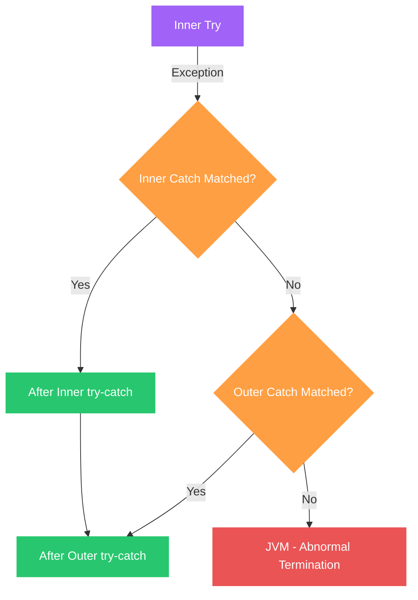

# Nested try-catch in Java

**Nested try-catch in Java** | In Java, we can use a try-catch block within another try-catch block. The try-catch placed inside another try/catch/finally is called the inner try-catch block.

- [Control Flow of Nested try-catch in Java](#control-flow-of-nested-try-catch-in-java)
- [Examples of Nested try-catch in Java](#examples-of-nested-try-catch-in-java)

---

**Basic nested try-catch structure:**

```java
try {
   // code
   try {
      // code
   } catch(Exception e) {
      // code
   }
} catch(Exception e) {
   // code
}
```

There are some situations when there is a chance of raising an exception inside try/catch/finally which can lead to an abnormal termination of the program. To solve this problem we should use nested try-catch blocks to terminate try, catch, finally block normally.

🛠️ **Example:** Take a value from the end-user, if it is a positive integer number then create an array of that size, if the passed number is negative then create an array with size=5. If the passed value is not a number then display appropriate messages.

```java
import java.util.Scanner;
public class Test {
   public static void main(String[] args) {
      Scanner scan = new Scanner(System.in);
      System.out.print("Enter a value: ");
      String str = scan.nextLine();
      int arr[] = null;

      try {
         int x = Integer.parseInt(str);
         System.out.println("x: " + x);

         try {
            arr = new int[x]; // size = x
         } catch(NegativeArraySizeException nase) {
            arr = new int[5]; // size = 5
         }

         // display array size
         System.out.println("Array size: " + arr.length);

      } catch(NumberFormatException nfe) {
         System.out.println("Pass only int value");
      } catch(Exception e) {
         System.out.println(e);
      }
   }
}
```

📤 **Output for different test cases:**

```
Enter a value: 10
x: 10
Array size: 10
```

```
Enter a value: -20
x: -20
Array size: 5
```

```
Enter a value: A
Pass only int value
```

> 📝 **Note:** When we passed value=-20 then `NegativeArraySizeException` raised because array size can't be negative, and the inner catch block executed. From inner catch block size = 5 is assigned to the array. In the 3rd test case, we passed value = "A" since it is not a number, therefore `NumberFormatException` was raised and the respective outer catch block was executed.

Also see: Different ways to get the exception message, [Develop User-defined Custom exception](185_Develop_User_defined_Custom_Exception_in_Java.md), [Java Custom Exception Example](186_Java_Custom_Exception_Example.md)

---

## 1. Control Flow of Nested try-catch in Java

1. 🛡️ The exception raised in inner try is caught by inner catch and the statements placed after inner try/catch are executed.
2. 🔄 If the inner catch parameter is not matched with the raised exception in the inner try then that exception will propagate to the outer try and it is caught by the outer catch and the statements placed after the outer try-catch are executed.
3. 💥 If outer catch is also not matched, then that exception is propagated to JVM and program execution is terminated abnormally.



We will see these points through different examples of nested try-catch in Java.

---

## 2. Examples of Nested try-catch in Java

### Example-1: Exception is not raised in the program

```java
public class Test {
   public static void main(String[] args) {
      System.out.println("main() start");
      try {
         System.out.println("Outer try");
         try {
            System.out.println("Inner try");
         } catch(ArithmeticException e) {
            System.out.println("Inner catch");
         }
         System.out.println("After inner try-catch");
      } catch(ArithmeticException e) {
         System.out.println("Outer catch");
      }
      System.out.println("After outer try-catch");
      System.out.println("main() end");
   }
}
```

📤 **Output:**

```
main() start
Outer try
Inner try
After inner try-catch
After outer try-catch
main() end
```

> 📝 **Note:** In this program, exceptions didn't raise anywhere therefore inner & outer catch blocks are not executed.

### Example-2: Exception is raised before outer try block

```java
public class Test {
   public static void main(String[] args) {
      System.out.println("main() start");
      System.out.println(9/0); // Exception
      try {
         System.out.println("Outer try");
         try {
            System.out.println("Inner try");
         } catch(ArithmeticException e) {
            System.out.println("Inner catch");
         }
         System.out.println("After inner try-catch");
      } catch(ArithmeticException e) {
         System.out.println("Outer catch");
      }
      System.out.println("After outer try-catch");
      System.out.println("main() end");
   }
}
```

📤 **Output:**

```
main() start
Exception in thread "main" java.lang.ArithmeticException: / by zero
at Test.main(Test.java:5)
```

> ⚠️ **Caution:** The exception is raised before the outer try block therefore the program is terminated abnormally without executing outer & inner try-catch blocks.

### Example-3: Exception raised in outer try before inner try-catch

```java
public class Test {
   public static void main(String[] args) {
      System.out.println("main() start");
      try {
         System.out.println("Outer try");
         System.out.println(9/0); // Exception
         try {
            System.out.println("Inner try");
         } catch(ArithmeticException e) {
            System.out.println("Inner catch");
         }
         System.out.println("After inner try-catch");
      } catch(ArithmeticException e) {
         System.out.println("Outer catch");
      }
      System.out.println("After outer try-catch");
      System.out.println("main() end");
   }
}
```

📤 **Output:**

```
main() start
Outer try
Outer catch
After outer try-catch
main() end
```

> 📝 **Note:** The exception is raised inside the outer try block but before the inner try-catch, therefore, control will directly come to the outer catch block without executing the inner try-catch block. Note that the inner catch block is also handling `ArithmeticException` but it will handle exceptions raised within the inner try block, but not outside of the inner try block.

### Example-4: Exception raised in inner try, matched with inner catch

```java
public class Test {
   public static void main(String[] args) {
      System.out.println("main() start");
      try {
         System.out.println("Outer try");
         try {
            System.out.println("Inner try");
            System.out.println(9/0); // Exception
         } catch(ArithmeticException e) {
            System.out.println("Inner catch");
         }
         System.out.println("After inner try-catch");
      } catch(ArithmeticException e) {
         System.out.println("Outer catch");
      }
      System.out.println("After outer try-catch");
      System.out.println("main() end");
   }
}
```

📤 **Output:**

```
main() start
Outer try
Inner try
Inner catch
After inner try-catch
After outer try-catch
main() end
```

✅ The exception is raised in the inner try block and matched with the inner catch parameter therefore control will go from inner try block to inner catch block. The code after the inner try-catch block will be executed successfully.

### Example-5: Exception raised in inner try, inner catch not matched, outer catch matched

```java
public class Test {
   public static void main(String[] args) {
      System.out.println("main() start");
      try {
         System.out.println("Outer try");
         try {
            System.out.println("Inner try");
            System.out.println(9/0); // Exception
         } catch(NumberFormatException ae) {
            System.out.println("Inner catch");
         }
         System.out.println("After inner try-catch");
      } catch(ArithmeticException ae) {
         System.out.println("Outer catch");
      }
      System.out.println("After outer try-catch");
      System.out.println("main() end");
   }
}
```

📤 **Output:**

```
main() start
Outer try
Inner try
Outer catch
After outer try-catch
main() end
```

🔄 The exception is raised in the inner try block, but the inner catch parameter is not matched. Therefore, the exception will be propagated to the outer catch block.

### Example-6: Exception raised in inner try, both inner & outer catch not matched

```java
public class Test {
   public static void main(String[] args) {
      System.out.println("main() start");
      try {
         System.out.println("Outer try");
         try {
            System.out.println("Inner try");
            System.out.println(9/0); // Exception
         } catch(NumberFormatException ae) {
            System.out.println("Inner catch");
         }
         System.out.println("After inner try-catch");
      } catch(NumberFormatException nfe) {
         System.out.println("Outer catch");
      }
      System.out.println("After outer try-catch");
      System.out.println("main() end");
   }
}
```

📤 **Output:**

```
main() start
Outer try
Inner try
Exception in thread "main" java.lang.ArithmeticException: / by zero
at Test.main(Test.java:9)
```

❌️ Since the exception is not matched with either the inner catch parameter or the outer catch parameter therefore it is propagated to the JVM and program execution is terminated abnormally.

### Example-7: Exception in inner try and again in inner catch

When an exception is raised in the inner catch block then it will be treated as a rising exception in the outer try block, because the inner try-catch block is part of the outer try block.

**Inner catch exception matched by outer catch:**

```java
public class Test {
   public static void main(String[] args) {
      System.out.println("main() start");
      try {
         System.out.println("Outer try");
         try {
            System.out.println("Inner try");
            System.out.println(9/0); // Exception
         } catch(ArithmeticException ae) {
            System.out.println("Inner catch");
            System.out.println(9/0); // Exception
         }
         System.out.println("After inner try-catch");
      } catch(ArithmeticException e) {
         System.out.println("Outer catch");
      }
      System.out.println("After outer try-catch");
      System.out.println("main() end");
   }
}
```

📤 **Output:**

```
main() start
Outer try
Inner try
Inner catch
Outer catch
After outer try-catch
main() end
```

**Inner catch exception NOT matched by outer catch:**

If the raised exception in the inner catch block is not matched with the outer catch block then the exception will be propagated to the JVM and the program will terminate abnormally without executing the remaining code.

```java
public class Test {
   public static void main(String[] args) {
      System.out.println("main() start");
      try {
         System.out.println("Outer try");
         try {
            System.out.println("Inner try");
            System.out.println(9/0); // Exception
         } catch(ArithmeticException ae) {
            System.out.println("Inner catch");
            System.out.println(9/0); // Exception
         }
         System.out.println("After inner try-catch");
      } catch(NumberFormatException nfe) {
         System.out.println("Outer catch");
      }
      System.out.println("After outer try-catch");
      System.out.println("main() end");
   }
}
```

📤 **Output:**

```
main() start
Outer try
Inner try
Inner catch
Exception in thread "main" java.lang.ArithmeticException: / by zero
at Test.main(Test.java:12)
```
