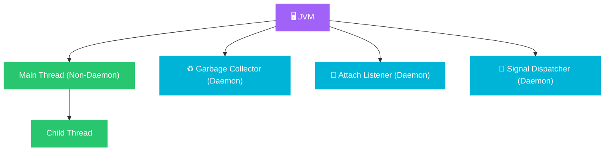
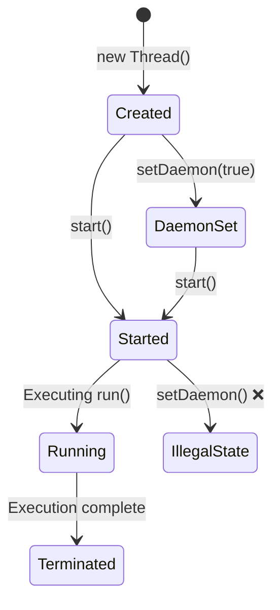

# Daemon Thread in Java with Examples

**Daemon Thread in Java with Examples** | In this Java multithreading tutorial, we will discuss what is daemon thread in Java, how to check and create daemon threads, their purpose, and many other things.

- [Types of Threads in Java](#types-of-threads-in-java)
- [Default Nature of a Thread](#default-nature-of-a-thread)
- [How to Create a Daemon Thread in Java](#how-to-create-a-daemon-thread-in-java)
- [When Daemon Thread Completed](#when-daemon-thread-completed)
- [Use of Daemon Thread in Java](#use-of-daemon-thread-in-java)
- [Conclusion on Daemon Thread in Java](#conclusion-on-daemon-thread-in-java)

---

## 1. Types of Threads in Java

**Java allows to create 2 types of threads:**

| Type | Description 📋 | Example 🛠️ |
|------|---------------|------------|
| **Non-daemon** | Executes the main logic of the project | `main` thread |
| **Daemon** | Runs in background to provide services to non-daemon threads | Garbage collector, attach listener, signal dispatcher |

🎬 **Non-daemon thread** — A thread that executes the main logic of the project. The `main` thread is responsible for executing the `main` method, and the execution of a Java program always starts from the `main` method.

👻 **Daemon thread** — **A thread that is running in the background based on a schedule to provide services to non-daemon threads is called daemon thread.** Daemon threads are also called service threads.

🧠 **In Simple Words:** Consider a program as a movie — the main lead role is played by the non-daemon thread and all necessary support is provided by the daemon thread like the producer, director, makeup artist, music director, etc. As end-user, we mainly see only the main lead role player on the screen but in the background, there were many people to make the movie.


🔑 **Key Point:** The main objective of the daemon thread is to provide support for non-daemon threads. For example — if the main thread runs with low memory then JVM runs a garbage collector to destroy useless objects. So that the number of bytes of free memory will be improved.

> 📝 **Note:** Usually, daemon threads have low priority but based on our requirement daemon threads can run with high priority also.



---

## 2. Default Nature of a Thread

What is the default nature of a thread, is it daemon or non-daemon? When we create a new thread then by default it will be a daemon or non-daemon thread?

By default, the **main thread is always a non-daemon thread**. When we create a **new thread** then the **default nature** will be **inherited from the parent thread** to the child thread. If the parent thread is a daemon thread then the child thread also will be a daemon thread, similarly, if the parent thread is a non-daemon thread then the child thread also will be a non-daemon thread.

🔍 Thread class in Java has the below method to check whether the thread is daemon or non-daemon thread:

**`public final boolean isDaemon()`**

Return value of the `isDaemon()` method:

- ✅ `true` — If thread is daemon
- ❌️ `false` — If thread is non-daemon

**Check daemon nature of main and child thread:**

```java
public class Test extends Thread {
   public static void main(String[] args) {
      System.out.println("Is main thread daemon: "
         + Thread.currentThread().isDaemon());

      // child thread
      Test t1 = new Test();
      System.out.println("Is child thread daemon: "
         + t1.isDaemon());
   }
}
```

📤 **Output:**

```
Is main thread daemon: false
Is child thread daemon: false
```

🔑 Since by default the main thread is non-daemon, therefore, the child thread created by the main thread is also a non-daemon thread.

---

## 3. How to Create a Daemon Thread in Java

The thread class has the below method to create a user-defined thread as daemon thread:

**`public final void setDaemon(boolean flag)`**

Here if the passed parameter is:

- ✅ `true` — Thread is created as daemon
- ❌️ `false` — Thread is created as non-daemon

**Create a daemon thread:**

```java
public class Test extends Thread {
   public static void main(String[] args) {
      // child thread
      Test t1 = new Test();
      System.out.println("Is child thread daemon: "
                        + t1.isDaemon());

      // change daemon state
      t1.setDaemon(true);
      System.out.println("Is child thread daemon: "
                        + t1.isDaemon());
   }
}
```

📤 **Output:**

```
Is child thread daemon: false
Is child thread daemon: true
```

> ⚠️ **Caution:** Changing the daemon nature of a thread is only applicable **before starting the thread.** Once a thread is started using `start()` then we can't call the `setDaemon()` method. After starting a thread if we are trying to change daemon nature then we will get a runtime exception: **`java.lang.IllegalThreadStateException`** (unchecked exception).

**IllegalThreadStateException example:**

```java
public class Test extends Thread {
   public static void main(String[] args) {

      // create thread
      Test t = new Test();
      // start the thread
      t.start();

      // change daemon nature of thread
      t.setDaemon(true);
   }
}
```

📤 **Output:**

```
Exception in thread "main" java.lang.IllegalThreadStateException
at java.base/java.lang.Thread.setDaemon(Thread.java:1400)
at Test.main(Test.java:9)
```

🔒 **Is it possible to change the daemon nature of the main thread? No.** There is no way to change the daemon nature of the main thread because the main thread is already started by the JVM at the very beginning.

**Cannot change main thread daemon nature:**

```java
public class Test {
   public static void main(String[] args) {
      System.out.println("Main thread already started by JVM");
      Thread.currentThread().setDaemon(true);
      Thread.currentThread().setDaemon(false);
   }
}
```

📤 **Output:**

```
Main thread already started by JVM
Exception in thread "main" java.lang.IllegalThreadStateException
```



---

## 4. When Daemon Thread Completed

The main purpose of the daemon thread in Java is to provide services to non-daemon threads. **If there is no non-daemon thread left then daemon threads also will be terminated.**

Whenever the last non-daemon thread in the program reaches into the TERMINATED state (either due to execution completed, or interrupted, or any other reason) then the daemon thread also will be terminated in the middle.

**Daemon thread terminates when main thread ends:**

```java
public class Test {
   public static void main(String[] args) {
      MyThread t1 = new MyThread();
      t1.setDaemon(true);
      t1.start();
      System.out.println("End of Main thread");
   }
}

class MyThread extends Thread {
   public void run(){
      for(int i=0; i<5; i++){
         System.out.println("Child Thread: " + i);
         try{
            Thread.sleep(1000);
         } catch (InterruptedException ie) {}
      }
   }
}
```

🧵 Currently, the main thread is non-daemon and the child thread is daemon. Whenever the main thread terminates then the child thread also will be terminated. The child thread will be executed either 0 or 1 times.

📤 **Expected Output-1:**

```
End of Main thread.
```

📤 **Expected Output-2:**

```
End of Main thread.
Child Thread.
```

📤 **Expected Output-3:**

```
Child Thread.
End of Main thread.
```

> 💡 **Tip:** If we comment the line `t1.setDaemon(true);` then both threads will be non-daemon threads, and they will run independently from each other. Hence both threads will be executed until their completion.

---

## 5. Use of Daemon Thread in Java

Daemon threads are useful for background supporting tasks such as:

- ♻️ **Garbage collection** — destroying unreferenced objects
- 💾 **Memory management** — releasing memory of unused objects
- 🗑️ **Cache cleanup** — removing unwanted entries from the cache

> 📝 **Note:** Most of the JVM threads are daemon threads. The garbage collector is a low priority daemon thread so we cannot guarantee its execution, and it is terminated if all non-daemon threads execution is completed.

---

## 6. Conclusion on Daemon Thread in Java

1. 👻 A thread that is **running in the background** based on schedule to provide services to non-daemon threads is called daemon thread.
2. 🔍 We can check the daemon nature of the thread by using the **`isDaemon()`** method of the Thread class.
3. 🔧 We can change the daemon nature of the thread by using the **`setDaemon()`** method of Thread class. It must be called before starting of the thread else we will get **`java.lang.IllegalThreadStateException`**.
4. 🧬 **Child thread daemon nature is inherited from parent thread.**
5. 🏠 The default nature of the **main thread is non-daemon.**
6. 🔚 Since daemon threads are service threads, therefore its execution is terminated automatically when all non-daemon threads execution is completed.

---

**Q) Daemon thread runs in**

a) Background
b) Foreground
c) Both
d) None of these

✅ **Answer:** a) Background — Daemon threads always run in the background to provide support for non-daemon threads. See more: MCQ on Java multithreading.

**Related Links:**

- Interview questions on Java multithreading
- [Deadlock in Java](187_Deadlock_in_Java_with_Example.md)
