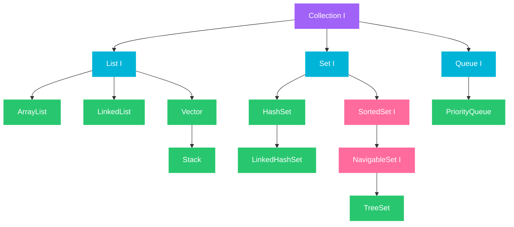

# Java Collection Framework Overview

**Java Collection Framework Overview** | Limitations of Array and the need for the Java collection framework. What is the Java Collection Framework? What are the different interfaces and classes? When to use which collection class?

- [Limitations of Array](#limitations-of-array)
- [Java Collection Framework](#java-collection-framework)
- [Array vs Collection Framework](#array-vs-collection-framework)
- [Different Format to Store Objects in Java Collection Framework](#different-format-to-store-objects-in-java-collection-framework)
- [Important Interfaces of Java Collection Framework](#important-interfaces-of-java-collection-framework)
- [Important Points on Java Collection Framework](#important-points-on-java-collection-framework)
- [Utility and Helper classes](#utility-and-helper-classes)

---

## 1. Limitations of Array

An [array](025_Java_Array_Tutorial.md) is an indexed collection of a fixed number of homogeneous data elements. The main advantage of the array is: we can represent multiple values by using a single variable so that the readability of the code will be improved.

❌️ **Limitations of Array in Java:**

1. **The array is fixed in size.** Once we create an array then we can't increase/decrease the size based on our requirement. Due to this, to use the array concept compulsory we should know the size in advance which may not be possible always.
2. **Array concept isn't implemented based on some standard data structures** and hence pre-defined method support is not available. For every requirement like sorting, searching and e.t.c. we have to write the code explicitly which increases the complexity of programming.
3. Generally, an **array can hold only homogeneous data type elements**.

Assume we have `Student` and `Customer` classes:

```java
class Student { }
class Customer { }
```

In an array of students, we can store only `Student` type elements. Similarly, in an array of integers, we can store only integer elements, we can't store double, String, and e.t.c. values.

```java
Student s[] = new Student[100];
s[0] = new Student(); // valid
s[1] = new Customer(); // invalid
```

In the array of Students if we try to add a `Customer` type element then we will get a compile-time error: `incompatible types; found: Customer, required: Student`.

We can solve this problem by using object-type arrays. But while retrieving and performing the different operations on this array we have to typecast the array element to the corresponding type which increases the burden on the programmer.

```java
Object obj[] = new Object[10000];
obj[0] = new Student(); // valid
obj[1] = new Customer(); // valid
// every time type casting is required
Student s1 = (Student) obj[0];
Customer c1 = (Customer) obj[1];
```

To overcome all these problems of arrays, we should go for the Java collections framework. Let us see what the Java collection framework is and how it solves the array problems.

---

## 2. Java Collection Framework

The **java.util package** contains several classes to group/collect homogeneous and heterogeneous objects without size limitations. These classes are usually called **Java collection framework classes**.

Java collection framework classes are Java data structures. These classes internally use several standard data structures and algorithms such as a growable array, vector, stack, queue, linked list, doubly linked list, hash table, balance tree, and e.t.c. All collection object size is automatically incremental and decremental.

✅ **Java Collection Framework classes are:**

- 📈 **Growable in nature** i.e. based on our requirement it can increase or decrease the size.
- 📦 **Can hold both homogeneous & heterogeneous objects**.
- 🏗️ **Implemented based on some standard data structure.** Hence for every requirement pre-defined method support is available. Being a programmer we are responsible for using those pre-defined methods based on our requirements.

---

## 3. Array vs Collection Framework

| Feature | Array 🅰️ | Collection Framework 📦 |
|---------|----------|------------------------|
| **Size** | Fixed in size, can't increase/decrease | Growable in nature, can increase or decrease |
| **Memory** | Not recommended to use | Recommended to use |
| **Performance** | Recommended to use | Not recommended to use |
| **Data Types** | Generally holds only homogeneous elements | Can hold both homogeneous & heterogeneous elements |
| **Data Structure** | No underlying data structure, no predefined method support | Implemented based on standard data structures with predefined methods |
| **Primitives** | Can hold both primitives and objects | Can hold only object types, not primitive values |

---

## 4. Different Format to Store Objects in Java Collection Framework

We can collect/store objects in 2 ways:

1. In array format
2. In (key, value) format

🛠️ **Example of array format:**

| 8564 | John | Java | 1000 |
|------|------|------|------|

🛠️ **Example of (key, value) pair format:**

| Key 🔑 | Value 📋 |
|--------|---------|
| **Id** | 8564 |
| **Name** | John |
| **Course** | Java |
| **Fee** | 1000 |

In array format, the objects don't have an identity. But in key, value format objects have their own identity. Based on these 2 formats Java collection classes are divided into two hierarchies:

- 📋 **Collection hierarchy** - To store objects in array format.
- 🗺️ **Map hierarchy** - To store objects in (key, value) format.

In **Java 1.0 version** only 4 classes were there to store/collect these two formats. They are:

- 📋 **Vector & Stack** - To store objects in array format.
- 🗺️ **Hashtable & Properties** - To store objects in (key, value) pair format.

These classes were created as **thread-safe classes**, which means all the methods in these two classes are declared as synchronized. Therefore for every method-call on these objects, JVM locks and unlocks the objects. In a single thread model application, it leads to performance issues. In single thread model application execution is sequential so there is no data corruption problem, hence locking of objects is not required.

To solve this problem many non-thread-safe classes were introduced in Java 1.2 version. Later in the 1.4, 1.5, and 1.6 versions, more classes were added. From Java 1.2 version all collection classes are collectively called as **Java collection framework**, and the collection classes available from Java 1.0 version are called **legacy classes**. Whenever we say "Java collection framework" it means we are talking about `java.util` package and its classes/interfaces.

📜 **The legacy classes (introduced in Java 1.0 version) are:**

1. Dictionary(AC)
2. Vector
3. Stack
4. Hashtable
5. Properties

In these 5 classes, `Dictionary` is an abstract class (AC) and the remaining are concrete Java classes which extend some other Java collection class.

💡 **Difference between Collection and Collection Framework?**

- 📦 **Collection:** If we want to represent a group of individual objects as a single entity then we should go for collection. It is an interface in the Java collection framework. It is considered as the root interface of the collection framework because most of the classes of `java.util` package indirectly implements `Collection(I)`. See more: [Collection interface in Java](194_Java_Collection_Interface.md).
- 🏗️ **Collection Framework:** It contains several classes & interfaces which can be used to represent a group of objects. Whenever we say Java collection framework it means we are talking about `java.util` package.

---

## 5. Important Interfaces of Java Collection Framework

There are 9 Key Interfaces of the Java Collection Framework.

1. **[Collection](194_Java_Collection_Interface.md)**
2. **[List](195_List_Interface_in_Java.md)**
3. **Set**
4. **SortedSet**
5. **NavigableSet**
6. **Queue**
7. **Map**
8. **SortedMap**
9. **NavigableMap**

Let us see these interfaces one by one. In which version they were introduced and how many implementation classes do they have? We will use I to represent Interface i.e. `Collection(I)` means Collection is an interface.



### Collection(I)

- 📦 If we want to represent a group of individual objects as a single entity then we should go for the [Collection interface](194_Java_Collection_Interface.md).
- ⚙️ `Collection(I)` defines the most common methods which are applicable for any collection object.
- 🏗️ In general `Collection(I)` is considered as the **root interface** of the Java collection framework, because most of the classes of the `java.util` package implements `Collection(I)`.
- 📜 It was introduced in Java 1.2 version.

There is no concrete class that implements the Collection interface directly, but `List`, `Set`, and e.t.c. interface implements `Collection(I)`.

💡 **What is the difference between "Collection" & "Collections" in Java Collection Framework?**
The "Collection" is an interface present in `java.util` package, if we want to represent a group of individual objects as a single entity then we should go for Collection. "Collections" is a utility class present in `java.util` package to define several utility methods for collection objects like sorting, searching, and e.t.c.

### List(I)

[List interface](195_List_Interface_in_Java.md) is the child interface of `Collection(I)`. We should go for List if we want to represent a group of individual objects as a single entity where:

- ✅ **Duplicates are allowed**
- ✅ **Insertion order must be preserved.** Similar to an array, the index of List also starts with 0.

**Implementation Class with Java version when they were introduced:**

- Collection(I) _1.2v_
  - List(I) _1.2v_
    - ArrayList _1.2v_
    - LinkedList _1.2v_
    - Vector _1.0v_
      - Stack _1.0v_

`ArrayList`, `LinkedList`, and `Vector` are the direct child class of `List(I)`. `Stack` class extends `Vector` class. Vector & Stack were introduced in 1.0v therefore they are considered as legacy classes. In Java 1.2 version Vector & Stack class was modified to implement `List(I)`.

🛠️ **List example:**

```java
import java.util.*;
public class Test {
   public static void main(String[] args) {
      List<String> al = new ArrayList<String>();
      al.add("KP");
      al.add("Java");
      al.add("KP"); // duplicate
      al.add(null);
      System.out.println(al);
      al.remove(2);
      System.out.println(al);
      al.add(2, "DEF");
      al.add("GHI");
      System.out.println(al);
   }
}
```

📤 **Output:**

```
[KP, Java, KP, null]
[KP, Java, null]
[KP, Java, DEF, null, GHI]
```

### Set(I)

It is the child interface of `Collection(I)`. We should go for Set if we want to represent a group of individual objects as a single entity where:

- ❌️ **Duplicates are not allowed**
- ❌️ **Insertion order not preserved.**

Objects are unique or duplicate is actually decided by the `==` operator and equals() method. If `==` operator returns true, then those objects are considered as duplicates (same objects). If `==` operator and also `equals()` method returns false then they are considered as unique objects (different objects).

**Implementation Class/interfaces:**

- Collection(I) _1.2v_
  - Set(I) _1.2v_
    - HashSet _1.2v_
      - LinkedHashSet _1.4v_
    - SortedSet(I) _1.2v_
      - NavigableSet(I) _1.6v_
        - TreeSet _1.2v_

`HashSet` is the child class of `Set(I)`, and `LinkedHashSet` is the child class of `HashSet`. `SortedSet` is an interface that implements `Set(I)`.

### SortedSet(I)

It is the child interface of `Set(I)`. We should go for SortedSet if we want to represent a group of individual objects as a single entity where:

- ❌️ **Duplicates are not allowed**
- ❌️ **Insertion order not preserved**
- ✅ **All objects should be inserted according to some sorting order**.

### NavigableSet(I)

It is the child interface of `SortedSet(I)`. It contains several methods **for navigation purposes**.

- Set(I) 1.2v
  - SortedSet(I) 1.2v
    - NavigableSet(I) 1.6v
      - TreeSet 1.2v

⚖️ **The most important difference between List and Set:**

| Feature | List 📋 | Set 📦 |
|---------|---------|--------|
| **Duplicates** | ✅ Allowed | ❌️ Not allowed |
| **Insertion Order** | ✅ Preserved | ❌️ Not preserved |

### Queue(I)

It is the child interface of `Collection(I)`. If we want to represent a group of individual objects prior to processing then we should go for the queue. Usually, the queue follows FIFO (first in first out) order but based on our requirement we can implement our own priority order also.

📝 **Example:** Before sending an email to different mail ids, all mail ids should be stored in some data structure. In which order all mail ids are stored in the same order mail should be delivered. The mail id which was added first will receive an email before others. For this requirement, Queue is the best choice.

`Queue(I)` and all its implementation were introduced in the 1.5 version. Among all implementation classes of `Queue(I)`, `PriorityQueue` is used frequently.

**Implementation classes:**

- Collection(I) _1.2v_
  - Queue(I) _1.5v_
    - PriorityQueue _1.5v_
    - BlockingQueue _1.5v_
      - PriorityBlockingQueue _1.5v_
      - LinkedBlockingQueue _1.5v_
    - Other classes

All the above interfaces (Collection, List, Set, SortedSet, NavigableSet & Queue) are meant for representing a group of individual objects. If we want to represent a group of objects as key-value pairs then we should go for Map.

### Map(I)

The map is **not** a child interface of `Collection(I)`. If we want to represent a group of objects as key-value pairs then we should go for Map.

| Key 🔑 | Value 📋 |
|--------|---------|
| **101** | Amelia |
| **102** | William |
| **103** | Sophia |

In Map:

- 🔑 **Both key & value are objects** therefore they can be of any type.
- ❌️ **Keys should be unique but values can be duplicated.**
- 📋 Each (key, value) is called an entry.

**Implementation Class/interfaces:**

- Map(I) _1.2v_
  - HashMap _1.2v_
    - LinkedHashMap _1.4v_
  - WeakHashMap _1.2v_
  - IdentityHashMap _1.4v_
  - Hashtable _1.0v_
    - Properties _1.0v_
  - SortedMap(I) _1.2v_
    - NavigableMap(I) _1.6v_
      - TreeMap _1.2v_

`Hashtable` implements `Map(I)` and extends `Dictionary(AC)` class. They are introduced in 1.0v therefore they are considered as legacy classes.

- Dictionary(AC) 1.0v
  - Hashtable 1.0v
    - Properties 1.0v

🛠️ **Map example:**

```java
import java.util.*;
public class Test {
   public static void main(String[] args) {
      HashMap<Integer, String> hm =
             new HashMap<Integer, String>();
      hm.put(700, "Alex");
      hm.put(123, "John");
      hm.put(856, "Robert");
      System.out.println(hm);
      System.out.println(hm.put(123, "Oliver"));
      System.out.println(hm);
   }
}
```

📤 **Output:**

```
{856=Robert, 123=John, 700=Alex}
John
{856=Robert, 123=Oliver, 700=Alex}
```

### SortedMap(I)

It is the child interface of `Map(I)`. If we want to represent a group of key-value pairs according to some **sorting order of keys** then we should go for SortedMap.

📝 **Note:** In SortedMap the sorting will be based on key but not based on value.

### NavigableMap(I)

It is the child interface of `SortedMap(I)`, which defines several methods for navigation purposes.

🔑 **In Java Collection(I) and Map(I) hierarchy:**

- 📜 `Vector`, `Stack`, `Hashtable`, `Properties` classes are available from Java 1.0 version.
- 🔗 `LinkedHashSet`, & `LinkedHashMap` were introduced in Java 1.4 version.
- 📬 `Queue(I)` and all its sub-classes were introduced in Java 1.5 version.
- 🧭 `NavigableSet` and `NavigableMap` were introduced in the 1.6 version.
- 📦 The remaining all classes and interfaces in these two hierarchies were introduced in Java 1.2 version.

**The data structure used in different classes:**

| Interface 📋 | Hash Table #️⃣ | Resizable Array 📏 | Balanced Tree 🌳 | Linked List 🔗 | Hash Table + Linked List 🔗#️⃣ |
|-------------|------------|-----------------|---------------|-------------|--------------------------|
| **List** | | ArrayList | | LinkedList | |
| **Deque** | | ArrayDeque | | LinkedList | |
| **Set** | HashSet | | TreeSet | | LinkedHashSet |
| **Map** | HashMap | | TreeMap | | LinkedHashMap |

---

## 6. Important Points on Java Collection Framework

Common points on all the above interfaces and classes:

1. Most Java collection framework classes are given to store heterogeneous elements but **TreeSet & TreeMap** are two classes that **allow only homogeneous elements**. We can't store heterogeneous elements in these two classes.

2. Usually, we use the Java collection framework to hold & transfer objects from one location to another location (container). To provide support for this requirement **every collection class implements Serializable and Cloneable interfaces.**

3. **ArrayList & Vector classes implement the RandomAccess interface.** Therefore in these 2 classes, we can access any random element with the same speed O(1). It means retrieving nth element directly without retrieving (n-1) elements. In other classes to access the 9th element first 8 elements should be iterated after that we can get the 9th element which reduces performance.

### When to use which Java Collection Framework Class

| Scenario 📋 | Should Use 🛠️ |
|------------|--------------|
| **Store objects in array format** | Collection(I) implemented classes |
| **Store objects in key, value format** | Map(I) implemented classes |
| **Store unique and/or duplicate elements in indexed order** | List(I) implemented classes |
| **Store only unique elements** | Set(I) implemented classes |
| **Store and retrieve elements in random order** | ArrayList or Vector |
| **Insertion and deletion in the middle** | LinkedList |
| **Store and retrieve elements in LIFO order** | Stack |
| **Store unique elements without sorting order** | HashSet |
| **Store unique elements in insertion order** | LinkedHashSet |
| **Store homogeneous unique elements in sorting order** | TreeSet |
| **Store unique entries** | HashMap |
| **Store unique entries in insertion order** | LinkedHashMap |
| **Store homogeneous unique entries in sorting order** | TreeMap |

---

## 7. Utility and Helper classes

Except for these above classes, the Java collection framework contains several utility and helper classes which are used for different purposes.

- ⚖️ **For Sorting:** Comparator(I)

- 🔄 **Cursors:**
  - Enumeration(I)
  - Iterator(I)
  - ListIterator(I)

- 🛠️ **Other Utility Classes:**
  1. Collections
  2. [Arrays](033_Arrays_Class_Java_With_Examples.md)
  3. Random
  4. Scanner
  5. StringTokenizer
  6. Locale
  7. ResourceBundle
  8. Currency
  9. Date
  10. Calendar
  11. GregorianCalendar
