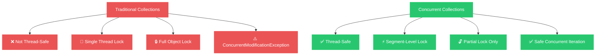

# Collections vs Concurrent Collections in Java

**Collections vs Concurrent Collections in Java** | Following are the limitations of traditional collection (`java.util` package) and how concurrent collections solve them.

- [Limitations of Traditional Collections](#limitations-of-traditional-collections)
- [ConcurrentModificationException Example](#concurrentmodificationexception-example)
- [Difference between Traditional and Concurrent Collections](#difference-between-traditional-and-concurrent-collections)

---

## 1. Limitations of Traditional Collections

Traditional collections from the `java.util` package have the following limitations:

1. 🔓 Most of the traditional collections are **not thread-safe** because at a time multiple threads are allowed to operate on collection objects which may lead to data inconsistency problems.
2. 🐢 Very few collections like `Vector`, `Hashtable`, `synchronizedList()`, `synchronizedSet()`, and `synchronizedMap()` are thread-safe but the problem with these thread-safe collections is: **At a time only one thread is allowed to operate.**
3. 🔒 For any operations (even for read operations) **complete collection object will be locked** by one thread which creates a performance issue.
4. ⚠️ While one thread iterates the collection object, the other threads are not allowed to perform any update operation on the underlying collection otherwise we will get `ConcurrentModificationException`.

> 🔑 **Key Point:** Hence these traditional collection objects are not suitable for scalable multithreaded applications. To overcome these problems, **concurrent collection was introduced in the 1.5 version.**



---

## 2. ConcurrentModificationException Example

While one thread is iterating the collection object, if the other thread is trying to modify the underlying collection object then it gives `ConcurrentModificationException`.

**Demonstrating ConcurrentModificationException:**

```java
import java.util.ArrayList;
import java.util.Iterator;
import java.util.List;

public class Test extends Thread {
    private static List<String> list = new ArrayList<>();

    @Override
    public void run() {
        try {
            Thread.sleep(2000);
        } catch (InterruptedException e) {
        }

        System.out.println("Child Thread updating list");
        list.add("Z");
    }

    public static void main(String[] args) throws InterruptedException {
        list.add("A");
        list.add("B");
        list.add("c");

        // create another thread
        Test test = new Test();
        test.start();

        // iterate list
        Iterator<String> iterator = list.iterator();
        while (iterator.hasNext()) {
            String string = iterator.next();
            System.out.println("Main thread, current element: " + string);
            Thread.sleep(3000);
        }

        System.out.println(list);
    }
}
```

📤 **Output:**

```
Main thread, current element: A
Child Thread updating list
Exception in thread "main" java.util.ConcurrentModificationException
```

---

## 3. Difference between Traditional and Concurrent Collections

| Feature | Traditional Collection 🔹 | Concurrent Collection 🔸 |
|---------|--------------------------|--------------------------|
| **Thread safety** | ❌️ Most collections are not thread-safe | ✅ Concurrent collections are always thread-safe |
| **Performance** | 🐢 Low performance (full object lock) | ⚡ High performance (segment-level locking) |
| **Concurrent iteration** | ❌️ Throws `ConcurrentModificationException` if modified during iteration | ✅ Allows safe modification during iteration |
| **Locking mechanism** | 🔒 Complete collection object locked | 🔓 Only segments/portions locked |

🔑 **Key Concurrent Collection Classes:**

- 🗺️ [ConcurrentHashMap](206_ConcurrentHashMap_Vs_HashMap.md) — Thread-safe `Map` with segment-level locking
- 📋 `CopyOnWriteArrayList` — Thread-safe `List` that creates a copy on write operations
- 📦 `CopyOnWriteArraySet` — Thread-safe `Set` based on `CopyOnWriteArrayList`

