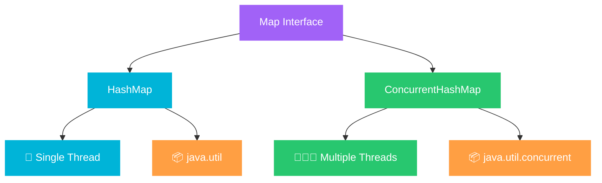

# ConcurrentHashMap Vs HashMap

**ConcurrentHashMap vs HashMap** | In this post we will see the difference between `HashMap` vs `ConcurrentHashMap`. The `HashMap` is defined in `java.util` package whereas `ConcurrentHashMap` is given in `java.util.concurrent` package. Both implement `Map` interface and store key-value pairs but they have many differences.

- [Overview](#overview)
- [Comparison Table](#comparison-table-between-concurrenthashmap-vs-hashmap)
- [Null Key and Value Handling](#null-key-and-value-handling)
- [ConcurrentHashMap vs HashMap In Multithreading](#concurrenthashmap-vs-hashmap-in-multithreading)

---

## 1. Overview

The **`HashMap`** is mainly given for **single thread applications** where only one thread performs all the operations but **`ConcurrentHashMap`** is the best choice for **multiple thread applications** where multiple threads perform operations simultaneously.



---

## 2. Comparison Table between ConcurrentHashMap Vs HashMap

| Feature | ConcurrentHashMap 🔒 | HashMap 🔓 |
|---------|---------------------|------------|
| **Thread safety** | ✅ Thread-safe | ❌️ Not thread-safe — multiple threads can work simultaneously leading to data inconsistency |
| **Version** | Introduced in **1.5** | Introduced in **1.2** |
| **Package** | `java.util.concurrent` | `java.util` |
| **Performance** | 🐢 Slightly lower — threads may wait for segment locks | ⚡ Higher — no thread waiting required |
| **Concurrent iteration** | ✅ Other threads can modify safely during iteration — no `ConcurrentModificationException` | ❌️ Other threads cannot modify during iteration — throws `ConcurrentModificationException` |
| **Iterator type** | Fail-safe — won't throw `ConcurrentModificationException` | Fail-fast — throws `ConcurrentModificationException` |
| **Null keys/values** | ❌️ Not allowed — throws `NullPointerException` | ✅ Allowed for both keys and values |

---

## 3. Null Key and Value Handling

Let us demonstrate ConcurrentHashMap vs HashMap through programs by inserting null values.

### ConcurrentHashMap — Null Not Allowed

`ConcurrentHashMap` is defined in `java.util.concurrent` package. Null is **not allowed** for both keys and values otherwise we will get a `NullPointerException`.

**ConcurrentHashMap null handling:**

```java
import java.util.concurrent.*;
public class Test {
   public static void main(String[] args) {
      ConcurrentHashMap<Integer, String> chm =
             new ConcurrentHashMap<Integer, String>();

      // insert some value
      chm.put(101, "A");
      chm.put(102, "B");
      System.out.println(chm); // {101=A, 102=B}

      /* Trying to insert null key or/and value */
      // chm.put(103, null); //  NullPointerException
      // chm.put(null, "C"); //  NullPointerException
      // chm.put(null, null); //  NullPointerException
   }
}
```

📤 **Output:**

```
{101=A, 102=B}
```

### HashMap — Null Allowed

`HashMap` is defined in the `java.util` package. Null is **allowed** for both keys and values.

**HashMap null handling:**

```java
import java.util.*;
public class Test {
   public static void main(String[] args) {
     HashMap<Integer, String> chm =
         new HashMap<Integer, String>();

      // insert some value
      chm.put(101, "A");
      chm.put(102, "B");
      System.out.println(chm); // {101=A, 102=B}

      /* trying to insert null key or/and value */
      chm.put(103, null);
      chm.put(null, "C");
      chm.put(null, null);
      System.out.println(chm);
   }
}
```

📤 **Output:**

```
{101=A, 102=B}
{null=null, 101=A, 102=B, 103=null}
```

---

## 4. ConcurrentHashMap vs HashMap In Multithreading

In a multithreading environment: `ConcurrentHashMap` is thread-safe whereas `HashMap` is not thread-safe. With a `HashMap` object, at a time multiple threads can perform different operations simultaneously.

With `ConcurrentHashMap` object:

- 📖 Multiple threads can perform **read operation** simultaneously
- ✏️ But a **limited number of threads** can perform update operations. By default (when we are using constructor `ConcurrentHashMap()`) maximum **16 threads** are allowed to perform simultaneously for update operation.

> ⚠️ **Caution:** While one thread iterates `HashMap` the other threads are not allowed to modify `HashMap` objects. Otherwise, we will get a Runtime exception: `ConcurrentModificationException`.

### HashMap — ConcurrentModificationException Example

**HashMap throws ConcurrentModificationException:**

```java
import java.util.*;
public class MyThread extends Thread {

   static Map<Integer, String> map =
            new HashMap<Integer, String>();

   public void run() {
      try {
         Thread.sleep(2000);
      } catch (InterruptedException ie) { }
      System.out.println("Child thread updating map");
      map.put(103, "C");
   }

   public static void main(String[] args) throws Exception {
      map.put(101, "A");
      map.put(102, "B");

      // create another thread
      MyThread mt = new MyThread();
      mt.start();

      // iterate Map
      Set s1 = map.keySet();
      Iterator itr = s1.iterator();
      while(itr.hasNext()) {
         Integer i1 = (Integer) itr.next();
         System.out.println("Main thread iterating"
            + " map & current entry is: "+ i1
            + "..." + map.get(i1));
         Thread.sleep(3000);
      }
      System.out.println(map);
   }
}
```

📤 **Output:**

```
Main thread iterating map & current entry is: 101...A
Child thread updating map
Exception in thread "main" java.util.ConcurrentModificationException
at java.base/java.util.HashMap$HashIterator.nextNode(HashMap.java:1584)
at java.base/java.util.HashMap$KeyIterator.next(HashMap.java:1607)
at MyThread.main(MyThread.java:28)
```

### ConcurrentHashMap — Safe Concurrent Modification

While one thread iterates `ConcurrentHashMap` the other threads are allowed to modify `ConcurrentHashMap` objects in a safe manner and it won't throw `ConcurrentModificationException`.

**ConcurrentHashMap handles concurrent modification safely:**

```java
import java.util.concurrent.*;
import java.util.*;
public class MyThread extends Thread {

   static Map<Integer, String> map =
            new ConcurrentHashMap<Integer, String>();

   public void run() {
      try {
         Thread.sleep(2000);
      } catch (InterruptedException ie) { }
      System.out.println("Child thread updating map");
      map.put(103, "C");
   }

   public static void main(String[] args) throws Exception {
      map.put(101, "A");
      map.put(102, "B");

      // create another thread
      MyThread mt = new MyThread();
      mt.start();

      // iterate Map
      Set s1 = map.keySet();
      Iterator itr = s1.iterator();
      while(itr.hasNext()) {
         Integer i1 = (Integer) itr.next();
         System.out.println("Main thread iterating"
            + " map & current entry is: "+ i1
            + "..." + map.get(i1));
         Thread.sleep(3000);
      }
      System.out.println(map);
   }
}
```

📤 **Output:**

```
Main thread iterating map & current entry is: 101...A
Child thread updating map
Main thread iterating map & current entry is: 102...B
Main thread iterating map & current entry is: 103...C
{101=A, 102=B, 103=C}
```

> 💡 **Tip:** Use `ConcurrentHashMap` when you need thread-safe operations with better performance than `Collections.synchronizedMap()`. It uses segment-level locking instead of locking the entire map.
