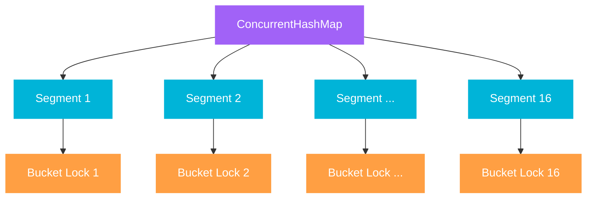

# ConcurrentMap Interface in Java

**ConcurrentMap Interface in Java** | We have seen why Concurrent collection was introduced and the difference between traditional collection (`java.util` package) vs concurrent collection (`java.util.concurrent` package).

- [putIfAbsent() Method of ConcurrentMap Interface in Java](#putifabsent-method-of-concurrentmap-interface-in-java)
- [remove(key, value) Method of ConcurrentMap Interface in Java](#removekey-value-method-of-concurrentmap-interface-in-java)
- [replace(key, oldValue, newValue) Method of ConcurrentMap Interface in Java](#replacekey-oldvalue-newvalue-method-of-concurrentmap-interface-in-java)
- [ConcurrentHashMap Class in Java](#concurrenthashmap-class-in-java)
- [ConcurrentHashMap vs synchronizedMap() vs Hashtable](#concurrenthashmap-vs-synchronizedmap-vs-hashtable)

---

The `ConcurrentMap` interface hierarchy:

- 🗺️ `Map(I)`
  - 🔒 `ConcurrentMap(I)`
    - ⚙️ `ConcurrentHashMap` class

The ConcurrentMap interface defines many methods. Some of the mostly used methods are as follows:

1. `putIfAbsent()`
2. `remove()`
3. `replace()`

---

## 1. putIfAbsent() Method of ConcurrentMap Interface in Java

Method signature: **`V putIfAbsent(K key, V value);`**

To add an entry to the map if the specified key is not already available. It works like this:

**Equivalent logic:**

```java
V putIfAbsent(K key, V value) {
   if(!map.containsKey(key)) {
      map.put(key, value);
   } else {
      return map.get(key);
   }
}
```

**Demonstration of `putIfAbsent()` method:**

```java
import java.util.concurrent.ConcurrentHashMap;

public class Test extends Thread {
    public static void main(String[] args) {
        ConcurrentHashMap<Integer, String> chm = new ConcurrentHashMap<>();
        chm.put(101, "Java");
        chm.putIfAbsent(101, "Python");
        System.out.println(chm); // {101=Java}
    }
}
```

| Feature 🔍 | `put()` 🅰️ | `putIfAbsent()` 🅱️ |
|------------|-----------|-------------------|
| **Key already exists** | Old value replaced with new value, returns old value | Entry won't be added, returns old associated value |
| **Key not available** | Entry will be added | Entry will be added |
| **Example** | `chm.put(101, "AAAA");` `chm.put(101, "BBBB");` `System.out.println(chm); // {101=BBBB}` | `chm.put(101, "AAAA");` `chm.putIfAbsent(101, "BBBB");` `System.out.println(chm); // {101=AAAA}` |

---

## 2. remove(key, value) Method of ConcurrentMap Interface in Java

Method prototype: **`boolean remove(Object key, Object value)`**

It removes the entry if the key is associated with the specified value. It works as follows:

**Equivalent logic:**

```java
Object remove(Object key, Object value) {
   if(map.containsKey(key) &&
      map.get(key).equals(value) ) {

      map.remove(key);
      return true;
   } else {
      return false;
   }
}
```

**Demonstration of `remove(key, value)` method:**

```java
import java.util.concurrent.ConcurrentHashMap;

public class Test extends Thread {
    public static void main(String[] args) {
        ConcurrentHashMap<Integer, String> chm = new ConcurrentHashMap<>();
        chm.put(101, "Java");
        System.out.println(chm.remove(101, "Python")); // false
        System.out.println(chm); // {101=Java}
        System.out.println(chm.remove(101, "Java")); // true
        System.out.println(chm); // {}
    }
}
```

| Feature 🔍 | `remove(key)` 🅰️ | `remove(key, value)` 🅱️ |
|------------|------------------|------------------------|
| **Behavior** | Removes the entry if the key is matched | Removes the entry if both key and value are matched, returns `true`. If not matched returns `false` |
| **Example** | `chm.put(101, "AAAA");` `chm.remove(101);` `System.out.println(chm); // {}` | `chm.put(101, "AAAA");` `chm.remove(101, "BBBB"); // false` `System.out.println(chm); // {101=AAAA}` `chm.remove(101, "AAAA"); // true` `System.out.println(chm); // {}` |

---

## 3. replace(key, oldValue, newValue) Method of ConcurrentMap Interface in Java

Method Signature: **`boolean replace(K key, V oldValue, V newValue)`**

If the key and oldValue matched then replace oldValue with newValue. It works as follows:

**Equivalent logic:**

```java
boolean replace(K key, V oldValue, V newValue) {
   if(map.containsKey(key) && map.get(key).equals(oldValue) ) {
      map.put(key, newValue);
      return true;
   } else {
      return false;
   }
}
```

**Demonstration of `replace(key, oldValue, newValue)` method:**

```java
import java.util.concurrent.ConcurrentHashMap;

public class Test extends Thread {
    public static void main(String[] args) {
        ConcurrentHashMap<Integer, String> chm = new ConcurrentHashMap<>();
        chm.put(101, "Java");
        chm.replace(101, "Know", "Python");
        System.out.println(chm); // {101=Java}
        chm.replace(101, "Java", "Python");
        System.out.println(chm); // {101=Python}
    }
}
```

---

## 4. ConcurrentHashMap Class in Java

- 🗄️ The underlying data structure is Hashtable.
- 🔒 ConcurrentHashMap allows concurrent read and thread-safe update operations.
- 🔑 **To perform read operation thread won't require any Lock. But to perform an update operation thread requires a lock but it is the lock of only a particular part of the Map (segment lock or bucket level lock).**
- 🧩 Concurrent update achieved by internally dividing Map into smaller portions which is defined by concurrency level.
- 📊 The default concurrency level is 16.
- 🔄 ConcurrentHashMap allows simultaneous multiple-read operations but simultaneously only 16 write/update operations.
- 🚫 Null is not allowed for both keys and values.
- ✅ While one thread iterates, another thread can perform an update operation and ConcurrentHashMap never throws `ConcurrentModificationException`.



🧠 **In Simple Words:**
How ConcurrentHashMap improves the performance compared with Hashtable: In Hashtable for performing any operation thread requires the lock of the complete Map object but in the case of ConcurrentHashMap thread won't require total map object lock. Instead, Thread requires segment lock or bucket level lock.

- **At a time how many threads are allowed to perform read operations simultaneously?**
  Multiple threads (Any number of threads). They don't require any lock.

- **At a time how many threads are allowed to perform update operations simultaneously?**
  By default 16 threads.

Hence waiting time for threads gets reduced and the performance of the system will be improved.

Concurrency level and number of buckets most of the time are the same. Therefore for every bucket a separate lock by default will be maintained.

- 📋 Default Initial capacity = 16
- 🔒 Concurrency level = 16

Concurrency level and initial capacity most of the time are same but need not be the same always. If both are the same then for 1 bucket, 1 lock is allocated. If both are not the same then based on concurrency level and initial capacity locks will be adjusted.

> 💡 **Tip:** Assume Default Initial capacity = 16 and Concurrency level = 8, then for every 2 buckets one lock will be maintained. Similarly, if Default Initial capacity = 16 and Concurrency level = 32, then for every bucket 2 locks will be maintained.

### Constructors of ConcurrentHashMap

- ⚙️ **`ConcurrentHashMap();`** It creates an empty ConcurrentHashMap with a default initial capacity of 16, a default fill ratio of 0.75, and default concurrency level = 16.
- 🔧 `ConcurrentHashMap(int initialCapacity);`
- 📋 `ConcurrentHashMap(int initialCapacity, float fillRatio);`
- 🔒 `ConcurrentHashMap(int initialCapacity, float fillRatio, int concurrencyLevel);`
- 🗺️ `ConcurrentHashMap(Map m);`

**Combined operations example:**

```java
import java.util.concurrent.ConcurrentHashMap;

public class Test extends Thread {
    public static void main(String[] args) {
        ConcurrentHashMap<Integer, String> chm = new ConcurrentHashMap<Integer, String>();
        chm.put(101, "A");
        chm.put(102, "B");
        chm.putIfAbsent(103, "C");
        chm.putIfAbsent(101, "D");
        chm.remove(101, "D");
        chm.replace(102, "B", "E");
        System.out.println(chm); // {101=A, 102=E, 103=C}
    }
}
```

ConcurrentHashMap is the best choice if the huge number of threads are working simultaneously.

While one thread iterating HashMap the other threads are not allowed to modify the HashMap object. Otherwise, we will get Runtime exception: `ConcurrentModificationException`.

**Demonstrating `ConcurrentModificationException`:**

```java
import java.util.HashMap;
import java.util.Iterator;
import java.util.Map;
import java.util.Set;

public class Test extends Thread {
    static Map<Integer, String> map = new HashMap<Integer, String>();

    public void run() {
        try {
            Thread.sleep(2000);
        } catch (InterruptedException ie) {
        }
        System.out.println("Child thread updating map");
        map.put(103, "C");
    }

    public static void main(String[] args) throws Exception {
        map.put(101, "A");
        map.put(102, "B");

        // create another thread
        Test test = new Test();
        test.start();

        // iterate Map
        Set<Integer> s1 = map.keySet();
        Iterator<Integer> itr = s1.iterator();
        while (itr.hasNext()) {
            Integer i1 = (Integer) itr.next();
            System.out.println("Main thread iterating"
                + " map & current entry is: " + i1 + "..." + map.get(i1));
            Thread.sleep(3000);
        }
        System.out.println(map);
    }

}
```

📤 **Output:**

```
Main thread iterating map & current entry is: 101...A
Child thread updating map
Exception in thread "main" java.util.ConcurrentModificationException
```

While one thread iterates ConcurrentHashMap another threads are allowed to modify the ConcurrentHashMap object in safe manner and it won't throw `ConcurrentModificationException`.

**Fix - Replace `HashMap` with `ConcurrentHashMap`:**

```java
static Map<Integer, String> map = new ConcurrentHashMap<Integer, String>();
```

📤 **Output:**

```
Main thread iterating map & current entry is: 101...A
Child thread updating map
Main thread iterating map & current entry is: 102...B
Main thread iterating map & current entry is: 103...C
{101=A, 102=B, 103=C}
```

📝 **Note:** While one thread iterating ConcurrentHashMap, and if the other thread trying to perform any modification then there is no guarantee that modification value will be available to the iterator.

---

## 5. ConcurrentHashMap vs synchronizedMap() vs Hashtable

| Feature 🔍 | ConcurrentHashMap 🅰️ | synchronizedMap() 🅱️ | Hashtable 🆎 |
|------------|---------------------|---------------------|-------------|
| **Thread Safety** | ✅ Without locking total Map object, just bucket-level lock | ✅ By locking the whole Map object | ✅ By locking the whole Map object |
| **Concurrent Access** | Multiple threads can operate on Map object safely | Only one thread at a time | Only one thread at a time |
| **Lock Granularity** | Read without lock, write with bucket level lock | Every read and write requires complete Map object lock | Every read and write requires complete Map object lock |
| **Modification During Iteration** | ✅ Allowed safely, no `ConcurrentModificationException` | ❌️ Not allowed, throws `ConcurrentModificationException` | ❌️ Not allowed, throws `ConcurrentModificationException` |
| **Iterator Type** | Fail-safe | Fail-fast | Fail-fast |
| **Null Keys/Values** | ❌️ Not allowed (`NullPointerException`) | ✅ Allowed for both | ❌️ Not allowed (`NullPointerException`) |
| **Version Introduced** | 1.5 | 1.2 | 1.0 |
