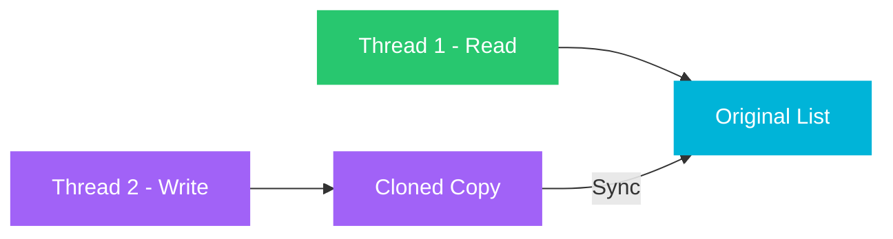

# CopyOnWriteArrayList In Java

**CopyOnWriteArrayList In Java** | It is a thread-safe version of ArrayList. As the name indicates CopyOnWriteArrayList creates a cloned copy of the underlying ArrayList for every update operation at a certain point both will synchronize automatically which is taken care by JVM internally.

- [CopyOnWriteArrayList.addIfAbsent() Method in Java](#copyonwritearraylistaddifabsent-method-in-java)
- [CopyOnWriteArrayList.addAllAbsent() Method in Java](#copyonwritearraylistaddallabsent-method-in-java)
- [CopyOnWriteArrayList Examples in Java](#copyonwritearraylist-examples-in-java)
- [Difference between ArrayList and CopyOnWriteArrayList](#difference-between-arraylist-and-copyonwritearraylist)
- [Difference between CopyOnWriteArrayList, synchronizedList() and Vector](#difference-between-copyonwritearraylist-synchronizedlist-and-vector)

---

The `CopyOnWriteArrayList` hierarchy:

- 📦 [Collection(I)](194_Java_Collection_Interface.md)
  - 📋 [List(I)](195_List_Interface_in_Java.md)
    - 🔒 CopyOnWriteArrayList

Key characteristics:

- 🔄 As the update operation will be performed on a cloned copy therefore there is no effect for the threads which performs read operations.
- 💰 It is costly to use because for every update operation a cloned copy will be created. Hence CopyOnWriteArrayList is the best choice if several read operations and fewer write operations are required.
- 📋 Insertion order is preserved.
- ✅ Duplicate objects are allowed.
- 🔀 Heterogeneous objects are allowed.
- 🚫 Null insertion is possible.
- 🔌 It implements `Serializable`, `Clonable`, and `RandomAccess` Interfaces.
- 🛡️ While one thread iterates CopyOnArrayList, the other threads are allowed to modify and we won't get `ConcurrentModificationException`. The iterator is fail-safe.
- ⚠️ The Iterator of ArrayList can perform the remove operation but the Iterator of CopyOnWriteArrayList can't perform the remove operation. Otherwise, it throws `UnsupportedOperationException`.



**Constructors of CopyOnWriteArrayList:**

1. `CopyOnWriteArrayList();`
2. `CopyOnWriteArrayList(Collection c);`
3. `CopyOnWriteArrayList(Object[] a);`

---

## 1. CopyOnWriteArrayList.addIfAbsent() Method in Java

**`boolean addIfAbsent(Object o)`** - The element will be added if and only if the List doesn't contain this Element.

**addIfAbsent() example:**

```java
import java.util.concurrent.CopyOnWriteArrayList;

public class Test {
    public static void main(String[] args) {
        CopyOnWriteArrayList<String> cowal = new CopyOnWriteArrayList<String>();
        cowal.add("A");
        cowal.add("A");
        System.out.println(cowal); // [A, A]

        System.out.println(cowal.addIfAbsent("B")); // true
        System.out.println(cowal); // [A, A, B]

        System.out.println(cowal.addIfAbsent("A")); // false
        System.out.println(cowal); // [A, A, B]
    }
}
```

📤 **Output:**

```
[A, A]
true
[A, A, B]
false
[A, A, B]
```

---

## 2. CopyOnWriteArrayList.addAllAbsent() Method in Java

**`int addAllAbsent(Collection c)`** - The elements of Collection will be added to the List if elements are absent and returns the number of elements added.

**addAllAbsent() example:**

```java
import java.util.ArrayList;
import java.util.concurrent.CopyOnWriteArrayList;

public class Test {
    public static void main(String[] args) {
        ArrayList<String> al = new ArrayList<String>();
        al.add("A");
        al.add("B");

        CopyOnWriteArrayList<String> cal = new CopyOnWriteArrayList<String>();
        cal.add("A");
        cal.add("C");
        cal.addAll(al);
        System.out.println(cal); // [A, B, A, C]

        ArrayList<String> al2 = new ArrayList<String>();
        al2.add("A");
        al2.add("D");

        System.out.println(cal.addAllAbsent(al2));
        /*
         * From al2, "A" is already available in cal but "D" is not present in cal
         */
        System.out.println(cal); // [A, B, A, C, D]
    }
}
```

📤 **Output:**

```
[A, C, A, B]
1
[A, C, A, B, D]
```

---

## 3. CopyOnWriteArrayList Examples in Java

**Example-1:**

```java
import java.util.ArrayList;
import java.util.concurrent.CopyOnWriteArrayList;

public class Test {
    public static void main(String[] args) {
        ArrayList<String> al = new ArrayList<String>();
        al.add("A");
        al.add("B");

        CopyOnWriteArrayList<String> cal = new CopyOnWriteArrayList<String>();
        cal.addIfAbsent("A");
        cal.addIfAbsent("C");
        cal.addAll(al);
        System.out.println(cal); // [A, C, A, B]

        ArrayList<String> al2 = new ArrayList<String>();
        al2.add("A");
        al2.add("E");

        System.out.println(cal.addAllAbsent(al2));
        System.out.println(cal); // [A, C, A, B, E]
    }
}
```

📤 **Output:**

```
[A, C, A, B]
1
[A, C, A, B, E]
```

**Example-2: Thread-safe iteration:**

```java
import java.util.Iterator;
import java.util.concurrent.CopyOnWriteArrayList;

public class MyThread extends Thread {

    static CopyOnWriteArrayList<String> list = new CopyOnWriteArrayList<String>();

    public void run() {
        try {
            Thread.sleep(2000);
        } catch (InterruptedException ie) {
        }
        System.out.println("Child thread updating list");
        list.add("Z");
    }

    public static void main(String[] args) throws Exception {
        list.add("A");
        list.add("B");
        list.add("C");

        // create another thread
        MyThread mt = new MyThread();
        mt.start();

        // iterate list
        Iterator<String> itr = list.iterator();
        while (itr.hasNext()) {
            String str = (String) itr.next();
            System.out.println("Main thread iterating"
                 + " list & current object is: " + str);
            Thread.sleep(3000);
        }
        System.out.println(list);
    }
}
```

📤 **Output:**

```
Main thread iterating list & current object is: A
Child thread updating list
Main thread iterating list & current object is: B
Main thread iterating list & current object is: C
[A, B, C, Z]
```

In the above example, while the main thread iterating the List, the child thread is allowed to modify and we won't get any `ConcurrentModificationException`.

- ⚠️ If we replace CopyOnWriteArrayList with ArrayList then we will get `ConcurrentModificationException`.
- 🚫 The iterator of CopyOnWriteArrayList can't perform remove operation otherwise we will get RuntimeException: `UnsupportedOperationException`.

**Example-3: Iterator remove operation throws exception:**

If it is a normal ArrayList iterator then it can perform both read and remove operations. But the CopyOnWriteArrayList iterator can perform only read operation but not remove operation else we will get `UnsupportedOperationException`.

```java
import java.util.Iterator;
import java.util.concurrent.CopyOnWriteArrayList;

public class Test {
    public static void main(String[] args) {
        CopyOnWriteArrayList<String> cal = new CopyOnWriteArrayList<String>();
        cal.add("A");
        cal.add("B");
        cal.add("C");
        System.out.println(cal); // [A, B, C]

        Iterator<String> itr = cal.iterator();
        while (itr.hasNext()) {
            String str = (String) itr.next();
            if (str.equals("C"))
                itr.remove();
        }
        System.out.println(cal);
    }
}
```

📤 **Output:**

```
[A, B, C]
Exception in thread "main" java.lang.UnsupportedOperationException
at java.base/java.util.concurrent.CopyOnWriteArrayList$COWIterator.remove(CopyOnWriteArrayList.java:1124)
at Test.main(Test.java:26)
```

💡 **Tip:** In the above program if we replace CopyOnWriteArrayList with ArrayList then we won't get any Exception. In this case, the output is:

```
[A, B, C]
[A, B]
```

**Example-4: Adding after iterator:**

```java
import java.util.Iterator;
import java.util.concurrent.CopyOnWriteArrayList;

public class Test {
    public static void main(String[] args) {
        CopyOnWriteArrayList<String> cal = new CopyOnWriteArrayList<String>();
        cal.add("A");
        cal.add("B");
        cal.add("C");
        System.out.println(cal); // [A, B, C]

        Iterator<String> itr = cal.iterator();
        cal.add("D"); // add element
        while (itr.hasNext()) {
            String str = (String) itr.next();
            System.out.println(str);
        }
    }
}
```

📤 **Output:**

```
[A, B, C]
A
B
C
```

🔑 **Key Point:**

- 🔄 Every update operation will be performed on a separate copy hence after getting an iterator if we are trying to perform any modification to the List it won't be reflected in the iterator.
- ⚠️ In the above program if we replace CopyOnWriteArrayList with ArrayList then we will get `ConcurrentModificationException`.

📤 **Output with ArrayList:**

```
[A, B, C]
Exception in thread "main" java.util.ConcurrentModificationException
at java.base/java.util.ArrayList$Itr.checkForComodification(ArrayList.java:1013)
at java.base/java.util.ArrayList$Itr.next(ArrayList.java:967)
at Test.main(Test.java:25)
```

---

## 4. Difference between ArrayList and CopyOnWriteArrayList

| Feature 🔍 | ArrayList 🅰️ | CopyOnWriteArrayList 🅱️ |
|------------|-------------|------------------------|
| **Thread Safety** | ❌️ Not thread-safe | ✅ Thread-safe (update on separate cloned copy) |
| **Modification During Iteration** | ❌️ Not allowed, throws `ConcurrentModificationException` | ✅ Allowed safely |
| **Iterator Type** | Fail-fast | Fail-safe |
| **Iterator Operations** | Can perform both read and remove | Can perform only read, remove throws `UnsupportedOperationException` |
| **Version Introduced** | 1.2 | 1.5 |
| **Package** | `java.util` | `java.util.concurrent` |

---

## 5. Difference between CopyOnWriteArrayList, synchronizedList() and Vector

| Feature 🔍 | CopyOnWriteArrayList 🅰️ | synchronizedList() 🅱️ | Vector 🆎 |
|------------|------------------------|---------------------|----------|
| **Thread Safety Mechanism** | Every update on separate cloned copy | Only one thread can access at a time | Only one thread can access at a time |
| **Concurrent Access** | ✅ Multiple threads allowed | ❌️ Only one thread at a time | ❌️ Only one thread at a time |
| **Modification During Iteration** | ✅ Allowed, no `ConcurrentModificationException` | ❌️ Throws `ConcurrentModificationException` | ❌️ Throws `ConcurrentModificationException` |
| **Iterator Type** | Fail-safe | Fail-fast | Fail-fast |
| **Iterator Remove** | ❌️ Throws `UnsupportedOperationException` | ✅ Can perform remove | ✅ Can perform remove |
| **Version Introduced** | 1.5 | 1.2 | 1.0 |
