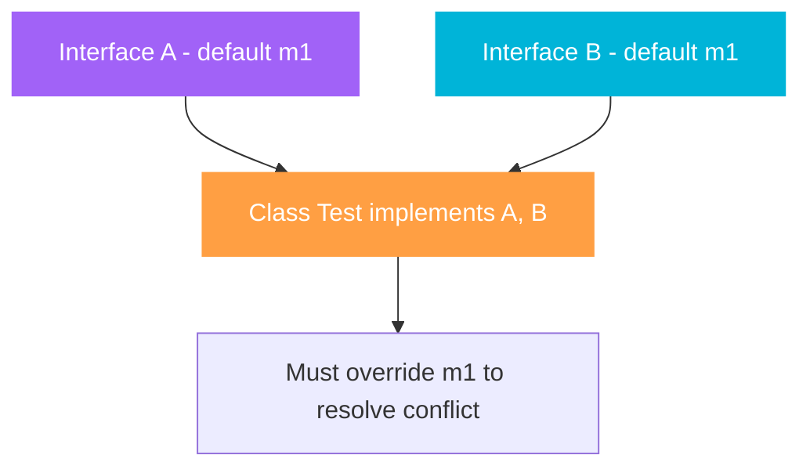

# Default Methods In Interface In Java

**Default Methods In Interface In Java** | From Java 1.8 version onwards, we can also define default methods in an interface. Let us see what it means, how to define default methods in an interface, how to use them, and more. Also see: [Java 8: Static Methods in Interface](211_Static_Methods_In_Interface_In_Java.md)

- [Default Methods in Multiple Inheritance](#default-methods-in-multiple-inheritance)
- [Differences Between Interface with Default Methods and Abstract Class](#differences-between-interface-with-default-methods-and-abstract-class)

---

- 📜 Until Java 1.7 version, An interface can contain only **public abstract methods** and **public static final variables**. Till Java 1.7 version, every method present inside an interface is always public and abstract whether we are declaring or not.
- 🔒 Every variable declared inside the interface is always public static final whether we are declaring or not.
- 🔌 From Java 1.8 version onwards in addition to these, we can also declare **default concrete methods** inside the interface, which are also known as defender methods.

We can declare a default method with the keyword `default` as follows. Note that this `default` isn't representing the modifier:

**Default method declaration:**

```java
interface intf {
   default void m1(){
      System.out.println ("Default Method");
   }
}
```

Default methods declared in Interface are by default available to all implementation classes. Based on the requirement, the implementation class can use these default methods directly or can override them.

**Using default method directly:**

```java
interface Interf {
   default void m1(){
      System.out.println("Default Method");
   }
}
public class Test implements Interf {
   public static void main(String[] args) {
      Test t = new Test();
      t.m1();
   }
}
```

📤 **Output:**

```
Default Method
```

Default methods are also known as defender methods or virtual extension methods. The main advantage of default methods is without affecting implementation classes we can add new functionality to the interface (backward compatibility).

**Overriding default method:**

```java
interface interf {
   default void m1(){
      System.out.println("Default Method");
   }
}
public class Test implements Interf {
   @Override
   public void m1() {
      System.out.println("Test class m1()");
   }
   public static void main(String[] args) {
      Test t = new Test();
      t.m1();

      Interf i2 = new Test();
      i2.m1();
   }
}
```

📤 **Output:**

```
Test class m1()
Test class m1()
```

> 📝 **Note:** We can't override Object class methods as default methods inside the interface otherwise we will get compile time error. Reason: Object class methods are by-default available to every Java class hence it's not required to bring through default methods.

**Invalid default method:**

```java
interface Interf {
   default int hashCode() {
      return 10;
   }
}
```

🚨 **Compile-time error:** A default method cannot override a method from `java.lang.Object`.

---

## 1. Default Methods in Multiple Inheritance

Two interfaces can contain a default method with the same signature. In that case, there may be a chance of ambiguity problem (diamond problem) in the implementation class which is implementing both interfaces. To overcome this problem, **we must override the default method in the implementation class otherwise we get compile time error**.

In the implementation class, we can provide a completely new implementation or we can call any interface method as follows: `interface-name.super.methodName();`

**Diamond problem resolution:**

```java
interface A {
    default void m1() {
        System.out.println("A Default Method");
    }
}

interface B {
    default void m1() {
        System.out.println("B Default Method");
    }
}

class Test implements A, B {
    public void m1() {
        System.out.println("Test Class Method");
        // Or
        // A.super.m1();
        // Or,
        // B.super.m1();
    }

    public static void main(String[] args) {
        Test t = new Test();
        t.m1();

        // We can't use them here
        // A.super.m1(); // Compile-time Error
        // B.super.m1(); // Compile-time Error
    }
}
```



---

## 2. Differences Between Interface with Default Methods and Abstract Class

Even though we can add concrete methods in the form of default methods to the interface, it won't be equal to an abstract class. Interface with the default method is not exactly similar to an abstract class.

| Feature 🔍 | Interface with Default Methods 🅰️ | Abstract Class 🅱️ |
|------------|----------------------------------|------------------|
| **Instance Variables** | ❌️ Never talks about state of Object, no instance variables | ✅ Can contain instance variables required for child class |
| **Object State** | ❌️ Cannot talk about state of Object | ✅ Can talk about state of Object |
| **Constructors** | ❌️ Cannot declare Constructors | ✅ Can declare Constructors |
| **Instance/Static Blocks** | ❌️ Cannot declare Instance and static blocks | ✅ Can declare Instance and static blocks |
| **Lambda Expression** | ✅ Functional interface with default methods can refer to lambda expression | ❌️ Cannot refer to Lambda Expressions |
| **Object Class Methods** | ❌️ Cannot override Object class methods | ✅ Can override Object class methods |
