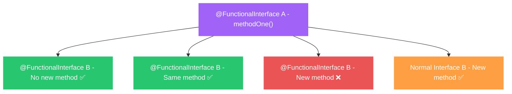

# Functional Interface In Java

**Functional Interface In Java** | If an interface contains only one abstract method, such type of interface is called a functional interface and the method is called a functional method or single abstract method (SAM).

- [@FunctionalInterface Annotation in Java](#functionalinterface-annotation-in-java)
- [Functional Interface With Respect To Inheritance in Java](#functional-interface-with-respect-to-inheritance-in-java)
- [Functional Interface and Object Class Methods](#functional-interface-and-object-class-methods)
- [Summary of Functional Interface In Java](#summary-of-functional-interface-in-java)

---

| Functional Interface 🏷️ | Method Contains 📋 |
|--------------------------|-------------------|
| **Runnable** | `run()` |
| **Comparable** | `compareTo()` |
| **ActionListener** | `actionPerformed()` |
| **Callable** | `call()` |

Inside the functional interface in addition to a single Abstract method (SAM), **it can have any number of default and static methods.** From Java 1.8 version onwards interface can contain default and static methods. See more: [Default Methods In Interface](210_Default_Methods_In_Interface_In_Java.md), [Static Methods In Interface](211_Static_Methods_In_Interface_In_Java.md)

> 📝 **Note:** In the functional interface, the restriction is only on the abstract method (it can have only 1 abstract method), but there is no restriction on static and default methods. **A functional interface can contain only 1 abstract method, but it can also contain any number of default and static methods.**

**Functional interface with default and static methods:**

```java
interface Inf {
   public void m1();
   // default method
   default void m2() { }
   // static method
   public static m3() { }
}
```

Is the below interface a functional interface?

```java
interface Inf1 {
   public void m1();
   public void m2();
}
```

❌️ No, it is not a functional interface because a functional interface can contain only 1 abstract method. But the above interface `Inf1` contains more than 1 abstract method.

---

## 1. @FunctionalInterface Annotation in Java

In Java 8, `@FunctionalInterface` annotation was introduced to specify that the interface is Functional Interface. Who will use this information? The compiler will use this information. The compiler will check the following details if an interface has `@FunctionalInterface` annotation then the **interface must have exactly 1 abstract method** else the compiler will give an error.

> 📝 **Note:** `@FunctionalInterface` annotation is used at the interface declaration level, but not on the method/variable/block level.

**Valid functional interface:**

```java
@FunctionalInterface
Interface Interf {
   public void m1();
}
```

This code compiles without any compilation errors. Inside Functional Interface we can take exactly one abstract method if we take more than one abstract method then the compiler gives a compilation error.

**Invalid - multiple abstract methods:**

```java
@FunctionalInterface
interface Interf {
   public void m1();
   public void m2();
}
```

🚨 **Compile-time error:**

```
error: Unexpected @FunctionalInterface annotation
@FunctionalInterface
^
Interf is not a functional interface
multiple non-overriding abstract methods found in interface Interf
```

Inside Functional Interface we have to take exactly only one abstract method. If we are not declaring that abstract method in that case also, the compiler gives an error message.

**Invalid - no abstract method:**

```java
@FunctionalInterface
interface Interf {
   // default method
   public void m1() { }
}
```

🚨 **Compile time error:** Interface abstract methods cannot have body.

---

## 2. Functional Interface With Respect To Inheritance in Java

**1) If an interface extends Functional Interface and the child interface doesn't contain any abstract method then the child interface is also Functional Interface.**

```java
@FunctionalInterface
interface A {
   public void methodOne();
}

@FunctionalInterface
interface B extends A {
   // valid
}
```

**2) In the child interface we can define exactly the same parent interface abstract method.**

```java
@FunctionalInterface
interface A {
   public void methodOne();
}

@FunctionalInterface
interface B extends A {
   public void methodOne();
}
```

✅ For interface B we won't get any compile-time errors.

**3) In the child interface we can't define any new abstract methods otherwise child interface won't be a Functional Interface and if we are trying to use `@FunctionalInterface` annotation then the compiler gives an error message.**

```java
@FunctionalInterface
interface A {
   public void methodOne();
}

@FunctionalInterface
interface B extends A {
   public void methodTwo();
}
```

🚨 **Compile-time Error:**

```
error: Unexpected @FunctionalInterface annotation
@FunctionalInterface
^
B is not a functional interface
multiple non-overriding abstract methods found in interface B
```

**4) If the abstract method is also available in the child interface then it can be a normal interface but not a functional interface.**

```java
@FunctionalInterface
interface A {
   public void methodOne();
}

// This is Normal interface.
// Doesn't have @FunctionalInterface
// So code compiles without error
interface B extends A {
   public void methodTwo();
}
```

💡 **Tip:** In the above examples, in both parent & child interfaces, we can write any number of default methods and there are no restrictions. Restrictions are applicable only for abstract methods.



---

## 3. Functional Interface and Object Class Methods

In Java, if an interface declares a method that's the same as one from the `Object` class (like `equals()`, `hashCode()`, or `toString()`), that method doesn't count as an abstract method of the interface. Why? Because any class implementing that interface will automatically have those methods from `Object` anyway, whether it's declared in the interface or not.

🛠️ **Example:** Comparator interface of `java.util` package. It contains two abstract methods `compare()` and `equals()` methods.

```java
@FunctionalInterface
public interface Comparator<T> {
    // abstract methods
    int compare(T o1, T o2);
    boolean equals(Object obj);

    // default methods
    default Comparator<T> reversed() {
        return Collections.reverseOrder(this);
    }
    // other default methods ...

    // static methods
    public static <T extends Comparable<? super T>> Comparator<T> reverseOrder() {
        return Collections.reverseOrder();
    }
    // other static methods ...
}
```

✅ The interface below is functional because the Object class method will override one of its abstract methods.

```java
@FunctionalInterface
public interface fun1 {
    long add(long a, int b);

    boolean equals(Object obj);
}
```

❌️ The below interface is not a functional interface and the compiler gives an error: Invalid `@FunctionalInterface` annotation; `fun1` is not a functional interface.

```java
@FunctionalInterface
public interface fun1 {
    boolean equals(Object obj);
}
```

---

## 4. Summary of Functional Interface In Java

The conclusion on the functional interface is:

- 1️⃣ It must contain exactly one abstract method (single abstract method).
- 🔌 It can contain any number of default and static methods.
- 🏷️ To indicate any interface as a functional interface we can use the `@FunctionalInterface` interface.
- ⚡ It acts as a type of lambda expression.
- 🔗 It can be used to invoke lambda expression.
- 🧩 Object class methods are not counted while evaluating whether the interface is a functional interface or not.
