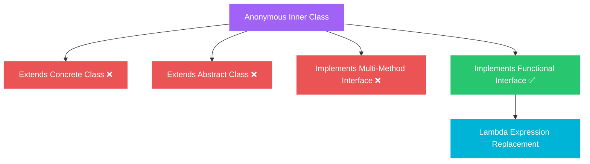

# Anonymous Inner Classes vs Lambda Expressions In Java

**Anonymous Inner Classes vs Lambda Expressions in Java** | As a beginner we can find the inner class and lambda expression very similar, and we may think that lambda expression is an alternative for the anonymous inner class, but that's not true. There is only a particular case when the lambda expression is an alternative for the anonymous inner class. Let us discuss it in more detail.

- [When Lambda Expression Is An Alternative To Anonymous Inner Class?](#when-lambda-expression-is-an-alternative-to-anonymous-inner-class)
- [Functioning of "this" Keyword in Anonymous Inner Classes vs Lambda Expressions In Java](#functioning-of-this-keyword-in-anonymous-inner-classes-vs-lambda-expressions-in-java)
- [Differences Between Anonymous Inner Classes and Lambda Expression in Java](#differences-between-anonymous-inner-classes-and-lambda-expression-in-java)

---

**Anonymous Inner class example:**

```java
public class InnerClassTest {
    public static void main(String[] args) {
        Runnable runnable = new Runnable() {
            // Anonymous Inner Class
            @Override
            public void run() {
                // loop executed by child thread
                for (int i = 0; i < 3; i++) {
                    System.out.println("Child Thread");
                }
            }
        };
        Thread thread = new Thread(runnable);
        thread.start();

        // loop executed by main thread
        for (int i = 0; i < 3; i++) {
            System.out.println("Main Thread");
        }
    }
}
```

📤 **Output:**

```
Main Thread
Main Thread
Main Thread
Child Thread
Child Thread
Child Thread
```

Wherever the Anonymous Inner class concept is there, there may be a chance of using Lambda Expression.

**Lambda Expression equivalent:**

```java
public class LambdaExpressionTest {
    public static void main(String[] args) {
        // Lambda Expression
        Runnable runnable = () -> {
            // loop executed by child thread
            for (int i = 0; i < 3; i++) {
                System.out.println("Child Thread");
            }
        };
        Thread thread = new Thread(runnable);
        thread.start();

        // loop executed by main thread
        for (int i = 0; i < 3; i++) {
            System.out.println("Main Thread");
        }
    }
}
```

Instead of defining `Thread thread = new Thread(runnable);`, and `runnable` separately we can define them together.

**Inline lambda expression:**

```java
public class LambdaExpressionTest {
    public static void main(String[] args) {
        // Lambda Expression
        Thread thread = new Thread(() -> {
            // loop executed by child thread
            for (int i = 0; i < 3; i++) {
                System.out.println("Child Thread");
            }
        });
        thread.start();

        // loop executed by main thread
        for (int i = 0; i < 3; i++) {
            System.out.println("Main Thread");
        }
    }
}
```

---

## 1. When Lambda Expression Is An Alternative To Anonymous Inner Class?

An anonymous inner class can extend a concrete class, can extend an abstract class, and can implement the interface with any number of methods but Lambda expression can implement an interface with only a single abstract method (Functional Interface). Hence if the anonymous inner class implements Functional Interface in that particular case only we can replace it with lambda expressions. Wherever the anonymous inner class concept is there, it may not possible to replace it with Lambda expressions. **An anonymous inner class is not equal to Lambda Expression.**

Not all anonymous inner classes can be replaced with lambda expressions. The lambda expression is not an alternative for the anonymous inner class. Consider the below 4 cases of anonymous inner class and guess in which case the anonymous inner class can be replaced with the lambda expression.

**Case-1: Anonymous inner class extending concrete class.**

```java
class Test {
    // Concrete class code
}

class Demo {
    public static void main(String[] args) {
        // Anonymous inner class that extends concrete class
        Test test = new Test() {
            // Annonymous inner class code
        };
    }
}
```

**Case-2: Anonymous inner class extending abstract class.**

```java
abstract class Test {
    // Abstract class code
}

class Demo {
    public static void main(String[] args) {
        // Anonymous inner class that extends abstract class
        Test test = new Test() {
            // Annonymous inner class code
        };
    }
}
```

**Case-3: Anonymous inner class implementing interface which contains multiple abstract methods.**

```java
interface Test {
    // interface containing multiple abstract methods
    public void m1();
    public void m2();
    public void m3();
}

class Demo {
    public static void main(String[] args) {
        // Anonymous inner class that implements
        // an interface which contains multiple methods
        Test test = new Test() {
            public void m1() {
                System.out.println("m1");
            }

            public void m2() {
                System.out.println("m2");
            }

            public void m3() {
                System.out.println("m3");
            }
        };
        test.m1();
        test.m2();
        test.m3();
    }
}
```

**Case-4: Anonymous inner class implementing an interface that contains only one abstract method.**

```java
@FunctionalInterface
interface Test {
    // interface containing only one abstract method
    // i.e. it is a functional interface
    public void m1();
}

class Demo {
    public static void main(String[] args) {
        // Anonymous inner class that implements
        // an interface which contains only one abstract method
        Test test = new Test() {
            public void m1() {
                System.out.println("m1");
            }
        };
        test.m1();
    }
}
```

> 🔑 **Key Point:** When we can go for lambda expression? When the interface contains only one abstract method i.e. **interface is a functional interface**. When the interface contains multiple abstract methods then we can't go for lambda expression. An anonymous class can extend a concrete class or abstract class but Lambda expression is not applicable to a concrete class or abstract class.

An anonymous class can implement an interface containing multiple abstract methods but lambda expression is not applicable in that case. Among the above four cases, only in 4th case lambda expression can be used in place of the anonymous inner class.

**Case-4 with Lambda Expression:**

```java
@FunctionalInterface
interface Test {
    // interface containing only one abstract method
    // i.e. it is a functional interface
    public void m1();
}

class Demo {
    public static void main(String[] args) {
        // Lambda Expression
        Test test = () -> {
            System.out.println("m1");
        };
        test.m1();
    }
}
```



| Feature 🔍 | Anonymous Inner Class 🅰️ | Lambda Expression 🅱️ |
|------------|-------------------------|---------------------|
| **Concrete/Abstract classes** | ✅ Can extend abstract and concrete classes | ❌️ Cannot extend abstract and concrete classes |
| **Interface with multiple methods** | ✅ Can implement interface with any number of abstract methods | ❌️ Cannot implement multi-method interface |
| **Functional Interface** | ✅ Can implement | ✅ Can implement (single abstract method) |

---

## 2. Functioning of "this" Keyword in Anonymous Inner Classes vs Lambda Expressions In Java

**The `this` works differently in the anonymous inner class and in the lambda expressions. Inside the anonymous inner class `this` always refers current class instance variable but in the lambda expression `this` always refers to outer class members. The code written for lambda expression is actually written for implemented method, therefore, all variables declared is a local variables.**

Inside the anonymous inner class, we can declare instance variables. Inside the anonymous inner class `this` always refers current inner class object (anonymous inner class) but not the related outer class object. Inside the lambda expression, we can't declare instance variables. Whatever the variables declared inside lambda expression simply act as local variables. Within lambda expression `this` keyword represents the current outer class object reference (that is a current enclosing class reference in which we declare lambda expression).

**"this" in Anonymous Inner Class:**

```java
@FunctionalInterface
interface Demo {
    public void m1();
}

class Test {
    int x = 123;

    public void m2() {
        Demo demo = new Demo() {
            // instance variable of inner class
            int x = 456;

            @Override
            public void m1() {
                System.out.println("this.x: " + this.x);
                System.out.println("x: " + x);
                // "this" always refer current class object
                System.out.println("Test.this.x: " + Test.this.x);
            }
        };
        demo.m1();
    }

    public static void main(String[] args) {
        Test test = new Test();
        test.m2();
    }
}
```

📤 **Output:**

```
this.x: 456
x: 456
Test.this.x: 123
```

**"this" in Lambda Expression:**

```java
@FunctionalInterface
interface Demo {
    public void m1();
}

class Test {
    int x = 123;

    public void m2() {
        Demo demo = () -> {
            // local variable of m1() method
            int x = 456;
            // inside lambda expression we can't
            // declare instance variable
            System.out.println("x: " + x);

            System.out.println("this.x: " + this.x);
        };
        demo.m1();
    }

    public static void main(String[] args) {
        Test test = new Test();
        test.m2();
    }
}
```

📤 **Output:**

```
x: 456
this.x: 123
```

---

## 3. Differences Between Anonymous Inner Classes and Lambda Expression in Java

| Feature 🔍 | Anonymous Inner Class 🅰️ | Lambda Expression 🅱️ |
|------------|-------------------------|---------------------|
| **Instance Variables** | ✅ Can declare instance variables | ❌️ Variables declared are simply local variables |
| **Instantiation** | ✅ Can be instantiated, can create an object | ❌️ Cannot be instantiated, can't create object |
| **"this" keyword** | Refers to current anonymous inner class object | Refers to current outer class object (enclosing class) |
| **Best Choice** | When handling multiple methods | When handling interface with single abstract method (Functional Interface) |
| **Class File Generation** | Separate `.class` file generated (`outerclass$1.class`) | No `.class` file generated, converts to private method in outer class |
| **Memory** | Allocated on demand when creating object | Resides in permanent memory of JVM (Method Area) |

**Lambda with enclosing class variables:**

```java
interface Interf {
  public void m1();
}
class Test {
  int x = 777;
  public void m2() {
    Interf i = () -> {
      int x = 888;
      System.out.println(x); // 888
      System.out.println(this.x); // 777
    };
    i.m1();
  }
  public static void main(String[] args) {
    Test t = new Test();
    t.m2();
  }
}
```

📤 **Output:**

```
888
777
```

- 🔗 From lambda expression, we can access enclosing class variables and enclosing method variables directly.
- 🔒 The local variables referenced from lambda expression are implicitly final and hence we can't perform re-assignment for those local variables otherwise we get compile time error.

**Local variable final restriction example:**

```java
interface Interf {
   public void m1();
}
class Test {
   int x = 10;
   public void m2() {
      int y = 20;
      Interf i = () -> {
         System.out.println(x); // 10
         System.out.println(y); // CE
         x = 888;
         y = 999; // CE
      };
      i.m1();
      y = 777;
   }
   public static void main(String[] args) {
      Test t = new Test();
      t.m2();
   }
}
```

🚨 **Compile-time error:**

```
Test.java:10: error: local variables referenced from a lambda expression must be final or effectively final
         System.out.println(y); // 20
                            ^
Test.java:12: error: local variables referenced from a lambda expression must be final or effectively final
         y = 999; // CE
         ^
2 errors
```

> ⚠️ **Caution:** Within the lambda expression or outside the lambda expression, we can't change the value of local variables which are referenced from the lambda expression.

Also see: [Default Methods In Interface](210_Default_Methods_In_Interface_In_Java.md)

**Valid example with final local variable:**

```java
interface A {
    public void m1();
}

class Test {
    int x = 10;

    public void m2() {
        final int y = 20;
        A i = () -> {
            System.out.println(x); // 10
            System.out.println(y); // 20
            x = 888;
        };
        i.m1();
    }

    public static void main(String[] args) {
        Test t = new Test();
        t.m2();
    }
}
```

📤 **Output:**

```
10
20
```
