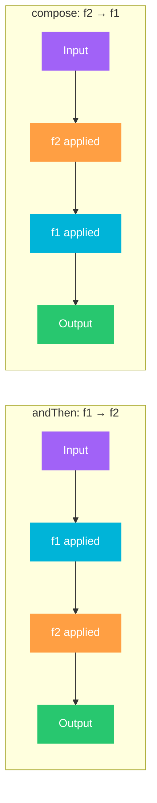

# Java Function Interface

**Java Function Interface** | Java contains multiple pre-defined functional interfaces like Predicate, Function, Supplier, Consumer, and e.t.c. We have already discussed many examples of Predicate functional interfaces using Lambda expression. Let us see examples of Function interfaces using the lambda expression.

- [Java Function Interface Example Using Lambda Expression](#java-function-interface-example-using-lambda-expression)
- [Java Function Interface Default Methods: andThen() and compose()](#java-function-interface-default-methods-andthen--compose)
- [Java Function Interface Static Method: identity()](#java-function-interface-static-method-identity)
- [Differences Between Predicate and Function Interface](#differences-between-predicate-and-function-interface)

---

- 🔀 The Function interface is very much similar to the Predicate interface except that the Function interface can return any type of value whereas Predicate returns only a boolean type value.
- 📤 The Function should (can) return only one value and that value can be any type as per our requirement.
- 🧮 To implement mathematical functions (which can return any type value; 1 value), Oracle introduced the Function interface in the 1.8 version.
- 📦 Function interface present in `java.util.function` package.
- ⚡ The Functional interface contains only one abstract method: **`apply()`**.
- 🔗 Since the Function interface is a **[functional interface](212_Functional_Interface_In_Java.md)** therefore it can refer to [lambda expression](213_Lambda_Expression_in_Java.md).

**Function interface definition:**

```java
public interface Function<T, R> {

    R apply(T t);

    default <V> Function<V, R> compose(Function<? super V, ? extends T> before) {
        Objects.requireNonNull(before);
        return (V v) -> apply(before.apply(v));
    }

    default <V> Function<T, V> andThen(Function<? super R, ? extends V> after) {
        Objects.requireNonNull(after);
        return (T t) -> after.apply(apply(t));
    }

    static <T> Function<T, T> identity() {
        return t -> t;
    }
}
```

Here `R` represents the return type and `T` represents the input type. The Function interface contains one abstract method: **`apply()`**, two [default methods](210_Default_Methods_In_Interface_In_Java.md): **`compose()`**, **`andThen()`**, and one [static method](211_Static_Methods_In_Interface_In_Java.md): **`identity()`** method.

---

## 1. Java Function Interface Example Using Lambda Expression

**Example-1: Write a Function to find the length of a given input string.**

```java
import java.util.function.Function;

public class Test {
    public static void main(String[] args) {
        Function<String, Integer> function = s -> s.length();
        System.out.println(function.apply("Hello World!"));
        System.out.println(function.apply("Welcome to Know Program."));
    }
}
```

📤 **Output:**

```
12
24
```

💡 **Tip:** The input type is `String` and after calculating the length of the string it will return an integer type value therefore we have written `Function<String, Integer>`.

**Example-2: Write a Function to find the square of a given input number.**

```java
import java.util.function.Function;

public class Test {
    public static void main(String[] args) {
        Function<Integer, Integer> function = x -> x * x;
        System.out.println(function.apply(10));
        System.out.println(function.apply(-3));
    }
}
```

📤 **Output:**

```
100
9
```

**Example-3: Program to remove spaces present in the given String by using Function.**

```java
import java.util.function.Function;

public class Test {
    public static void main(String[] args) {
        Function<String, String> function = s -> s.replaceAll(" ", "");
        System.out.println(function.apply("Hello World!"));
        System.out.println(function.apply("Java Program"));
    }
}
```

📤 **Output:**

```
HelloWorld!
JavaProgram
```

**Example-4: Program to find the Number of spaces present in the given String by using Function.**

```java
import java.util.function.Function;

public class Test {
    public static void main(String[] args) {
        Function<String, Integer> function = s -> s.length() - s.replaceAll(" ", "").length();
        System.out.println(function.apply("Hello World!"));
        System.out.println(function.apply("Welcome to Know Program"));
    }
}
```

📤 **Output:**

```
1
3
```

**Example-5: Program to find the Grade of a Student based on the given conditions by using Function.**

| Marks 📊 | Grade 🏆 |
|----------|---------|
| **>=80** | A (Distinction) |
| **>=60** | B (First) |
| **>=50** | C (Second) |
| **>=35** | D (Third) |
| **<35** | E (Failed) |

**Student class:**

```java
public class Student {
    private String name;
    private int    marks;

    // constructor
    public Student(String name, int marks) {
        this.name = name;
        this.marks = marks;
    }

    // getter and setter methods
    public String getName() {
        return name;
    }

    public void setName(String name) {
        this.name = name;
    }

    public int getMarks() {
        return marks;
    }

    public void setMarks(int marks) {
        this.marks = marks;
    }
}
```

**Test class with grading Function:**

```java
import java.util.ArrayList;
import java.util.List;
import java.util.function.Function;

public class Test {
    public static void main(String[] args) {

        List<Student> students = new ArrayList<>();
        students.add(new Student("Amelia", 75));
        students.add(new Student("William", 55));
        students.add(new Student("John", 30));
        students.add(new Student("Rocket", 90));

        Function<Student, String> function = student -> {
            if (student.getMarks() >= 80) {
                return "A (Distinction)";
            } else if (student.getMarks() >= 60) {
                return "B (First)";
            } else if (student.getMarks() >= 50) {
                return "C (Second)";
            } else if (student.getMarks() >= 35) {
                return "D (Third)";
            } else {
                return "E (Failed)";
            }
        };

        for (Student student : students) {
            System.out.println(student.getName() + ": "
                             + function.apply(student));
        }
    }
}
```

📤 **Output:**

```
Amelia: B (First)
William: C (Second)
John: E (Failed)
Rocket: A (Distinction)
```

**Example-5: Program to find the Total Monthly Salary of All Employees by using Function.**

**Employee class:**

```java
public class Employee {
    private String name;
    private Double salary;

    // constructor
    // getter and setter methods
}
```

**Test class with salary calculation:**

```java
import java.util.ArrayList;
import java.util.List;
import java.util.function.Function;

public class Test {
    public static void main(String[] args) {

        List<Employee> employees = new ArrayList<>();
        employees.add(new Employee("Amelia", 7500.0));
        employees.add(new Employee("William", 5500.0));
        employees.add(new Employee("John", 9030.0));
        employees.add(new Employee("Rocket", 5090.0));

        Function<List<Employee>, Double> function = emps -> {
            Double totalSal = 0.0;
            for (Employee emp : emps) {
                totalSal += emp.getSalary();
            }
            return totalSal;
        };

        System.out.println("Total salary of all employees: " +
                            function.apply(employees));
    }
}
```

📤 **Output:**

```
Total salary of all employees: 27120.0
```

**Example-6: Program to perform Salary Increment for Employees by using Predicate & Function.**

If the salary of the employee is < 3000 then increase their salary by 1000. Check employee salary is < 3000 using Predicate and increase their salary by using Function.

**Employee class:**

```java
public class Employee {

    private String name;
    private Double salary;

    // constructor
    // getter and setter methods

    @Override
    public String toString() {
        return name + "-" + salary;
    }
}
```

**Test class with Predicate and Function:**

```java
import java.util.ArrayList;
import java.util.List;
import java.util.function.Function;
import java.util.function.Predicate;

public class Test {
    public static void main(String[] args) {

        List<Employee> employees = new ArrayList<>();
        employees.add(new Employee("Amelia", 2500.0));
        employees.add(new Employee("William", 5500.0));
        employees.add(new Employee("John", 9030.0));
        employees.add(new Employee("Rocket", 1500.0));

        Predicate<Employee> predicate = emp -> emp.getSalary() < 3000;
        Function<Employee, Employee> function = emp -> {
            emp.setSalary(emp.getSalary() + 1000);
            return emp;
        };

        System.out.println("Initial Employees List:\n" + employees);
        for (Employee emp : employees) {
            if (predicate.test(emp)) {
                function.apply(emp);
            }
        }
        System.out.println("After Increment:\n" + employees);
    }
}
```

📤 **Output:**

```
Initial Employees List:
[Amelia-2500.0, William-5500.0, John-9030.0, Rocket-1500.0]
After Increment:
[Amelia-3500.0, William-5500.0, John-9030.0, Rocket-2500.0]
```

---

## 2. Java Function Interface Default Methods: andThen() and compose()

We can combine multiple functions together to form more complex functions. For this Function interface defines the following 2 [default methods](210_Default_Methods_In_Interface_In_Java.md):

- ➡️ **`f1.andThen(f2):`** First `f1` will be applied and then `f2` will be applied.
- ⬅️ **`f1.compose(f2):`** First `f2` will be applied and then `f1` will be applied.



**Example-1 to Demonstrate the difference between `andThen()` and `compose()`:**

```java
import java.util.function.Function;

public class Test {
    public static void main(String[] args) {
        // add number by 5
        Function<Integer, Integer> f1 = n -> n + 5;
        // cube
        Function<Integer, Integer> f2 = n -> n * n * n;

        System.out.println(f1.apply(9));
        System.out.println(f2.apply(9));
        System.out.println(f1.andThen(f2).apply(9));
        System.out.println(f1.compose(f2).apply(9));
    }
}
```

📤 **Output:**

```
14
729
2744
734
```

**Example-2 to Demonstrate the difference between `andThen()` and `compose()`:**

```java
import java.util.function.Function;

public class Test {
    public static void main(String[] args) {
        // remove spaces from string
        Function<String, String> f1 = str -> str.replaceAll(" ", "");
        // get first 7 characters of the string
        Function<String, String> f2 = str -> str.substring(0, 7);

        System.out.println(f1.apply("Hello World!"));
        System.out.println(f2.apply("Hello World!"));
        System.out.println(f1.andThen(f2).apply("Hello World!"));
        System.out.println(f1.compose(f2).apply("Hello World!"));
    }
}
```

📤 **Output:**

```
HelloWorld!
Hello W
HelloWo
HelloW
```

**Example-3 to User Authentication Using `andThen()` and `compose()`:**

```java
import java.util.Scanner;
import java.util.function.Function;

public class Test {
    private static String defaultUsername = "amelia";
    private static String defaultPassword = "password";

    public static void main(String[] args) {
        // make string lowercase
        Function<String, String> f1 = str -> str.toLowerCase();
        // get username from mail Id (before @)
        Function<String, String> f2 = str -> {
            if (str != null) {
                return str.split("@")[0];
            }
            return str;
        };

        Scanner scan = new Scanner(System.in);
        System.out.print("Enter username: ");
        String username = scan.next();
        System.out.print("Enter password: ");
        String password = scan.next();
        scan.close();

        // convert username to lowercase, get string before @ from it
        // and compare with defaultUsername
        if (f1.andThen(f2).apply(username).equals(defaultUsername)
            && password.equals(defaultPassword)) {
            System.out.println("Authentication Successful");
        } else {
            System.out.println("Authentication Failed");
        }
    }
}
```

📤 **Output:**

```
Enter username: AMELIA@Gmail.com
Enter password: password
Authentication Successful

Enter username: Amelia@gmail.com
Enter password: password
Authentication Successful
```

---

## 3. Java Function Interface Static Method: identity()

Function interface contains a [static method](211_Static_Methods_In_Interface_In_Java.md): `static <T> Function<T, T> identity()`. It returns a function that always returns its input argument.

```java
import java.util.function.Function;

public class Test {
    public static void main(String[] args) {
        Function<String, String> f1 = Function.identity();
        String string = f1.apply("Know Program");
        System.out.println(string);
    }
}
```

📤 **Output:**

```
Know Program
```

---

## 4. Differences Between Predicate and Function Interface

| Feature 🔍 | Predicate 🅰️ | Function 🅱️ |
|------------|-------------|------------|
| **Purpose** | Implement conditional checks | Perform operations and return results |
| **Type Parameters** | One: `Predicate<T>` (input argument type) | Two: `Function<T, R>` (input type, return type) |
| **Abstract Method** | `boolean test(T t)` | `R apply(T t)` |
| **Return Type** | ❌️ Only boolean value | ✅ Any type of value |

🧠 **In Short:** We can say, Predicate is a special case of Function interface where the return type is always boolean.

> 📝 **Note:** Predicate is a boolean-valued function. `and()`, `or()`, `negate()` are default methods present inside the Predicate interface.
