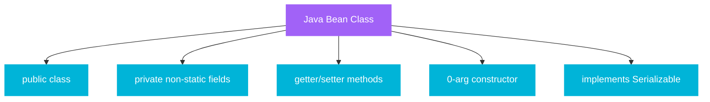

# Java Bean

**Java Bean** | It is a Java class that is developed by following some standards. Java Bean is used as a helper class to transfer multiple values from one Java class to another.

- [Need of Java Bean Class](#need-of-java-bean-class)
- [Standards to Develop Java Bean Class](#standards-to-develop-java-bean-class)
- [Example of Java Bean Class](#example-of-java-bean-class)
- [Advantages of Java Beans](#advantages-of-java-beans)
- [Types of Java Beans](#types-of-java-beans)

---

In this post, we will discuss what is Java bean, what is the need for Java bean class and why we should use them in our application, what are standards to develop Java bean class, examples of Java bean class, a different type of Java beans class and their examples.

Java Bean is never used as the main class of the application, it is always used as the helper class to transfer multiple values from one Java class to another Java class. Instead of passing multiple values separately as individual values, it is recommended to place them in the form of the object of a Java bean class and send that object to their classes.

> 📝 **Note:** In Java bean class we don't keep any serious business logic or persistence logic and e.t.c. We just keep bean properties i.e. variables and setter/getter methods to access/modify those bean properties.

Before discussing more on Java bean classes, standards, and class examples, let us first understand the need for it.

---

## 1. Need of Java Bean Class

Let us assume we need to develop a payment class to do transactions using card details. We can write it as given below.

**Payment class without Java Bean:**

```java
public class Payment {

   public float doPayment(long cardNo, String holderName,
         String paymnetGateway, int cvv, Date expiryDate,
         Date billDate, float billAmt) {
      ........
      ........ // complete payment process using the
      ........ // given card details
      ........
      return taxid;
   }
}
```

Now, in client application we can call the `doPayment()` method as:

**Client application:**

```java
public class ClientApplication {

   public static void main(String[] args) {

     // initial logic

     // create object of Payment class
     Payment payment = new Payment();

     // read card info from end-user
     // using form or another GUI
     long cardNo = ...;
     String holderName = ...;
     String gateway = ...;
     int cvv = ...;
     Date exipyDate = ...;
     Date billDate = ...;
     float billAmt = ...;

     // method call
     long taxid = payment.doPayment(cardNo,
          holderName, gateway, cvv, exipyDate,
          billDate, billAmt);

     // remaining logics
   }
}
```

Designing a Java method having more than three or four parameters is not a good programming practice. Very rarely you can find that the Java method is accepting more than three or four parameters. It will be having the following limitations while calling that Java method.

⚠️ **Limitations:**

1. We should remember the count of the arguments.
2. We should remember the index or order of the arguments.
3. We can't ignore to pass unknown values. We still need to pass dummy/meaningful default values.

Assume the end user only passes required information not the optional details, in that case also while calling `doPayment()` method we must pass default values (empty string or null). This design is forcing us to pass all the details even though it is unknown. Remembering the count and order of arguments also increases the burden on programmers.

> 💡 **Tip:** To overcome all these problems we must take Java bean as the method parameter. And for this, first, we need to design a Java bean class.

---

## 2. Standards to Develop Java Bean Class

There are few standards to develop the Java class as a Java bean. If we don't follow them then we don't get any type of compile-time error or exception but that class won't be called as a Java bean class.

**1) Class must be public.**

Since it is a helper class used to pass data from one class to another class, therefore it must be visible in the source and destination classes. To make the Java class visible inside and outside of the project, the Java class must be declared a public class.

**2) All bean properties (member variables) must be private and non-static.**

We must encapsulate the data so that no one can modify the data directly. Non-static variables allocate memory separately for each object and it makes every object carry its own data.

**3) Every bean property should have one setter and one getter method.**

Due to encapsulation, bean properties aren't accessible directly. To access them we must provide getter and setter methods. The setter method is useful to set data or modify the data of the bean property and the getter method is useful to read data from the bean property.

**4) It must have a 0-parameterized constructor.**

To provide an easy way of object creation, the Java bean class must have a 0-parameterized constructor either directly (manually placed by the programmer) or indirectly (generated by the Java compiler as the default constructor). When we don't place any constructor in the Java class then only the Java compiler itself generates a 0-parameterized constructor as the default constructor.

**5) It is recommended to implement the `java.io.Serializable` interface.**

Java bean class also can be used to pass data between two different projects/applications/networks. Only serializable object data can be sent over the network.



---

## 3. Example of Java Bean Class

Below is an example of a Java bean class developed by following the above standards.

**CardDetails Java Bean:**

```java
// Java bean class
// import Serializable interface
import java.io.Serializable;

// import other required classes

public class CardDetails implements Serializable {

   // bean properties
   private long cardNo;

   private String holderName;

   private String gateway;

   private int cvv;

   private Date expiryDate;

   private Date billDate;

   private float billAmt;

   // setter and getter methods
   public long getCardNo() {
      return cardNo;
   }

   public void setCardNo(long cardNo) {
      this.cardNo = cardNo;
   }

   public String getHolderName() {
      return holderName;
   }

   public void setHolderName(String holderName) {
      this.holderName = holderName;
   }

   public String getGateway() {
      return gateway;
   }

   public void setGateway(String gateway) {
      this.gateway = gateway;
   }

   public int getCvv() {
      return cvv;
   }

   public void setCvv(int cvv) {
      this.cvv = cvv;
   }

   public Date getExpiryDate() {
      return expiryDate;
   }

   public void setExpiryDate(Date expiryDate) {
      this.expiryDate = expiryDate;
   }

   public Date getBillDate() {
      return billDate;
   }

   public void setBillDate(Date billDate) {
      this.billDate = billDate;
   }

   public float getBillAmt() {
      return billAmt;
   }

   public void setBillAmt(float billAmt) {
      this.billAmt = billAmt;
   }

}
```

Now, we can use it in the Payment and Client class as given below.

**Payment class with Java Bean:**

```java
public class Payment {

   public float doPayment(CardDetails card) {
      ........
      ........ // complete payment process using the
      ........ // given card details
      ........
      return taxid;
   }
}
```

**Client application with Java Bean:**

```java
public class ClientApplication {

   public static void main(String[] args) {

     // initial logic

     // create object of Java bean class
     // CardDetails class object
     CardDetails card = new CardDetails();

     // read card info from end-user
     // using form or another GUI
     // and set it to CardDetails
     card.setCardNo(...);
     card.setHolderName(...);
     card.setGateway(...);
     card.setCvv(...);
     card.setExpiryDate(...);
     card.setBillDate(...);
     card.setBillAmt(...);

     // create object of Payment class
     Payment payment = new Payment();

     // call method
     long taxid = payment.doPayment(card);

     // remaining logics
   }
}
```

---

## 4. Advantages of Java Beans

Following are the advantages of developing Java bean as a Java method parameter:

- 📋 While setting data to the Java Bean class object, we do not need to worry about the order or index of parameters because setter methods are used for this purpose.
- 🚫 We can ignore setting values to unknown properties.
- 📖 It improves the readability of the coding.
- ⚡ Calling the methods becomes very easy.

It is industry standard and lots of predefined classes and methods are given like this therefore we should also use the Java bean class.

---

## 5. Types of Java Beans

Java beans class can be categorized into three types based on the kind of data they hold:

- 📥 **VO class** (Value Object class)
- 🔄 **DTO class or TO class** (Data Transfer Object class / Transfer Object class)
- 💾 **BO** (Business Object) **class** or **Entity class** or **Business class**

💡 **Tip:** Generally, we add VO/DTO/BO word with the name of the class to avoid confusion and to tell that the following class is a VO/DTO/BO class. Example: `StudentVO` class, `EmployeeVO` class, `StudentDTO` class, `EmployeeDTO` class, `StudentBO` class, `EmployeeBO` class.

### Value Object (VO) Class

The Java bean whose object holds either input values or output values is called the VO class. This class generally contains String properties because it has to hold inputs or outputs. In most cases, the input values passed from GUI components or from the HTML form components will be there in the **form of String values**. So this class also maintains all its properties as **String properties**. For the VO class implementing the Serializable interface is optional.

Assume there is a signup form to accept the student details and for that, the Value Object (VO) class can be written as:

**StudentVO class:**

```java
// Java bean VO class
public class StudentVO {

   // bean properties
   // all should be String
   private String sno;

   private String sname;

   private String address;

   private String avgMark;

   // getter and setter methods
   public String getSno() {
      return sno;
   }

   public void setSno(String sno) {
      this.sno = sno;
   }

   public String getSname() {
      return sname;
   }

   public void setSname(String sname) {
      this.sname = sname;
   }

   public String getAddress() {
      return address;
   }

   public void setAddress(String address) {
      this.address = address;
   }

   public String getAvgMark() {
      return avgMark;
   }

   public void setAvgMark(String avgMark) {
      this.avgMark = avgMark;
   }

}
```

### Data Transfer Object (DTO) Class

The Java bean class whose object data is shippable within the project or over the network is called DTO (Data Transfer Object) class or TO (Transfer Object) class. This class generally **implements `java.io.Serializable` interface** containing different properties as needed by the destination component that receives data.

🛠️ **Example:** E-commerce application sends card details to bank application over the network in the form of DTO class object.

**CardDetails DTO class:**

```java
// import Serializable interface
import java.io.Serializable;

// import other required classes
import sun.util.calendar.LocalGregorianCalendar.Date;

public class CardDetails implements Serializable {

   // bean properties
   private long cardNo;

   private int cvv;

   private Date expiryDate;

   private float billAmt;

   // setter and getter methods
   public long getCardNo() {
      return cardNo;
   }

   public void setCardNo(long cardNo) {
      this.cardNo = cardNo;
   }

   public int getCvv() {
      return cvv;
   }

   public void setCvv(int cvv) {
      this.cvv = cvv;
   }

   public Date getExpiryDate() {
      return expiryDate;
   }

   public void setExpiryDate(Date expiryDate) {
      this.expiryDate = expiryDate;
   }

   public float getBillAmt() {
      return billAmt;
   }

   public void setBillAmt(float billAmt) {
      this.billAmt = billAmt;
   }
}
```

### Entity Class

The Java bean class whose object holds either persistable data (to be inserted into the database table) or persistent data (retrieved from the database table) is called **BO** (Business Object) or **Entity** or **Persistence class**.

This class name will be mapped with the database table and properties/attributes/fields will be mapped with database table columns. This class will be taken on 1 per database table basis i.e. if the project is having 100 database tables then we take 100 entity classes.

> 📝 **Note:** Database table column data types and entity class property type must be compatible with each other. Variable's names in table and class may be different but their data types must be compatible.

Assume there is a BankAccount table in the Oracle database with the following data types:

| Column Name 🏷️ | Data Type 📋 |
|----------------|-------------|
| **accno** | Long (primary key) |
| **holderName** | Varchar2 |
| **balance** | float |
| **nominee** | Varchar2 |
| **BranchLocation** | Varchar2 |

For this table, the Entity class can be developed as:

**BankAccount Entity class:**

```java
// import Serializable interface
import java.io.Serializable;

public class BankAccount implements Serializable {

   // bean properties
   private long accNo;
   private String holderName;
   private String nominee;
   private float balance;
   private String branchInfo;

   // setter and getter methods
   public long getAccNo() {
      return accNo;
   }
   public void setAccNo(long accNo) {
      this.accNo = accNo;
   }
   public String getHolderName() {
      return holderName;
   }
   public void setHolderName(String holderName) {
      this.holderName = holderName;
   }
   public String getNominee() {
      return nominee;
   }
   public void setNominee(String nominee) {
      this.nominee = nominee;
   }
   public float getBalance() {
      return balance;
   }
   public void setBalance(float balance) {
      this.balance = balance;
   }
   public String getBranchInfo() {
      return branchInfo;
   }
   public void setBranchInfo(String branchInfo) {
      this.branchInfo = branchInfo;
   }

}
```

> 💡 **Tip:** While working with the Java Bean class we always use setter and getter methods. To generate getter and setter methods in the IDE you can use shortcut keys for example: in **Eclipse IDE Ctrl+Alt+S, R**. While working with Maven or Gradle building tools you can also use Lombok API to generate Object class methods, setter and getter methods dynamically. Lombok API is very helpful and easy to use.
