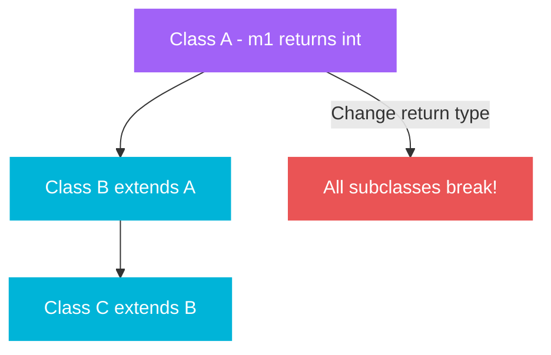

# Problems with Inheritance in Java

**Problems with Inheritance in Java** | Limitations of Inheritance | In this post, we will see problems with Inheritance in Java and how to solve them.

- [Multiple Inheritance Problem](#multiple-inheritance-problem)
- [Fragile Base Class Problem](#fragile-base-class-problem)
- [Complexity in Testing](#complexity-in-testing)

---

Inheritance is one of the most important and basic principles in OOP, used almost everywhere in project development. However, there are some situations where it creates problems and breaks the implementation even though we are using it correctly. There are some problems with inheritance in Java, let us discuss them in detail and we will also see how we can solve those problems.

**Limitations of inheritance in Java:**

- 🚫 Java doesn't support multiple inheritances through classes.
- 🧬 With inheritance, code becomes fragile (easily breakable).
- 🧪 With inheritance, code testing is a bit complex/heavy process.

---

## 1. Multiple Inheritance Problem

Java doesn't support multiple inheritances through classes.

**Two separate classes:**

```java
public class A { }
public class B { }
```

⚠️ **Problem:** If we want the functionalities of multiple classes then we have to use multiple inheritances but Java doesn't support multiple inheritances through classes.

**Invalid - multiple inheritance:**

```java
// Invalid statement
public class C extends A, B { }
```

✅ **Solution:** We can bring the effect of multiple inheritances through composition.

**Composition approach:**

```java
public class C {
   A a = new A();
   B b = new B();
   // logic
}
```

🧠 **In Simple Words:** In composition (HAS-A relation) we can work with functionalities of multiple different classes.

---

## 2. Fragile Base Class Problem

With inheritance, code becomes fragile (easily breakable). This fragile base class problem is a very well-known architectural problem in object-oriented programming systems, where base classes (superclasses) are considered "fragile" because seemingly safe modifications to a base class, when inherited by the derived classes, may cause the derived classes to malfunction. The programmer cannot determine whether a base class change is safe simply by examining in isolation the methods of the base class.

One possible solution is to make instance variables private to their defining class and force subclasses to use accessors to modify superclass states. These changes prevent subclasses from relying on implementation details of superclasses and allow subclasses to expose only those superclass methods that are applicable to themselves.

Another alternative solution could be to have an interface instead of the superclass. Let us understand it through an example.

**Inheritance hierarchy:**

```java
public class A {
   public int m1() {
      // logic
      return 100;
   }
}
```

```java
public class B extends A {
   // Overridden method
   public int m1() {
      // logic
      return 1000;
   }
}
```

```java
public class C extends B {
   // Overridden method
   public int m1() {
      // logic
      return 500;
   }
}
```



⚠️ **Problem:** Assume we change the return type of `m1()` method in class A (superclass) from `int` to `double`. Just with this single modification, we will get errors in all the classes that are in the inheritance hierarchy. This makes code easily breakable.

If the methods of [java.lang.Object class](069_Object_Class_in_Java.md) is disturbed then the entire Java class hierarchy will be collapsed.

✅ **Solution:** Use composition to isolate the dependency.

**Class A (unchanged):**

```java
public class A {
   public int m1() {
      // logic
      return 100;
   }
}
```

**Class X using composition:**

```java
public class X {
   private A a = new A();
   // Not overridden method
   // Direct method of X class
   public int m1() {
      // using m1() method of class A
      int x = a.m1();

      // logic
      return x+100;
   }
}
```

**Class B and C extend X:**

```java
public class B extends X {
   public int m1() {
      // logic
      return 1000;
   }
}
```

```java
public class C extends B {
   public int m1() {
      // logic
      return 500;
   }
}
```

Now, If we modify the return type of `m1()` method of class A from `int` to `double` then only one line code of X class will be disturbed. We can solve that problem by correcting the code in the X class, other code will not be disturbed.

> 📝 **Note:** It was one simple example where we get the problem, and there can multiple different examples where code becomes fragile. In the book Effective Java, author [Joshua Bloch](https://en.wikipedia.org/wiki/Joshua_Bloch) writes that programmers should "**Design and document for inheritance or else prohibit it**".

---

## 3. Complexity in Testing

With inheritance, code testing is a bit complex/heavy process and increases the burden to programmers. Testing means checking actual results with expected results. If matched then the result is positive else the result is negative. Programmer testing on his own piece of code is called unit testing. We perform unit testing either manually or by taking the support of different tools like JUnit.

**Class A with methods:**

```java
public class A {
   public int m1() {
      // logic
      return 400;
   }
   public int m2() {
      // logic
      return 500;
   }
}
```

**Class B inheriting from A:**

```java
public class B extends A {
   public int m3() {
      // logic
      return 100;
   }
   public int m4() {
      // logic
      return 1000;
   }
}
```

**In user class:**

```java
B b = new B();
b.m1();
b.m2();
b.m3();
b.m4();
```

⚠️ **Problem:** While testing subclass, we need to perform testing not only on the direct methods of the subclass, we have to perform unit testing also on the inheritance methods of other classes that are there in the inheritance classes.

✅ **Solution:** (With composition)

```java
public class B {
   private A a = new A();
   public int m3() {
      int x = a.m1();
      // logic
      return x+100;
   }
   public int m4() {
      int x = a.m2();
      // logic
      return x+1000;
   }
}
```

Here we need to do unit testing only on B class methods, not on the A-class methods i.e. only `m3()` and `m4()` methods should be tested. This reduces the burden to programmers. By the way, `m1()` and `m2()` methods are called internally from `m3()` and `m4()` methods therefore they also will be tested in that process.

Apart from these problems sometimes we need to add functionalities to the existing object. Always adding new functionalities/responsibilities on the existing object through inheritance is bad practice and we may end up getting a huge number of classes. We will discuss this problem and solution in detail in the **[Decorator/Wrapper design pattern](../2_design_patterns/07_Decorator_Design_Pattern_in_Java.md)**.

> 🔑 **Key Point:** Based on the above points don't conclude that inheritance is bad and we should not use it. **When we should use inheritance and when we should use composition?** If class B wants to use all the properties and methods of class A (i.e. total functionality of class A) then we should go for inheritance. But if class B wants to use partial properties and partial methods of class A then we should go for composition (HAS-A relation).
