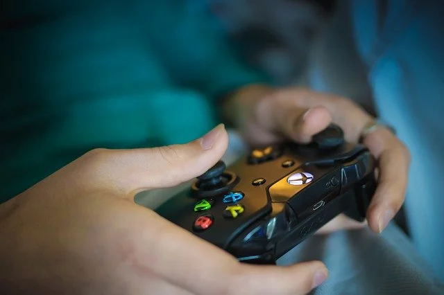

# How to Code a Game: Building a Game From Scratch

**How to Code a Game: Building a Game From Scratch** | It is a challenging task to build a game as it requires complete knowledge about game coding. But if you really want to create a game or make it a career then here in this article you will find everything that you need to know regarding building a game from scratch.

- [Step-by-Step Guide to Create a Game](#step-by-step-guide-to-create-a-game)
- [The Best Programming Languages for Building a Game](#the-best-programming-languages-for-building-a-game)
- [Should I Choose Java for Creating a Game?](#should-i-choose-java-for-creating-a-game)
- [Wrap up](#wrap-up)

---

There are multiple sites that provide [online video gaming](https://plays.org/games/) without any software installation. Let's not hide it: If you learn how to create games, you can expect to earn a lot if your game gains success; think of how much the creators of Fortnite or [PUBG](https://www.pubg.com/) make. Billions!

---

## 1. Step-by-Step Guide to Create a Game

1️⃣ **Do your own research and mentally visualize your game.** Finalize what kind of game you want to build and then do proper research about the skills you need to have to create such a game. Also, you must know the necessary features, objectives, and main story of the kind of game you are planning to develop.

2️⃣ **Briefly outline your game.** Whatever you have conceptualized, put it down on a document. You must know the design you want to make and what things you need to add to make the final outcome look impeccable.

3️⃣ **Select reliable software.** Choosing software depends upon the type of game you are designing. If you are planning to build a simple game then you need simple software with basic features; however, if you plan to build more sophisticated games then you need software with advanced features that might cost a lot.

4️⃣ **Start writing code.** Select the programming language like [Java](https://codegym.cc/) or Python that meet your game needs and start writing codes as per your game features.

5️⃣ **Examine your game and do proper marketing.** Play your game, see if all the features such as design or sound effects are functioning properly. Once all the bugs and errors are fixed, the last and final step that you need to do to be successful is to promote the game in the right way.

---

## 2. The Best Programming Languages for Building a Game

For developing a successful game you need to know about the best programming languages. Below are a few of them:

### For System Programming

- 🎮 **C++**: It is not an easy language to learn therefore not everyone can enter this field. But once you understand it then get ready for some amazing benefits like more power on hardware and graphics. It is used for advanced games that are played on Xbox and PlayStation. Unreal Engine and CryEngine make use of C++. Counterstrike, Fortnite, and other popular games are made by the C++ language.
- ☕ [**Java**](https://codegym.cc/): It is a very versatile language that can be used nearly everywhere. Java is the foundation of most Android applications and games. Plus, it allows game makers to add the feature of multi-player. Games like Minecraft and FIFA 11 are built using Java.
- 🐍 **Python**: Python is an outstanding language to learn as it performs well in instant prototyping and in improving the readability of users. Game Engines like Unity, Panda3d, and famous games like Freedom Force, Battlefield 2 are made in Python.

### For Web Programming

- 🌐 **JavaScript**: JavaScript supports web technologies that are used in CSS and HTML5, making it the most widely used language in current times. GDevelop, Babylon, Bejeweled, and Angry birds are written in Javascript.
- 🖥️ **HTML5** and **CSS**: Create the outline and design of your game using these two languages. HTML5 is essential for creating a user-friendly interface and when this language is supported by JavaScript then you can create complex games with remarkable graphics and interactivity. PlayCanvas, Phaser, Crosscode, and Treasure Area are made using HTML5 and CSS.

---

## 3. Should I Choose Java for Creating a Game?

The base of Android devices started from Java. From that time till now, Java provides users with improved performance and easy to use interface. It is not only adaptable to mobile devices but from printers to microwaves it is used everywhere. Plus you can add the feature of multi-player in your games without accessing extra libraries. So if you plan to choose Java, then start learning it now. Knowing this language, you will never be jobless! And the best way to comprehend Java or any other programming language is to practice it as much as you can.

> 💡 **Tip:** Java's cross-platform capability ("Write Once, Run Anywhere") makes it an excellent choice for game development across multiple devices.

---

## 4. Wrap up

While learning any new thing, you must be ready to face all the ups and downs. Sometimes you will easily catch the concept and understand it completely and sometimes you will find it very challenging to comprehend. Just be determined and stay on the path no matter what. And never get disappointed if your game is not recognized in public despite doing all the marketing and promotion. Creating a game itself is a huge accomplishment. So stay positive and one day you will create a game that will be popular all over the world.
