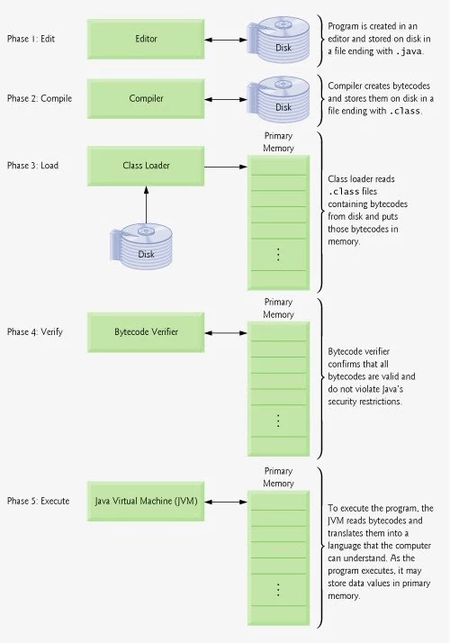

# 5 Phases of the Java Program

**5 Phases of the Java Program** | Understanding the five phases needed to create and execute a Java application using a Java development environment.

- [Overview](#overview)
- [Phase 1 Edit](#phase-1-edit)
- [Phase 2 Compile](#phase-2-compile)
- [Phase 3 Load](#phase-3-load)
- [Phase 4 Verify](#phase-4-verify)
- [Phase 5 Execute](#phase-5-execute)
- [Related Resources](#related-resources)

---

## 1. Overview

There are five phases needed to run the Java program. In this section, we will discuss those 5 phases of the Java program in detail.

These steps are to create and execute the Java application using a Java development environment. These phases are discussed in the context of JDK 6.0 from Sun Microsystems Inc. Sun Microsystems Inc. is an American technology company that has sold computers and also has given many information technology services, this company has created Java programming language and the Solaris operating system, Virtual Box, Network File System, and SPARC Microprocessors and many more.

JDK is the [Java Development Kit](005_JDK_vs_JRE_vs_JVM_vs_JIT.md) and JDK6 is the 6th version of JDK, this is the distribution of Java by Oracle Corporation. It implements (JLS) Java Language Specification and (JVMS) Java Virtual Machine Specification and provides the Java Application Programming Interface (API). The first version of JDK is JDK 1.0 released on 23 January 1993.

The 5 Phases of the Java Program are as follows:

| Phase 🔢 | Name 🏷️ | Purpose 📋 |
|----------|---------|-----------|
| **1** | Edit | ✏️ Write and save Java source code (`.java`) |
| **2** | Compile | ⚙️ Convert source code to bytecode (`.class`) |
| **3** | Load | 📥 Load bytecode into primary memory (RAM) |
| **4** | Verify | 🔒 Validate bytecodes for security compliance |
| **5** | Execute | 🚀 JVM translates bytecode to machine language and runs it |

---

## 2. Phase 1 Edit

When we write a Java program on any editor and save it, then it is stored in a disk with an extension of `.java`. This `.java` file is platform-independent therefore a Java program (`.java` file) written in one operating system can be used in any operating system.

- ✏️ Write the Java source code in any text editor or IDE
- 💾 Save the file with a `.java` extension
- 🌐 The `.java` file is **platform-independent**

---

## 3. Phase 2 Compile

The compiler's work is to convert the high-level language to bytecodes then store it with an extension of `.class`. To compile we use the `javac` command.

After developing the Java program, we compile it through the `javac` command. The compiler checks for syntax errors, and if everything is correct then it starts translating the `.java` file else it gives a compile-time error. After compilation of the `.java` file, the `.java` file is translated to `.class` file. Similar to the `.java` file, the `.class` file is also platform-independent.

- ⚙️ Use the `javac` command to compile
- 🔍 Compiler checks for **syntax errors**
- 📄 Produces a `.class` file containing **bytecode**
- 🌐 The `.class` file is also **platform-independent**

---

## 4. Phase 3 Load

The class loader reads the code, compiles it, and puts those bytecodes from the disk to primary memory. From the class loader, the codes are stored in primary memory.

When we execute the `java` command to run the Java application then the `.class` file (which contains bytecode) is loaded into the RAM, and this task is done by the class loader.

- 📥 The **class loader** reads the `.class` file from disk
- 🧠 Bytecodes are loaded into **primary memory (RAM)**
- 🚀 Triggered by the `java` command

---

## 5. Phase 4 Verify

This step confirms that the bytecodes are valid and make sure that they do not risk the Java security restrictions.

- 🔒 The **bytecode verifier** validates all bytecodes
- 🛡️ Ensures code does not violate **Java security restrictions**
- ✅ Only verified bytecodes proceed to execution

---

## 6. Phase 5 Execute

In this step, the [JVM (Java Virtual Machine)](005_JDK_vs_JRE_vs_JVM_vs_JIT.md) reads the bytecode and translates it to the language that the machine can understand, that is machine language, then executes the program and stores values in primary memory. This machine language will be different for different operating systems.

- 🖥️ JVM translates bytecode to **machine language**
- ⚡ The program is executed and results are stored in primary memory
- 🔀 Machine language output is **OS-specific**

> 💡 **Tip:** The platform-independence of Java comes from the fact that `.java` and `.class` files are portable, while only the final machine language translation (Phase 5) is OS-specific.

---

## 7. Related Resources

- **Java Tutorial**
- **Java Programs**

**Java Basic:**

- Introduction to Java
- Java Editions & Concepts
- [JDK JRE JVM JIT in Java](005_JDK_vs_JRE_vs_JVM_vs_JIT.md)
- [How to Run Java program](006_How_to_Run_Java_Program.md)
- [Java Hello World program](007_Java_Hello_World_Program.md)
- [How to set the Java path](008_Different_ways_to_set_the_Java_path.md)
- Classpath Environment
- [Tokens in Java Language](010_Tokens_in_Java.md)
- List of Java Keywords
- [Identifiers in Java](012_Identifiers_in_Java.md)
- [Data types in Java](013_Data_Types_in_Java.md)
- [Float & double in Java](014_Float_and_Double_in_Java.md)
- [Literals in Java](015_Java_Literals.md)
- [Escape Sequence In Java](016_Escape_Sequence_In_Java.md)
- [Unicode character set](017_Unicode_Character_Set_in_Java.md)
- [String data type in Java](018_String_Data_Type_in_Java.md)
- [Arithmetic operators in Java](019_Arithmetic_Operators_in_Java.md)
- [Increment and Decrement](020_Increment_and_Decrement_Operators_in_Java.md)
- Comments in Java
- [Java Naming Conventions](023_Java_code_conventions.md)
- [Static Import in Java](024_Static_Import_in_Java.md)
