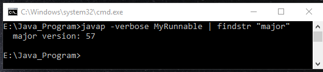
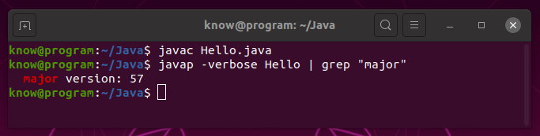
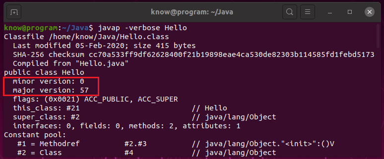
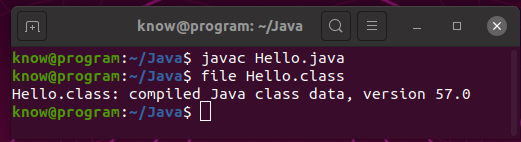
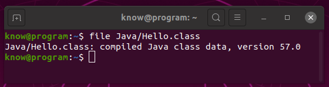
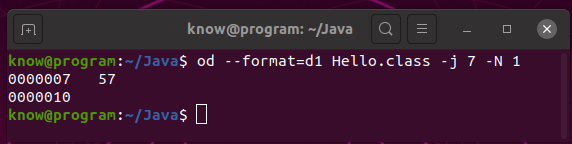

# Read and Display .class File Version

**Read and Display .class File Version** | How to find out a Java class file's compiler version using different tools across operating systems.

- [Understanding .class File Versions](#understanding-class-file-versions)
- [Using javap Tool](#using-javap-tool)
- [JDK Version to Major Version Mapping](#jdk-version-to-major-version-mapping)
- [Verbose javap Output](#verbose-javap-output)
- [Other Ways to Read and Display .class File Version In Linux](#other-ways-to-read-and-display-class-file-version-in-linux)
- [Using Hex Editor](#using-hex-editor)
- [References](#references)

---

## 1. Understanding .class File Versions

After compilation of a `.java` file, the compiler generates a `.class` file. Every `.class` file contains `minor_version` and `major_version` attributes that represent the version of the `.class` file. The JVM (Java Virtual Machine) uses `minor_version` and `major_version` attributes to identify the version of the compiler which generates the given `.class` file.

There are different ways to read and display the `.class` file version name.

> 📝 **Note:** The `.class` file generated by the lower version of the compiler can be executed by the higher version JVM, but the `.class` file generated by the higher version of the compiler can't be executed by the lower version JVM.

---

## 2. Using javap Tool

We can use the `javap` tool for this purpose.

**In Windows operating system:**

```bash
> javap -verbose ClassName | findstr "major"
```


*Windows*

**In Linux operating system:**

```bash
$ javap -verbose ClassName | grep "major"
```


*Ubuntu*

---

## 3. JDK Version to Major Version Mapping

| JDK Version ☕ | Major Version (Decimal) 🔢 | Major Version (Hex) 🔣 |
|---------------|--------------------------|----------------------|
| **JDK 1.1** | 45 | `0x2D` |
| **JDK 1.2** | 46 | `0x2E` |
| **JDK 1.3** | 47 | `0x2F` |
| **JDK 1.4** | 48 | `0x30` |
| **Java SE 5.0** | 49 | `0x31` |
| **Java SE 6.0** | 50 | `0x32` |
| **Java SE 7.0** | 51 | `0x33` |
| **Java SE 8.0** | 52 | `0x34` |
| **Java SE 9.0** | 53 | `0x35` |
| **Java SE 10.0** | 54 | `0x36` |
| **Java SE 11.0** | 55 | `0x37` |
| **Java SE 12.0** | 56 | `0x38` |
| **Java SE 13.0** | 57 | `0x39` |
| **Java SE 14.0** | 58 | `0x3A` |

---

## 4. Verbose javap Output

By using the `javap` tool you can get every piece of information about the `.class` file.

**Full verbose output:**

```bash
javap -verbose ClassName
```



> 💡 **Tip:** For example, if a `.class` file is generated by Java SE 8.0 it can be executed by Java SE 13.0, but the `.class` file generated by Java SE 13.0 can't be executed by the Java SE 8.0 JVM.

---

## 5. Other Ways to Read and Display .class File Version In Linux

Go to the directory where the `.class` file is located and execute the command in terminal:

**Using the `file` command:**

```bash
$ file ClassName.class
```

📤 **Output:**

```
ClassName.class: compiled Java class data, version 57.0
```



You can also read and display `.class` file `major_version` without going to the directory.

**Using full path:**

```bash
$ file path-to-file/ClassName.class
```

In my case, the java file `Hello.java` is located in the `Java` directory. So, the below command gives the version number.



---

## 6. Using Hex Editor

If you don't have access to `javap`, you can also use a console-based utility or GUI hex editor to look at the value of the byte at position 7 in the file. Using Linux, this is easily done using the `od` dump standard utility.

**Using the `od` command:**

```bash
$ od --format=d1 MyClass.class -j 7 -N 1
```

📤 **Output:**

```
0000007   57
0000010
```



> 🔧 **Tip:** The byte at position 7 in a `.class` file holds the major version number. This is a quick way to check the version without needing JDK tools installed.

---

## 7. References

- 📖 [Java class file - Wikipedia](https://en.wikipedia.org/wiki/Java_class_file#General_layout)
- 📖 [How to check the JDK version used to compile a .class file - Stack Overflow](https://stackoverflow.com/questions/1096148/how-to-check-the-jdk-version-used-to-compile-a-class-file)
- 📖 [Find out a Java class file's compiler version - Reverse Engineering Stack Exchange](https://reverseengineering.stackexchange.com/questions/1328/find-out-a-java-class-files-compiler-version)
