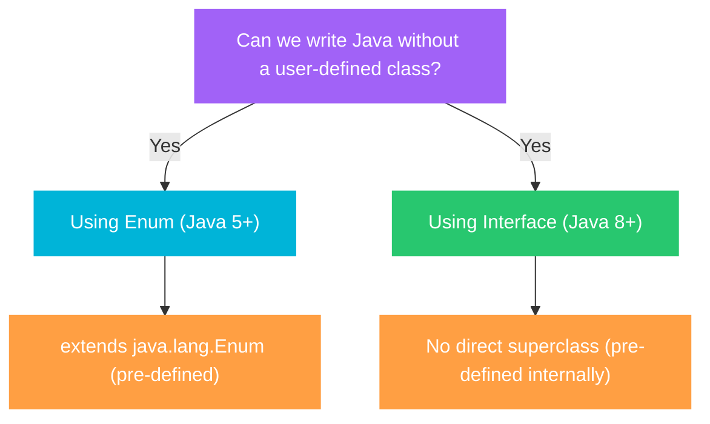
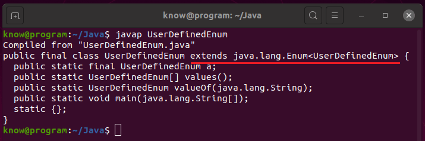
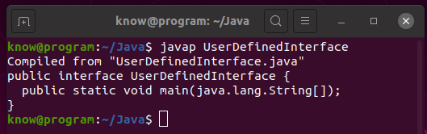

# Develop Java Program Without Using User-defined Class

**Develop Java Program Without Using User-defined Class** | Can we develop a Java program without using a user-defined class? Exploring alternatives with Enum and Interface.

- [Overview](#overview)
- [Using Enum](#using-enum)
- [Using an Interface](#using-an-interface)

---

## 1. Overview

We can't develop a Java program without class, but we can develop a Java program without using a user-defined class.

But it is possible to write a Java program without using a user-defined class. If we use `Enum` or `Interface` then it will be extended from another class. Those classes are pre-defined classes, not user-defined classes.



---

## 2. Using Enum

From Java 5 onwards we can use `Enum` to develop a program without using a user-defined class.

**Enum with main method:**

```java
public enum UserDefinedEnum {
   a;
   public static void main(String[] args) {
     System.out.println("Know Program");
   }
}
```

📤 **Output:**

```
Know Program
```

The `javap` tool shows that internally `UserDefinedEnum` uses `java.lang.Enum` class. It is extended from `java.lang.Enum` class but that class is a pre-defined class, not a user-defined class.

**javap output:**

```bash
> javap UserDefinedEnum

Compiled from "UserDefinedEnum.java"
public final class UserDefinedEnum extends java.lang.Enum<UserDefinedEnum> {
  public static final UserDefinedEnum a;
  public static UserDefinedEnum[] values();
  public static UserDefinedEnum valueOf(java.lang.String);
  public static void main(java.lang.String[]);
  static {};
}
```

> 📝 **Note:** Every user-defined class is a subclass of `java.lang.Object` class. So, internally every user-defined Java class uses the pre-defined class. To execute every Java program, `java.lang.Object` is loaded by the JVM. If we are using `println()` method to display the output, the `println()` method is defined in the `System` class so JVM also loads the `System` class. There are so many classes that are internally used by the JVM.


*Using Enum*

---

## 3. Using an Interface

From Java SE 8.0 onwards in an interface, in addition to abstract methods, we are allowed to create a method with an implementation body, those methods are called default and static implementation methods. So, from Java SE 8.0 onwards we can use `Interface` to develop a Java program without using any class.

**Interface with main method:**

```java
public interface UserDefinedInterface{
   public static void main(String[] args) {
     System.out.println("Know Program");
   }
}
```

📤 **Output:**

```
Know Program
```

**javap output:**

```bash
> javap UserDefinedInterface.java

Compiled from "UserDefinedInterface.java"
public interface UserDefinedInterface {
  public static void main(java.lang.String[]);
}
```


*Using an Interface*

The `javap` tool describes that directly, the `UserDefinedInterface` is not using any user-defined or pre-defined class. But internally it uses many pre-defined classes. Using `javap -verbose UserDefinedInterface` command we can get all information of the `UserDefinedInterface` program.

> 🔑 **Key Point:** We can't write a Java program without using a class, but we can develop a Java program without using a user-defined class by leveraging `Enum` (Java 5+) or `Interface` (Java 8+).

Also see: [Read and display .class file version](223_Read_and_Display_.class_File_Version.md)
