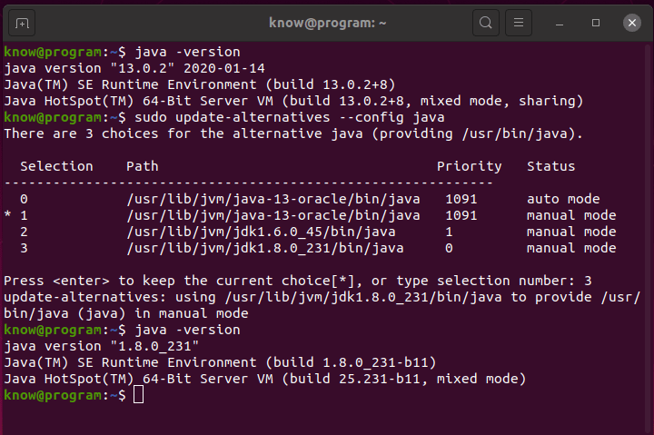

# Switching Between Multiple JDKs in Ubuntu

**Switching Between Multiple JDKs in Ubuntu** | You may work with multiple versions of JDK in your Ubuntu operating system. For switching between multiple JDKs in Ubuntu, you need to configure the java alternatives. Here we will see how to switch between multiple versions of the `java` and `javac` tools.

- [Switching Between Multiple Versions of java Tool](#switching-between-multiple-versions-of-java-tool)
- [Switching Between Multiple Versions of javac Tool](#switching-between-multiple-versions-of-javac-tool)

---

## 1. Switching Between Multiple Versions of java Tool

Use the below command for switching between multiple `java` tools in Ubuntu:

**Switch command:**

```bash
$ sudo update-alternatives --config java
```

For example, my computer has 3 JDKs: `java-13`, `jdk1.6`, and `jdk1.8`. But the currently active one is Java 13.

**Check current version:**

```bash
know@program:~$ java -version
java version "13.0.2" 2020-01-14
Java(TM) SE Runtime Environment (build 13.0.2+8)
Java HotSpot(TM) 64-Bit Server VM (build 13.0.2+8, mixed mode, sharing)
```

To switch between multiple versions of the Java tool, use the below command:

**Switching to JDK 1.8:**

```bash
know@program:~$ sudo update-alternatives --config java
There are 3 choices for the alternative java (providing /usr/bin/java).

  Selection    Path                                  Priority   Status
------------------------------------------------------------
  0            /usr/lib/jvm/java-13-oracle/bin/java   1091      auto mode
* 1            /usr/lib/jvm/java-13-oracle/bin/java   1091      manual mode
  2            /usr/lib/jvm/jdk1.6.0_45/bin/java      1         manual mode
  3            /usr/lib/jvm/jdk1.8.0_231/bin/java     0         manual mode

Press <enter> to keep the current choice[*], or type selection number: 3
update-alternatives: using /usr/lib/jvm/jdk1.8.0_231/bin/java to provide
 /usr/bin/java (java) in manual mode
```

Now let us see the updated version of the `java` tool.

**Verify the switch:**

```bash
know@program:~$ java -version
java version "1.8.0_231"
Java(TM) SE Runtime Environment (build 1.8.0_231-b11)
Java HotSpot(TM) 64-Bit Server VM (build 25.231-b11, mixed mode)
```

To switch back to Java 13 we can do the following:

**Switching back to Java 13:**

```bash
know@program:~$ sudo update-alternatives --config java
There are 3 choices for the alternative java (providing /usr/bin/java).

  Selection    Path                                  Priority   Status
------------------------------------------------------------
  0            /usr/lib/jvm/java-13-oracle/bin/java   1091      auto mode
  1            /usr/lib/jvm/java-13-oracle/bin/java   1091      manual mode
  2            /usr/lib/jvm/jdk1.6.0_45/bin/java      1         manual mode
* 3            /usr/lib/jvm/jdk1.8.0_231/bin/java     0         manual mode

Press <enter> to keep the current choice[*], or type selection number: 0
update-alternatives: using /usr/lib/jvm/java-13-oracle/bin/java to provide
 /usr/bin/java (java) in auto mode
```

Using `java -version` command we can check the current version.

**Confirm version restored:**

```bash
know@program:~$ java -version
java version "13.0.2" 2020-01-14
Java(TM) SE Runtime Environment (build 13.0.2+8)
Java HotSpot(TM) 64-Bit Server VM (build 13.0.2+8, mixed mode, sharing)
```



> 💡 **Tip:** Selection `0` sets the JDK to **auto mode**, which means the system will automatically pick the highest-priority JDK. Use a specific selection number for **manual mode** to lock a particular version.

---

## 2. Switching Between Multiple Versions of javac Tool

Switching between multiple JDKs in Ubuntu using the `javac` tool: Like the `java` command, we can also choose `javac` among multiple javac tools. The below command switches between the multiple `javac` tools.

**Switch javac command:**

```bash
$ sudo update-alternatives --config javac
```

**Example -- switching javac from 1.8 to 13:**

```bash
$ javac -version
javac 1.8.0_231

$ sudo update-alternatives --config javac
There are 3 choices for the alternative javac (providing /usr/bin/javac).

  Selection    Path                                   Priority   Status
------------------------------------------------------------
  0            /usr/lib/jvm/java-13-oracle/bin/javac   1091      auto mode
  1            /usr/lib/jvm/java-13-oracle/bin/javac   1091      manual mode
  2            /usr/lib/jvm/jdk1.6.0_45/bin/javac      1         manual mode
* 3            /usr/lib/jvm/jdk1.8.0_231/bin/javac     0         manual mode

Press <enter> to keep the current choice[*], or type selection number: 0
update-alternatives: using /usr/lib/jvm/java-13-oracle/bin/javac to provide
 /usr/bin/javac (javac) in auto mode

$ javac -version
javac 13.0.2
```

> ⚠️ **Caution:** By switching `java` or `javac` tools independently, you can end up with mismatched versions (e.g., `java` pointing to JDK 13 but `javac` pointing to JDK 8). Always ensure both `java` and `javac` point to the same JDK version.
