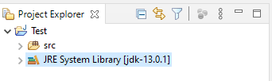
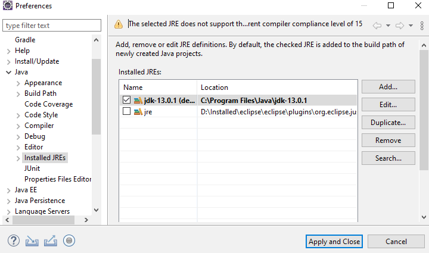
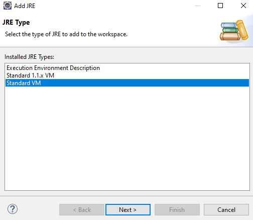
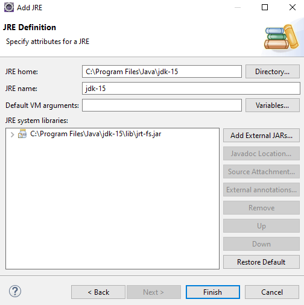
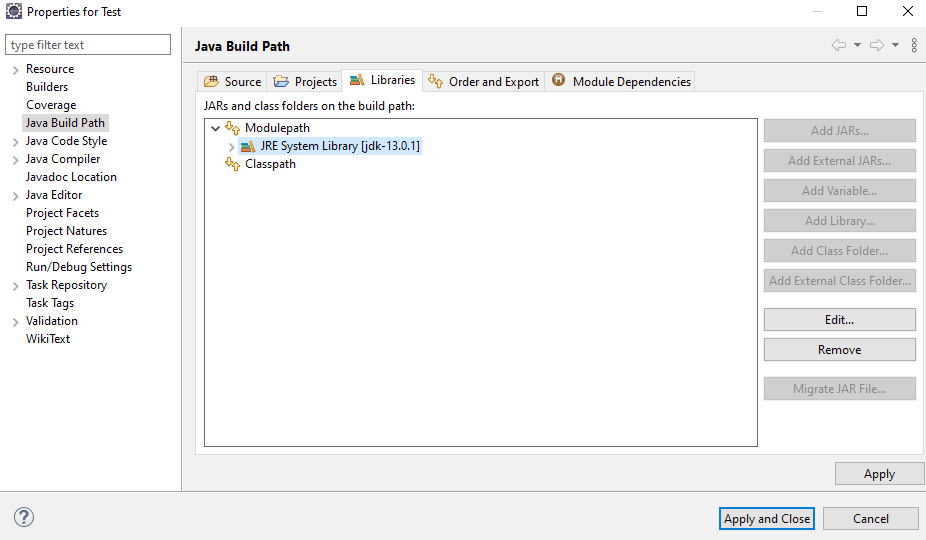
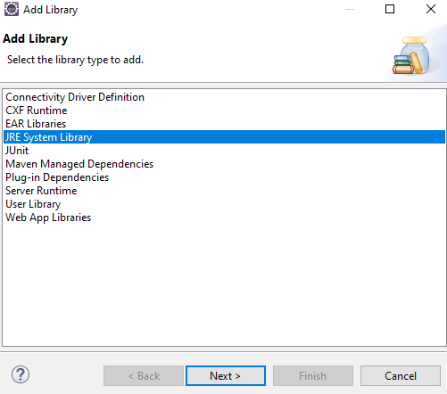
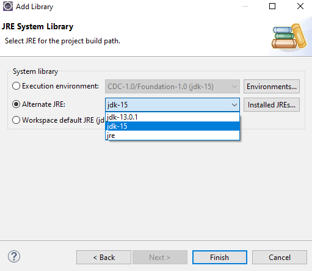
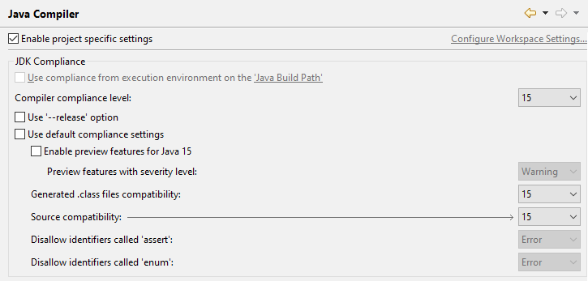

# Change Java Version Eclipse Project

**Change Java Version Eclipse Project** | How to change the Java version for an existing Eclipse project by adding a new JRE and updating build path settings.

- [Check Java Version of Current Project](#check-java-version-of-current-project)
- [Check Available JRE in the Eclipse IDE](#check-available-jre-in-the-eclipse-ide)
- [Add JRE to the Eclipse IDE](#add-jre-to-the-eclipse-ide)
- [Change Java Version for the Project in Eclipse](#change-java-version-for-the-project-in-eclipse)
- [Check Compiler Version for the Java Project](#check-compiler-version-for-the-java-project)

---

## 1. Check Java Version of Current Project

When we create a Java project inside the Eclipse IDE then at that time we can assign the installed Java version, but we can also change it after creating the project. Let us see how to do this.

This can be done in the following steps:

1. 🔍 Check the current Java version of the Eclipse project.
2. 📋 Check available JRE in the Eclipse IDE.
3. ➕ Add JRE (required Java version) to the Eclipse IDE.
4. 🔄 Change Java Version for the Project in Eclipse.
5. ✅ Check Compiler Version for the Java Project.

In the Project Explorer section, we can see the JRE System Library which is also displaying the current Java version of the Project.

In this project the current Java version is 13, but we need to change to the higher version Java 15. Let us see how to do it.

---

## 2. Check Available JRE in the Eclipse IDE

Before changing the Java version for a project, first, check the JRE installed in the current system. Go to **Window** => **Preferences** => **Java** => **Installed JREs**.

Currently, the Eclipse IDE is having the default JRE and JDK13 versions. To change the Java version, first, we need to add that Java version (with JRE) to the Eclipse IDE.

---

## 3. Add JRE to the Eclipse IDE

1️⃣ **Click on "Add"** to add the JRE, a new window will appear to ask the type of JRE. Here we will choose **Standard VM**.

2️⃣ **Click on Directory**, browse the Java home and add it to the Eclipse IDE. Based on the Java version, Eclipse IDE itself fetches the JRE name and JRE system libraries files. Click on **Finish**.

3️⃣ **Adding JRE to the Eclipse IDE is completed.** Now, our Eclipse IDE is having three installed JREs. Click on **Apply and Close**.

> 💡 **Tip:** You can add multiple JRE versions to Eclipse and switch between them per project without reinstalling Eclipse.

---

## 4. Change Java Version for the Project in Eclipse

Select Java project => **right-click** on it => Click on **Build Path** => **Configure Build Path**.

In the **Libraries** section:

1️⃣ Select the existing **JRE System Library** and **Remove** it.

2️⃣ After removing it, click on **Add Libraries**, and choose **JRE System Library**.

3️⃣ Now, select the Java version and click on **Finish**.

---

## 5. Check Compiler Version for the Java Project

At last, check the correct compiler is configured or not.

If not then change it. Select the Java project => Right-click => **Build Path** => **Configure Build Path** => **Java Compiler**.

> ⚠️ **Caution:** Make sure the compiler compliance level matches the JRE version you selected. A mismatch can cause unexpected compilation errors or prevent usage of newer Java features.
